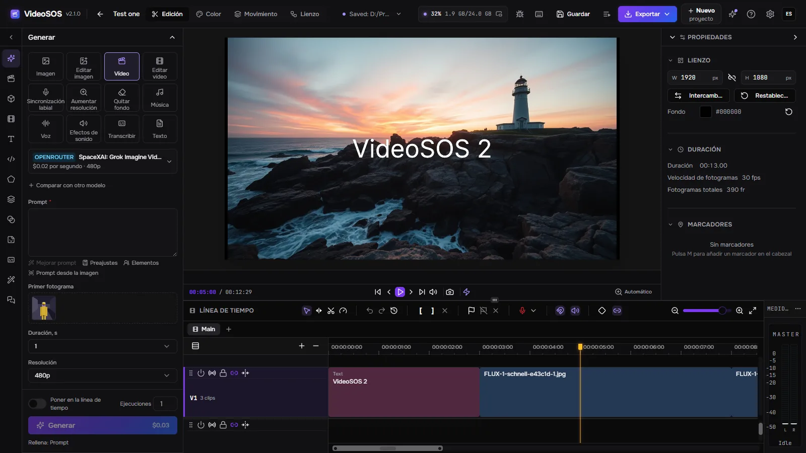
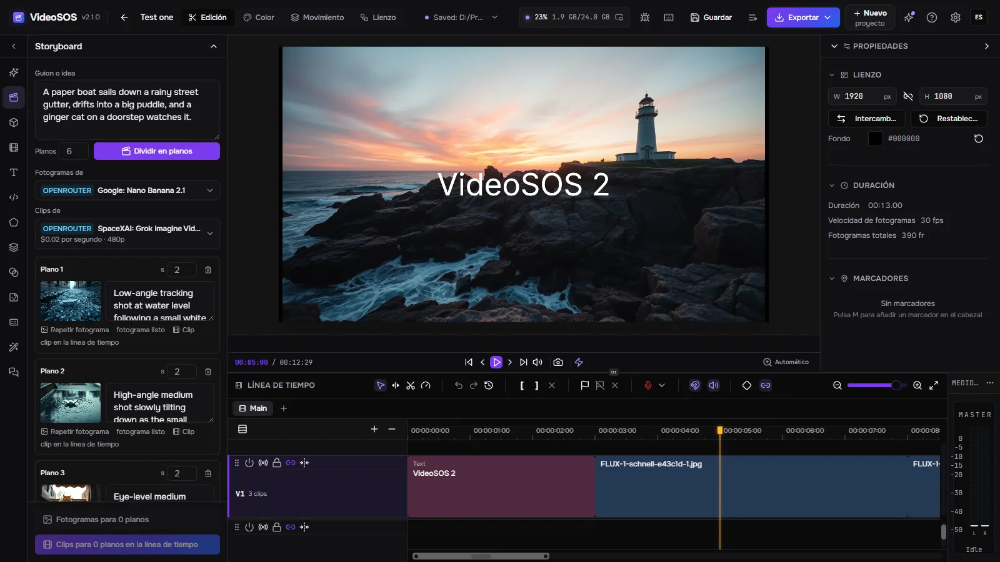
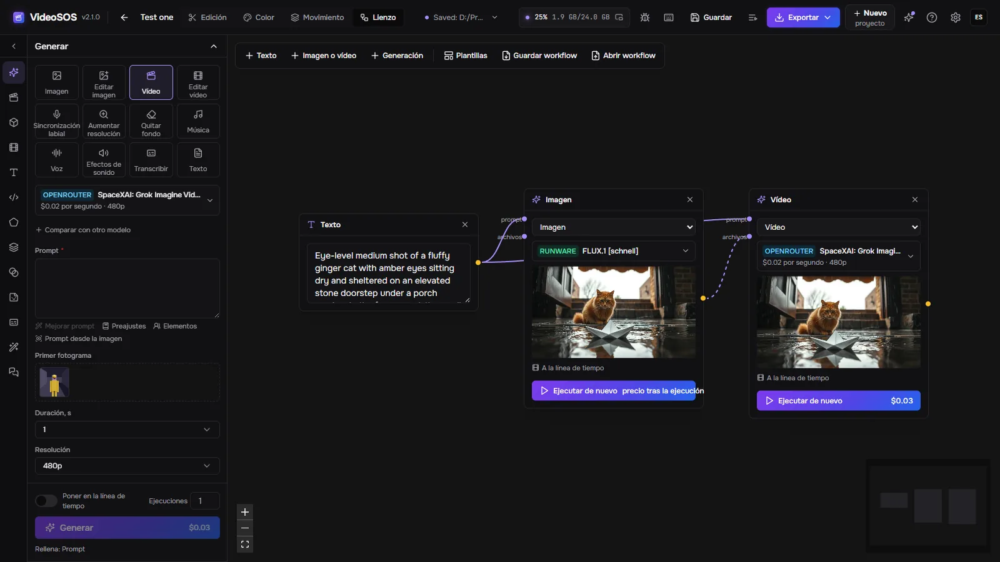
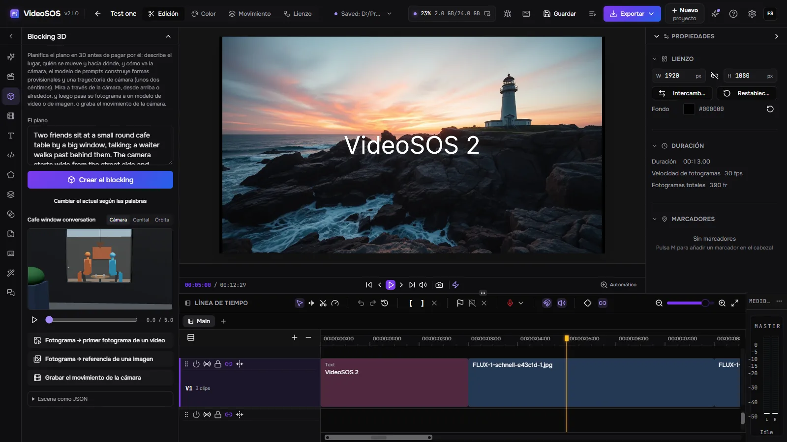
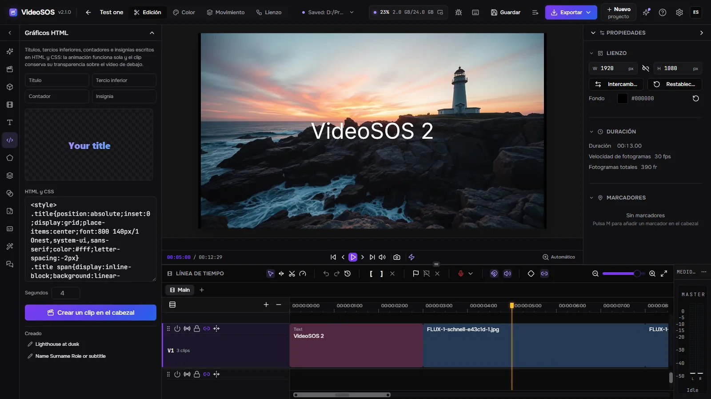

<div align="center">


# VideoSOS 2

**Un estudio de vídeo con IA para el escritorio: genera imágenes, vídeo, música, voces, efectos de sonido y texto con los mejores modelos de OpenRouter, fal y Runware o gratis en tu propia tarjeta gráfica, planifica la película en un storyboard, un lienzo de nodos y un blocking 3D, y móntalo todo en una línea de tiempo multipista de verdad hasta obtener un vídeo terminado. Una sola aplicación nativa (Rust + Tauri) para Windows, Linux y macOS, con tus propias claves, tus archivos en tu disco y un servidor MCP para que un agente de IA haga el vídeo contigo.**

[](LICENSE)
[](https://github.com/timoncool/videosos/stargazers)
[](https://github.com/timoncool/videosos/releases)
[](https://github.com/timoncool/videosos/releases)
[](https://github.com/timoncool/videosos/commits)

[English](README.md) · [Русский](README.ru.md) · [中文](README.zh.md) · **Español** · [Français](README.fr.md) · [Português](README.pt.md)

### 🌐 [Sitio con todas las pantallas →](https://timoncool.github.io/videosos/es.html)



</div>

## Qué es

**VideoSOS 2** reúne la generación con IA y la edición de vídeo en una sola ventana. A la izquierda eliges qué hacer —
una imagen, la edición de una imagen, un vídeo a partir de texto o de un fotograma, un busto parlante con sincronización labial, un aumento de resolución, un
fondo eliminado, música, una locución, efectos de sonido, una transcripción o un guion — y un modelo de **OpenRouter,
fal o Runware**. El formulario se construye a partir de la propia descripción del modelo, así que están todos los ajustes que el modelo admite,
y el precio se muestra **antes** de pulsar Generar. El resultado llega a la biblioteca de medios del proyecto
y, si quieres, directamente a la línea de tiempo, en la posición del cabezal de reproducción.

El editor es un NLE completo: varias pistas de vídeo y de audio, recortes por ondulación, por rodillo, de desplazamiento y de deslizamiento, transiciones,
fotogramas clave con gráfico de Bézier, máscaras, modos de fusión, gradación de color con monitores de señal, texto y formas, subtítulos y una
exportación rápida a MP4, WebM, MOV o MKV que se ejecuta en tu tarjeta gráfica — o un FCPXML para Final Cut, DaVinci
Resolve y Premiere. El volumen de la exportación puede llevarse a −14, −16 o −23 LUFS, y los subtítulos de la transcripción se muestran completos, palabra a palabra o como karaoke.

VideoSOS 1 era una aplicación web en el navegador. **La versión 2 es un programa nativo de escritorio**: su servidor está escrito en Rust,
los proyectos y las generaciones se guardan como archivos normales en tu disco, los trabajos sobreviven a un reinicio y no hay ninguna cuenta nuestra
en ninguna parte: pagas a los proveedores directamente con tus propias claves. La ventana habla diez idiomas.

## Genera de todo

| Tarea | Qué obtienes | Proveedores |
|---|---|---|
| Imagen | de texto a imagen | OpenRouter, fal, Runware |
| Editar imagen | imagen con referencias o una máscara | OpenRouter, fal, Runware |
| Vídeo | de texto a vídeo, primer fotograma, primer y último fotograma, referencias | OpenRouter, fal, Runware |
| Editar vídeo | de vídeo a vídeo, ampliar, cambiar de estilo | OpenRouter, fal, Runware |
| Sincronización labial | un rostro que dice tu audio | fal, Runware |
| Aumentar resolución | imágenes y vídeos en mayor resolución | fal, Runware, OpenRouter (vídeo) |
| Quitar fondo | recortes transparentes | fal, Runware |
| Música | canciones y bandas sonoras | fal, Runware |
| Voz | de texto a voz con decenas de voces e idiomas | OpenRouter, fal, Runware |
| Efectos de sonido | efectos foley a partir de texto o de un vídeo | fal, Runware |
| Transcribir | de voz a texto | OpenRouter, fal |
| Texto | guiones, prompts, ideas: cualquier LLM de OpenRouter | OpenRouter |

- **Catálogos en vivo.** Los modelos se leen de los propios proveedores — más de mil, los más recientes primero, con lo que
  hace bien cada uno, su precio y su tiempo habitual en tu ordenador; los favoritos quedan arriba y los modelos que se retiran aparecen marcados.
- **Precio antes de ejecutar.** Las tarifas por segundo, resolución, sonido e imágenes de entrada se calculan a partir del formulario; tras
  la ejecución se registra la factura del propio proveedor. En Configuración, Proveedores ves lo que has gastado hoy y en total.
- **Compara modelos en una sola ejecución.** El mismo prompt se envía hasta a otros dos modelos y los resultados quedan uno junto a otro.
- **Archivos como entradas.** Arrastra una imagen, un clip o un sonido de la biblioteca — o el resultado de una generación anterior —
  a una ranura: primer fotograma, último fotograma, referencias, el vídeo al que sincronizar los labios. **Continuar desde el último fotograma** empieza el
  siguiente clip donde termina el anterior.
- **Elementos.** Un personaje, un objeto o un lugar guardados con un nombre y sus imágenes: `@nombre` en un prompt envía sus
  imágenes al modelo como referencias, de modo que el mismo rostro vuelve plano tras plano.
- **Prompts con ayuda.** Preajustes, `{{variables}}` que se rellenan al enviar el trabajo, un prompt mejorado por un modelo
  de lenguaje, un prompt escrito a partir de una imagen y una comprobación del límite del modelo antes de pagar nada.
- **Nunca se paga dos veces.** Un trabajo se guarda antes de enviarse; tras un reinicio, un trabajo ya enviado se sigue, no se envía
  de nuevo. Los resultados se descargan al instante, antes de que caduquen los enlaces de los proveedores, y se nombran y etiquetan según su prompt.
- **Vídeos a partir de sus enlaces.** Un enlace de YouTube, cualquier sitio que yt-dlp conozca o un archivo directo entran en la biblioteca con
  su progreso, cancelación y reanudación.
- **Generar sin fin.** Las ejecuciones se repiten con semillas nuevas hasta que las detienes o una falla.
- **Lo que ha gastado una clave.** La comprobación de la clave muestra el gasto y el límite de OpenRouter y el saldo de Runware.

## Generar en este equipo

Sin clave y sin factura: el proveedor **Local** está junto a los de la nube (por ahora en Windows).

| Modelo | Qué hace | Aceleradores |
|---|---|---|
| Qwen-Image 2.1 | imágenes | Turbo 8 pasos, LightX2V Lightning 4, Viggle Turbo 6 |
| MiniMax-H3 | vídeo con su propio sonido, desde un prompt o un primer fotograma | LightX2V Turbo 8 y 4 pasos |
| LTX-2.5 | vídeo con sonido, dos pasadas con el escalador ×2 de Lightricks | destilado, 8 pasos |

- **stable-diffusion.cpp** los ejecuta en CUDA, Vulkan o el procesador; Automático elige la tarjeta. Solo se usan
  pesos cuantizados (GGUF Q4, int8).
- **Ajustes → Modelos locales** descarga cada modelo y su motor una sola vez, con versión fijada, comprobación SHA-256
  y reanudación. Un archivo que ya tiene otro programa del autor se toma de él (un enlace duro en el mismo disco) en
  lugar de descargarse, y la fila del modelo dice de dónde vino.
- **Los estudios de música del autor.** Mientras [YuE2 Studio](https://github.com/timoncool/YuE2-Studio), [MiniMax Music3 Studio](https://github.com/timoncool/MiniMax-Music3-Studio) o [ACE-Step Studio](https://github.com/timoncool/ACE-Step-Studio) está abierto, aparece en Música con su propio
  formulario; el estudio hace la canción y su archivo llega a la biblioteca con sus etiquetas.
- **Speech Studio.** Mientras Speech Studio está abierto, cada uno de sus motores en este ordenador (Qwen3-TTS, Supertonic 3, Drama 3, Higgs Audio) aparece en Voz con sus voces e idiomas; el estudio pone voz al texto y su archivo llega a la biblioteca.
- **Los modelos propios de la ventana** funcionan en la ventana: Parakeet Ultra (int8) y Whisper Large v3 Turbo (Q8)
  para transcripciones, Gemma 4 E4B para describir escenas y comprobar cortes.

## Planifica la película

| | |
|---|---|
|  | **Storyboard.** Un modelo de lenguaje divide un guion en planos; cada plano recibe un fotograma de un modelo de imagen y un clip de un modelo de vídeo que empieza en ese fotograma, y los clips se colocan en la línea de tiempo uno tras otro. Los fotogramas baratos se aprueban antes del vídeo de pago. |
|  | **Lienzo de nodos.** Texto, imágenes, vídeos y generaciones son nodos unidos por lo que se transmiten: un prompt a una imagen, la imagen a un vídeo. Las **plantillas de workflow** colocan una cadena ya hecha en el lienzo de una sola vez (fotograma a vídeo, comparación de modelos, una foto de producto, un busto parlante y más); un lienzo se guarda como archivo de workflow para pasarlo a otros. |
|  | **Blocking 3D.** Describe el plano y el modelo de prompts lo construye con formas provisionales, personas de pie y sentadas, sus movimientos y la trayectoria de la cámara. Mira a través de la cámara, desde arriba o alrededor, y luego pasa su fotograma a un modelo de vídeo como primer fotograma o graba el movimiento de la cámara — antes de que un céntimo vaya al vídeo. |
|  | **Gráficos HTML.** Títulos, tercios inferiores, contadores e insignias escritos en HTML y CSS, con vista previa en vivo, convertidos en un clip con transparencia que se superpone al vídeo en el cabezal de reproducción. |

En la propia línea de tiempo: una ejecución colocada en la línea de tiempo se dibuja donde va a quedar mientras se ejecuta, y **una parte de cualquier
clip se puede generar de nuevo** — la parte se corta, se envía a un modelo de edición de vídeo y la nueva toma se coloca encima.

## Para agentes de IA

Mientras VideoSOS está abierto, ofrece MCP en `http://127.0.0.1:8796/mcp`. Un agente como Claude Code, Claude Desktop,
Cursor o Codex puede hacer lo que hace la ventana: elegir modelos y leer sus ajustes, estimar precios, generar, esperar
los resultados, leer y editar la línea de tiempo del proyecto abierto (cada edición es un paso que se puede deshacer y que ves ocurrir), plantear un plano
en blocking 3D, crear gráficos HTML, importar medios, mover el cabezal de reproducción, hacer una captura de la ventana y exportar el vídeo. Cada acción
se rotula en la ventana y se escribe en el registro de actividad.

```bash
claude mcp add --transport http videosos http://127.0.0.1:8796/mcp
```

Otros clientes: `{ "mcpServers": { "videosos": { "type": "streamable-http", "url": "http://127.0.0.1:8796/mcp" } } }`.
El servidor ofrece su guía como el recurso `videosos://skill` (prompt `videosos`) — el mismo texto que
[docs/mcp-skill.md](docs/mcp-skill.md).

- **Puntos de restauración.** La línea de tiempo se guarda antes de cada edición de un agente; el botón Puntos de restauración, junto a deshacer
  y rehacer, recupera cualquiera de ellos. Un agente puede ensayar una edición (`dry_run`) y ver lo que haría sin tocar nada.
- **Propuestas.** Con *Las ediciones del agente en la línea de tiempo esperan mi aprobación* activado en Configuración, Agentes, la edición de un agente se muestra con palabras sencillas
  y solo se aplica después de que pulses Aceptar.
- **Un límite de gasto.** Las generaciones son de pago: Configuración, Agentes fija un límite diario para los agentes, superado el cual
  `generate` se rechaza. Solo pueden conectarse los agentes de este ordenador y la propia ventana del programa; las claves de los proveedores nunca
  se les muestran.
- **Chat en la ventana.** La pestaña Chat ejecuta un modelo de OpenRouter de tu elección con las mismas herramientas, paso a paso, con
  el coste de cada paso y un botón Detener.
- **El agente conectado como asistente de la ventana**, como en YuE2 Studio: con Ajustes → Agentes en el agente MCP,
  mejorar un prompt, un prompt a partir de una imagen, el storyboard, el blocking y el chat van al agente, sin clave y
  sin coste. Las guías de escritura se sirven como los recursos `videosos://guide/prompt`, `picture` y `storyboard`.

## Capturas de pantalla

El espacio de edición con el panel de generación, el lienzo de nodos con una cadena real, el storyboard, el blocking 3D y los
gráficos HTML: todas las pantallas en ocho idiomas están en el [sitio](https://timoncool.github.io/videosos/es.html).

| | |
|---|---|
|  |  |
|  |  |

## Inicio rápido

1. Descarga desde la [última versión](https://github.com/timoncool/videosos/releases/latest): `VideoSOS_<version>_x64-setup.exe`
   (o el `.msi`, o el portátil `VideoSOS-<version>-portable-windows-x64.zip`) para Windows, el `.AppImage` o el `.deb`
   para Linux, el `.dmg` para macOS en Apple Silicon.
2. Crea un proyecto, abre la pestaña **Generar** de la izquierda y pega una clave de
   [OpenRouter](https://openrouter.ai/settings/keys), [fal](https://fal.ai/dashboard/keys) o
   [Runware](https://my.runware.ai/keys) cuando te la pidan. Con un proveedor basta para empezar.
3. Elige una tarea y un modelo, escribe lo que quieres y pulsa **Generar**.

Los cambios y sus fechas están en [CHANGELOG.md](CHANGELOG.md), y el botón de destellos de la parte superior de la ventana los muestra.
Normas para colaboradores y agentes de programación: [AGENTS.md](AGENTS.md).

## Requisitos

- **Windows** 10/11 x64 con Microsoft Edge WebView2 (el instalador lo obtiene si falta).
- **Linux** x86-64 (experimental): el `.deb` o el AppImage, con WebKitGTK y GStreamer del sistema.
- **macOS** 13 o posterior en Apple Silicon (experimental).
- Una tarjeta gráfica con WebGPU (cualquier NVIDIA, AMD o Intel reciente) para la vista previa y la exportación rápida.
- Conexión a internet para la generación en la nube; la generación local, la edición y la exportación funcionan sin
  conexión. Los modelos de vídeo locales están comprobados en una tarjeta de 24 GB.

Configuración, Red tiene un proxy para los proveedores y las descargas, y **Acceso desde la red**: desactivado por defecto; activado,
un navegador de otro ordenador o de un teléfono abre la misma interfaz con una clave de acceso, mientras todo se ejecuta aquí.

## Todo lo que descarga la aplicación

El programa trae lo que necesita para editar y generar en la nube. El resto se descarga solo cuando lo pides, desde
donde se publica, y cada archivo se comprueba con su tamaño y su SHA-256 fijados antes de usarse: yt-dlp, Deno y ffmpeg
la primera vez que importas un vídeo por su enlace (después yt-dlp se actualiza solo una vez al día), y el motor
stable-diffusion.cpp y los modelos locales cuando los descargas en Ajustes → Modelos locales. En Linux las herramientas
llegan en sus compilaciones para Linux; en macOS la importación por enlace todavía no está disponible; la generación
local es por ahora solo para Windows.

Los modelos propios de la ventana se descargan de Hugging Face la primera vez que se usa su función y se guardan en la
caché de la ventana (Ajustes → Almacenamiento los borra): Parakeet Ultra int8 y Whisper Large v3 Turbo Q8 para
transcripciones, Gemma 4 E4B para describir escenas, CLIP, MiniLM y CLAP para la búsqueda y las muletillas, RIFE para
la interpolación de fotogramas.

<!-- downloads:start -->
| Herramienta | Para qué | Archivo (enlace directo) | Tamaño | Dónde va |
|---|---|---|---|---|
| yt-dlp + Deno | importar un vídeo por su enlace | [yt-dlp.exe](https://github.com/yt-dlp/yt-dlp/releases/download/2026.08.19/yt-dlp.exe) | 17.8 MB | `data\tools\yt-dlp\` (tal cual) |
|  |  | [deno-x86_64-pc-windows-msvc.zip](https://github.com/denoland/deno/releases/download/v2.9.7/deno-x86_64-pc-windows-msvc.zip) | 42.6 MB | `data\tools\yt-dlp\` (descomprimido) |
| ffmpeg | unir la imagen y el sonido de un vídeo enlazado | [ffmpeg-N-126342-gf88b741dbf-win64-gpl.zip](https://github.com/BtbN/FFmpeg-Builds/releases/download/autobuild-2026-08-31-13-27/ffmpeg-N-126342-gf88b741dbf-win64-gpl.zip) | 170.7 MB | `data\tools\ffmpeg\` (ffmpeg.exe y ffprobe.exe del archivo) |
| stable-diffusion.cpp CUDA 12 | generación local con tarjetas NVIDIA | [sd-master-1d0a58a-bin-win-cuda12-x64.zip](https://github.com/leejet/stable-diffusion.cpp/releases/download/master-964-1d0a58a/sd-master-1d0a58a-bin-win-cuda12-x64.zip)<br>[cudart-sd-bin-win-cu12-x64.zip](https://github.com/leejet/stable-diffusion.cpp/releases/download/master-964-1d0a58a/cudart-sd-bin-win-cu12-x64.zip) | 901.5 MB | `data\tools\sd\cuda12\` (descomprimido) |
| stable-diffusion.cpp Vulkan | generación local con otras tarjetas | [sd-master-1d0a58a-bin-win-vulkan-x64.zip](https://github.com/leejet/stable-diffusion.cpp/releases/download/master-964-1d0a58a/sd-master-1d0a58a-bin-win-vulkan-x64.zip) | 30.2 MB | `data\tools\sd\vulkan\` (descomprimido) |
| stable-diffusion.cpp CPU | generación local sin tarjeta gráfica | [sd-master-1d0a58a-bin-win-cpu-x64.zip](https://github.com/leejet/stable-diffusion.cpp/releases/download/master-964-1d0a58a/sd-master-1d0a58a-bin-win-cpu-x64.zip) | 17.6 MB | `data\tools\sd\cpu\` (descomprimido) |
| Qwen-Image 2.1 | imágenes en este equipo, opcional | [Qwen3VL-8B-Instruct-Q4_K_M.gguf](https://huggingface.co/Qwen/Qwen3-VL-8B-Instruct-GGUF/resolve/f982a07559d4a2f6c8744d840bf6fccab30eea96/Qwen3VL-8B-Instruct-Q4_K_M.gguf) → `data\models\qwen-image-2.1\Qwen3VL-8B-Instruct-Q4_K_M.gguf`<br>[qwen_image_2.1_vae_bf16.safetensors](https://huggingface.co/Comfy-Org/Qwen-Image-2.1/resolve/a8342359c61979b06a8dafb1a47991fe1f30e994/vae/qwen_image_2.1_vae_bf16.safetensors) → `data\models\qwen-image-2.1\qwen_image_2.1_vae_bf16.safetensors`<br>[qwen-image-2.1-turbo-Q4_K_M.gguf](https://huggingface.co/unsloth/Qwen-Image-2.1-Turbo-GGUF/resolve/5d1f9f759ea877ae556cda88dbec958b62ad3809/qwen-image-2.1-turbo-Q4_K_M.gguf) → `data\models\qwen-image-2.1\qwen-image-2.1-turbo-Q4_K_M.gguf`<br>[pytorch_lora_weights.safetensors](https://huggingface.co/lightx2v/Qwen-Image-2.1-Lightning/resolve/6b0a1176327c01522a44276c5da67331a025b6fc/pytorch_lora_weights.safetensors) → `data\models\qwen-image-2.1\loras\qwen-image-2.1-lightning-4step.safetensors`<br>[Qwen-Image-2.1-viggle-turbo-v0.3-6step-lora-r256.safetensors](https://huggingface.co/Viggle/Qwen-Image-2.1-viggle-turbo/resolve/009a44a895ef85f7e643c80fdca9543795248867/Qwen-Image-2.1-viggle-turbo-v0.3-6step-lora-r256.safetensors) → `data\models\qwen-image-2.1\loras\qwen-image-2.1-viggle-turbo-v0.3-6step-lora-r256.safetensors`<br>[qwen-image-2.1-Q4_K_M.gguf](https://huggingface.co/unsloth/Qwen-Image-2.1-GGUF/resolve/2c31ccd392b367a6637841a143813320a02dff55/qwen-image-2.1-Q4_K_M.gguf) → `data\models\qwen-image-2.1\qwen-image-2.1-Q4_K_M.gguf` | 15.5 GB | tal cual, en la ruta tras la flecha |
| MiniMax-H3 | vídeo con sonido en este equipo, opcional | [minimax_h3_fl2va_pruned-Q4_K.gguf](https://huggingface.co/unsloth/MiniMax-H3-GGUF/resolve/d629413c2e5b51b38c453668b75ca3b06ca92703/minimax_h3_fl2va_pruned-Q4_K.gguf) → `data\models\minimax-h3\minimax_h3_fl2va_pruned-Q4_K.gguf`<br>[qwen3vl_32b_minimax_h3-Q4_K_M.gguf](https://huggingface.co/unsloth/MiniMax-H3-GGUF/resolve/d629413c2e5b51b38c453668b75ca3b06ca92703/qwen3vl_32b_minimax_h3-Q4_K_M.gguf) → `data\models\minimax-h3\qwen3vl_32b_minimax_h3-Q4_K_M.gguf`<br>[minimax_h3_video_vae_fp16.safetensors](https://huggingface.co/unsloth/MiniMax-H3-GGUF/resolve/d629413c2e5b51b38c453668b75ca3b06ca92703/vae/minimax_h3_video_vae_fp16.safetensors) → `data\models\minimax-h3\minimax_h3_video_vae_fp16.safetensors`<br>[minimax_h3_audio_vae_fp32.safetensors](https://huggingface.co/unsloth/MiniMax-H3-GGUF/resolve/d629413c2e5b51b38c453668b75ca3b06ca92703/vae/minimax_h3_audio_vae_fp32.safetensors) → `data\models\minimax-h3\minimax_h3_audio_vae_fp32.safetensors`<br>[minimax_h3_fl2v_turbo_8step_v1.0_768p_comfyui_bf16.safetensors](https://huggingface.co/lightx2v/Minimax-h3-Turbo/resolve/3ec17a324ced54151364f24f8b5fb6bf7e26414f/minimax_h3_fl2v_turbo_8step_v1.0_768p_comfyui_bf16.safetensors) → `data\models\minimax-h3\loras\minimax_h3_fl2v_turbo_8step_v1.0_768p_comfyui_bf16.safetensors`<br>[minimax_h3_fl2v_turbo_4step_v1.2_768p_comfyui_bf16.safetensors](https://huggingface.co/lightx2v/Minimax-h3-Turbo/resolve/3ec17a324ced54151364f24f8b5fb6bf7e26414f/minimax_h3_fl2v_turbo_4step_v1.2_768p_comfyui_bf16.safetensors) → `data\models\minimax-h3\loras\minimax_h3_fl2v_turbo_4step_v1.2_768p_comfyui_bf16.safetensors` | 39.4 GB | tal cual, en la ruta tras la flecha |
| LTX-2.5 | vídeo con sonido en este equipo, opcional | [ltx-2.5-22b-distilled-Q4_K_M.gguf](https://huggingface.co/unsloth/LTX-2.5-GGUF/resolve/6eae90030f7f15460a0ecf9ab16445d676b2bbb6/distilled/ltx-2.5-22b-distilled-Q4_K_M.gguf) → `data\models\ltx-2.5\ltx-2.5-22b-distilled-Q4_K_M.gguf`<br>[gemma4-12b-with-proj-ltx-2.5-comfy-int8-convrot.safetensors](https://huggingface.co/PulpCut/LTX-2.5-INT8-ConvRot-safetensors/resolve/7597fb305b4cab9e7ff2c1d1e9551279c2932f0f/text_encoders/gemma4-12b-with-proj-ltx-2.5-comfy-int8-convrot.safetensors) → `data\models\ltx-2.5\gemma4-12b-with-proj-ltx-2.5-comfy-int8-convrot.safetensors`<br>[ltx-2.5-video-vae-conv-bf16.safetensors](https://huggingface.co/comfyicu/LTX-2.5/resolve/1026e00f808dbd9601911479b22d65b760737dc8/vae/ltx-2.5-video-vae-conv-bf16.safetensors) → `data\models\ltx-2.5\ltx-2.5-video-vae-conv-bf16.safetensors`<br>[ltx-2.5-audio-vae-bf16.safetensors](https://huggingface.co/comfyicu/LTX-2.5/resolve/1026e00f808dbd9601911479b22d65b760737dc8/vae/ltx-2.5-audio-vae-bf16.safetensors) → `data\models\ltx-2.5\ltx-2.5-audio-vae-bf16.safetensors`<br>[ltx-2.5-latent-spatial-upscaler-x2-bf16-1.0.safetensors](https://huggingface.co/comfyicu/LTX-2.5/resolve/1026e00f808dbd9601911479b22d65b760737dc8/latent_upscale_models/ltx-2.5-latent-spatial-upscaler-x2-bf16-1.0.safetensors) → `data\models\ltx-2.5\ltx-2.5-latent-spatial-upscaler-x2-bf16-1.0.safetensors` | 31.8 GB | tal cual, en la ruta tras la flecha |
<!-- downloads:end -->

## Dónde están tus archivos

En Windows todo vive junto al programa (o en `%LOCALAPPDATA%\VideoSOS` cuando esa carpeta es de solo lectura); en Linux
en `~/.local/share/videosos` (`$XDG_DATA_HOME`), en macOS en `~/Library/Application Support/VideoSOS`.
`data\workspace` — proyectos, medios, miniaturas y exportaciones; `data\generations` — los archivos de cada generación;
`secrets` — claves de los proveedores; `data\videosos.db` — el historial de generaciones. Al desinstalar se conservan, a menos que marques
*Delete the application data*.

## Solución de problemas

**El instalador se detiene en WebView2.** La ventana funciona con Microsoft Edge WebView2, y el instalador lo obtiene cuando
Windows no lo tiene. Con una conexión bloqueada, esa descarga falla: instala WebView2 con el instalador independiente de Microsoft,
[Evergreen Standalone x64](https://go.microsoft.com/fwlink/p/?LinkId=2124701), y ejecuta de nuevo el instalador de VideoSOS.

**Una generación falla.** La tarjeta indica de qué tipo de fallo se trató; *Texto del error* muestra las palabras del propio proveedor, y una
clave ausente o rechazada abre Configuración, Proveedores. Un trabajo que ya se envió nunca se reenvía solo: pulsa *Repetir* en su tarjeta
cuando quieras intentarlo otra vez.

**Un vídeo por su enlace se detiene con «confirma que no eres un robot».** El sitio quiere un navegador con sesión iniciada: exporta
`cookies.txt` desde un navegador con sesión iniciada en el sitio y añádelo en el cuadro de diálogo del enlace (Añadir cookies.txt).

**Una edición de vídeo de OpenRouter rechaza un archivo de este ordenador.** OpenRouter solo acepta vídeos de origen mediante un enlace `https`;
usa un modelo de edición de vídeo de fal o Runware para un archivo local, o un vídeo incorporado desde un enlace.

**La vista previa o la exportación van lentas o no se inician.** Ambas funcionan con WebGPU y el codificador de vídeo de la tarjeta gráfica.
Actualiza el controlador gráfico; cuando la tarjeta no puede codificar los ajustes elegidos, el cuadro de diálogo de exportación lo indica — elige otro
códec o contenedor.

## Estadísticas anónimas y novedades

La pantalla del primer arranque tiene un interruptor **Enviar estadísticas anónimas**; el mismo interruptor está en Configuración, Privacidad.
Mientras está activado, el programa envía una vez al día: un identificador de instalación aleatorio, la versión, el sistema operativo y el idioma de la ventana, cuántas
generaciones terminaron o fallaron por tarea y qué modelos se ejecutaron. Nunca prompts, archivos, claves ni nada personal.
`DO_NOT_TRACK=1` o `STUDIO_TELEMETRY=0` lo desactivan por completo.

## Cómo está construido

- `crates/vs-providers` — OpenRouter, fal y Runware reducidos a un único contrato: catálogo, formulario a partir del
  JSON Schema del modelo, una regla de precio, trabajos que terminan en archivos. Las tareas de Runware se comprueban con el esquema del modelo antes de
  enviarse, así que un ajuste incorrecto no cuesta nada.
- `crates/vs-server` — axum en 127.0.0.1: el espacio de trabajo del editor en disco, la cola de trabajos en SQLite, claves, gasto,
  puntos de restauración, la importación por enlace, el servidor MCP y su puente con la ventana.
- `frontend` — la ventana del editor: un fork de [FreeCut](https://github.com/walterlow/freecut) (MIT) mantenido como git
  subtree, con su almacenamiento trasladado al servidor y con el panel de generación, el storyboard, el lienzo, el blocking 3D, los gráficos
  HTML, la configuración y el puente de agentes añadidos.
- `desktop` — la carcasa de Tauri: un solo proceso, con el servidor dentro, y actualizaciones desde las versiones de GitHub.

### Compilar desde el código fuente

```bash
git clone https://github.com/timoncool/videosos.git
cd videosos

npm --prefix frontend ci && npm --prefix frontend run build   # 1) la ventana
npm --prefix desktop ci && npm --prefix desktop run build     # 2) el programa, con el servidor dentro
```

Hacen falta Node 20+ y Rust (la versión está fijada en `rust-toolchain.toml`; MSVC en Windows). El programa queda en
`desktop/src-tauri/target/release` y encuentra su ventana en el repositorio. `cargo run -p vs-server` inicia solo el servidor,
para un navegador en `http://127.0.0.1:8796`. Los instaladores y paquetes los genera `scripts/build-release.ps1` (Windows), `scripts/build-release-linux.sh` en Docker (Linux) y
`scripts/build-release-macos.sh` (macOS).

### Linux y macOS (experimental)

El `.deb`, el AppImage y el `.dmg` salen del mismo código. El servidor y la ventana se comprobaron en Linux en un
navegador — un proyecto creado, guardado y exportado al disco de Linux — pero el autor trabaja en Windows y no ha ejecutado las
ventanas de escritorio en un Linux o un Mac reales. **Si vives en Linux o macOS, sería genial que las pulieras y
enviaras las correcciones en una pull request.** La compilación de macOS está firmada ad hoc y no notarizada, así que macOS te pide permitir su primer inicio en Ajustes del Sistema,
Privacidad y seguridad.

## Más aplicaciones portátiles de IA

| Proyecto | Qué es |
|--------|----------|
| [Dub Studio](https://github.com/timoncool/dub-studio) | Doblaje de vídeo con IA sin conexión, con una voz clonada |
| [YuE2 Studio](https://github.com/timoncool/YuE2-Studio) | Generador de canciones con IA con partitura editable |
| [MiniMax Music3 Studio](https://github.com/timoncool/MiniMax-Music3-Studio) | Estudio de música con IA, local y en la nube |
| [ACE-Step Studio](https://github.com/timoncool/ACE-Step-Studio) | Estudio de música con IA: canciones, voces, versiones, videoclips |
| [Higgs Ultimate](https://github.com/timoncool/Higgs-Ultimate) | Síntesis de voz nativa y clonación de voz |

## Autores

- **Nerual Dreming** — [Telegram](https://t.me/nerual_dreming) | [neuro-cartel.com](https://neuro-cartel.com) | fundador de [ArtGeneration.me](https://artgeneration.me)
- **Neuro-Soft** — [Telegram](https://t.me/neuroport) | aplicaciones portátiles de IA

## Créditos

- **[FreeCut](https://github.com/walterlow/freecut)**, de Walter Low — el editor sobre el que se construye esta ventana (MIT).
- **[OpenRouter](https://openrouter.ai)**, **[fal](https://fal.ai)** y **[Runware](https://runware.ai)** — los
  proveedores, y los creadores de modelos que hay detrás.
- **[mediabunny](https://github.com/Vanilagy/mediabunny)**, **[three.js](https://threejs.org)**,
  **[React Flow](https://reactflow.dev)**, **[modern-screenshot](https://github.com/qq15725/modern-screenshot)**,
  **[Tauri](https://tauri.app)**, **[axum](https://github.com/tokio-rs/axum)**,
  **[jsonschema](https://github.com/Stranger6667/jsonschema)**, **[yt-dlp](https://github.com/yt-dlp/yt-dlp)**,
  **[FFmpeg](https://ffmpeg.org)**, **[lucide](https://lucide.dev)**.
- Ideas tomadas de LTX Studio (storyboard), Weave y Flora (lienzo y plantillas), AIMovieStudio (previsualización), WeftCut
  (gráficos en movimiento, puntos de restauración), OpenChatCut (propuestas), Kling (elementos) y Descript (FCPXML).
- VideoSOS 1 empezó como un fork del **[fal AI Video Starter Kit](https://github.com/fal-ai-community/video-starter-kit)**.

## Apoya al autor

Creo software de código abierto e investigo sobre IA: casi todo lo que hago es de libre acceso. Las donaciones me permiten desarrollar e investigar más.

**[Todas las formas de apoyar](DONATE.es.md)** | **[dalink.to/nerual_dreming](https://dalink.to/nerual_dreming)** | **[boosty.to/neuro_art](https://boosty.to/neuro_art)**

- **BTC:** `1E7dHL22RpyhJGVpcvKdbyZgksSYkYeEBC`
- **ETH (ERC20):** `0xb5db65adf478983186d4897ba92fe2c25c594a0c`
- **USDT (TRC20):** `TQST9Lp2TjK6FiVkn4fwfGUee7NmkxEE7C`

## Historial de estrellas

<a href="https://github.com/timoncool/videosos/stargazers">
 <picture>
   <source media="(prefers-color-scheme: dark)" srcset="docs/stars-dark.svg" />
   <source media="(prefers-color-scheme: light)" srcset="docs/stars-light.svg" />
   
 </picture>
</a>

## Licencia

El código es [MIT](LICENSE); la ventana del editor se basa en FreeCut (MIT). Lo que generes se rige por los términos del
proveedor y del modelo que hayas usado: léelos antes de publicar o vender.
