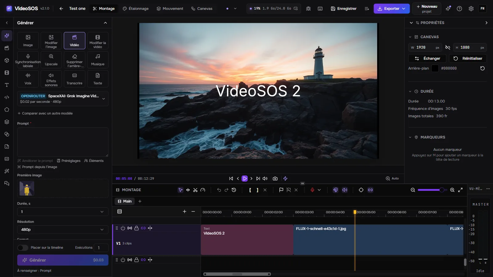
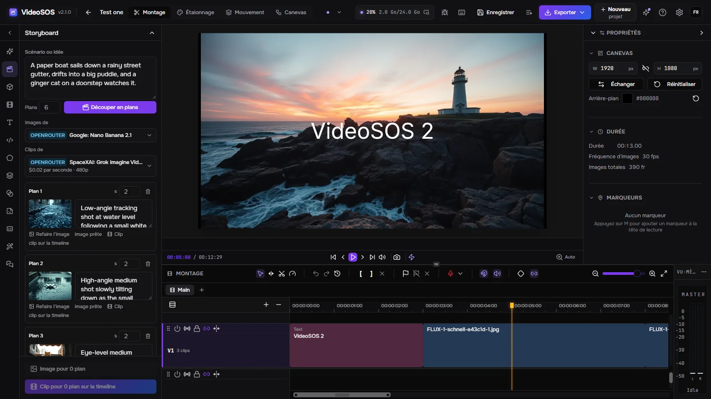
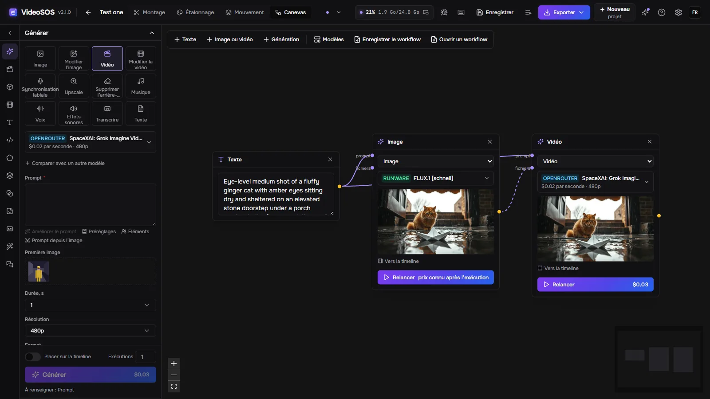
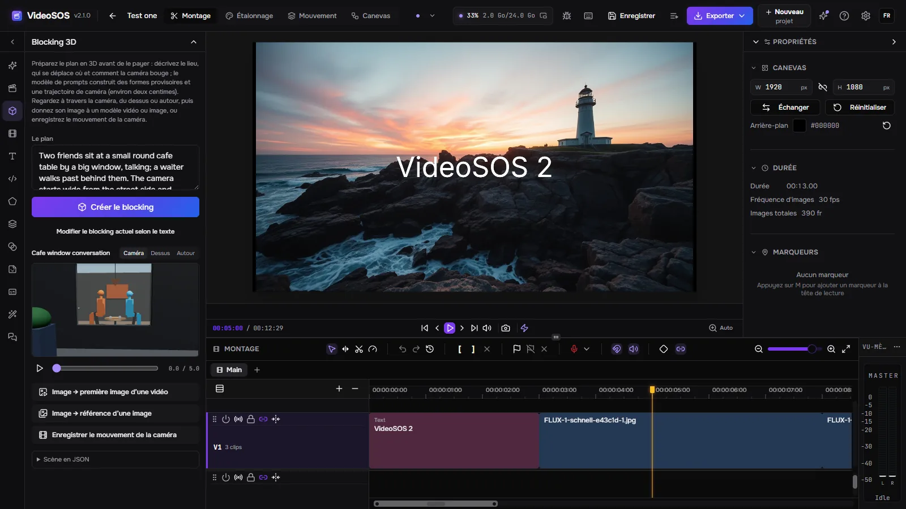
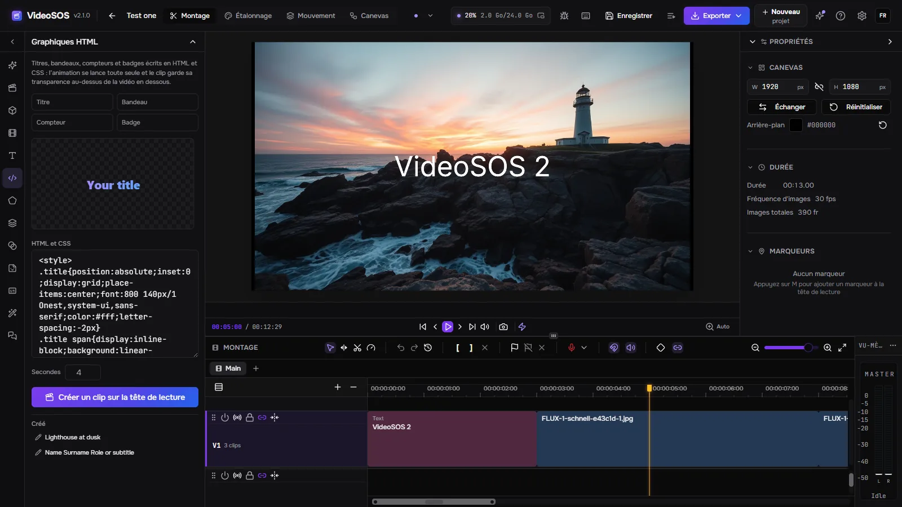
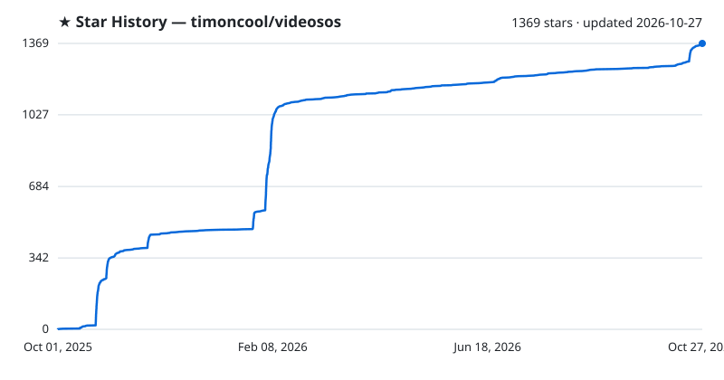

<div align="center">


# VideoSOS 2

**Un studio vidéo IA de bureau : générez images, vidéo, musique, voix, effets sonores et texte avec les meilleurs modèles d’OpenRouter, fal et Runware, planifiez le film sur un storyboard, un canevas de nœuds et un blocking 3D, puis montez le tout sur une vraie timeline multipiste pour obtenir une vidéo terminée. Une seule application native (Rust + Tauri) pour Windows, Linux et macOS, vos propres clés, vos fichiers sur votre disque, et un serveur MCP pour qu’un agent IA fasse la vidéo avec vous.**

[](LICENSE)
[](https://github.com/timoncool/videosos/stargazers)
[](https://github.com/timoncool/videosos/releases)
[](https://github.com/timoncool/videosos/releases)
[](https://github.com/timoncool/videosos/commits)

[English](README.md) · [Русский](README.ru.md) · [中文](README.zh.md) · [Español](README.es.md) · **Français** · [Português](README.pt.md)

### 🌐 [Site avec tous les écrans →](https://timoncool.github.io/videosos/fr.html)



</div>

## De quoi s’agit-il

**VideoSOS 2** réunit la génération par IA et le montage vidéo dans une seule fenêtre. À gauche, vous choisissez ce que vous voulez faire —
une image, la retouche d’une image, une vidéo à partir d’un texte ou d’une image, un buste parlant avec synchronisation labiale, un upscale, un
arrière-plan supprimé, de la musique, une voix off, des effets sonores, une transcription ou un script — et un modèle d’**OpenRouter,
fal ou Runware**. Le formulaire est construit d’après la description du modèle lui-même : tous les réglages que le modèle accepte
y figurent, et le prix s’affiche **avant** que vous cliquiez sur Générer. Le résultat arrive dans la médiathèque du projet
et, si vous le souhaitez, directement sur la timeline, à la position de la tête de lecture.

L’éditeur est un véritable NLE : plusieurs pistes vidéo et audio, coupes ripple, rolling, slip et slide, transitions,
images clés avec courbe de Bézier, masques, modes de fusion, étalonnage avec scopes, texte et formes, sous-titres, et un
export rapide en MP4, WebM, MOV ou MKV qui s’exécute sur votre carte graphique — ou un FCPXML pour Final Cut, DaVinci
Resolve et Premiere.

VideoSOS 1 était une application web dans le navigateur. **La version 2 est un programme de bureau natif** : son serveur est écrit en Rust,
les projets et les générations sont conservés sous forme de simples fichiers sur votre disque, les tâches survivent à un redémarrage, et il n’y a aucun compte chez nous
nulle part — vous payez directement les fournisseurs avec vos propres clés. La fenêtre parle dix langues.

## Tout générer

| Tâche | Ce que vous obtenez | Fournisseurs |
|---|---|---|
| Image | texte vers image | OpenRouter, fal, Runware |
| Modifier l’image | image avec références ou un masque | OpenRouter, fal, Runware |
| Vidéo | texte vers vidéo, première image, première et dernière image, références | OpenRouter, fal, Runware |
| Modifier la vidéo | vidéo vers vidéo, prolonger, changer de style | OpenRouter, fal, Runware |
| Synchronisation labiale | un visage qui prononce votre audio | fal, Runware |
| Upscale | images et vidéos en plus haute résolution | fal, Runware, OpenRouter (vidéo) |
| Supprimer l’arrière-plan | détourages transparents | fal, Runware |
| Musique | chansons et partitions | fal, Runware |
| Voix | synthèse vocale en dizaines de voix et de langues | OpenRouter, fal, Runware |
| Effets sonores | bruitage à partir d’un texte ou d’une vidéo | fal, Runware |
| Transcrire | de la parole au texte | OpenRouter, fal |
| Texte | scripts, prompts, idées — n’importe quel LLM d’OpenRouter | OpenRouter |

- **Catalogues en direct.** Les modèles sont lus chez les fournisseurs eux-mêmes — plus de mille, les plus récents d’abord, avec ce
  que chacun fait de mieux, son prix et son temps habituel sur votre ordinateur ; les favoris restent en haut, les modèles en fin de vie sont signalés.
- **Le prix avant de lancer.** Les tarifs à la seconde, à la résolution, au son et aux images en entrée sont calculés d’après le formulaire ; après
  l’exécution, la facture du fournisseur lui-même est enregistrée. Paramètres, Fournisseurs montre ce que vous avez dépensé aujourd’hui et au total.
- **Comparez des modèles en une seule exécution.** Le même prompt part vers deux autres modèles au plus, et les résultats s’affichent côte à côte.
- **Des fichiers en entrée.** Glissez une image, un clip ou un son de la médiathèque — ou le résultat d’une génération précédente —
  dans un emplacement : première image, dernière image, références, la vidéo à synchroniser sur les lèvres. **Continuer depuis la dernière image** démarre le
  clip suivant là où le précédent se termine.
- **Éléments.** Un personnage, un objet ou un lieu conservé sous un nom avec ses images : `@nom` dans un prompt envoie ses
  images au modèle comme références, de sorte que le même visage revient plan après plan.
- **Des prompts avec de l’aide.** Des préréglages, des `{{variables}}` renseignées à l’envoi de la tâche, un prompt amélioré par un modèle
  de langage, un prompt rédigé à partir d’une image, et une vérification de la limite du modèle avant tout paiement.
- **Jamais payé deux fois.** Une tâche est enregistrée avant d’être envoyée ; après un redémarrage, une tâche déjà envoyée est suivie, pas renvoyée.
  Les résultats sont téléchargés aussitôt, avant l’expiration des liens des fournisseurs, puis nommés et étiquetés d’après leur prompt.
- **Des vidéos par leur lien.** Un lien YouTube, n’importe quel site que yt-dlp connaît ou un fichier direct entre dans la médiathèque avec
  sa progression, son annulation et sa reprise.

## Planifier le film

| | |
|---|---|
|  | **Storyboard.** Un modèle de langage découpe un script en plans ; chaque plan reçoit une image d’un modèle d’image et un clip d’un modèle vidéo qui démarre sur cette image, et les clips se placent sur la timeline les uns après les autres. Les images peu coûteuses sont validées avant la vidéo payante. |
|  | **Canevas de nœuds.** Textes, images, vidéos et générations sont des nœuds reliés par ce qu’ils se transmettent — un prompt vers une image, l’image vers une vidéo. Les **modèles de workflow** posent d’un coup une chaîne toute prête sur le canevas (image vers vidéo, comparaison de modèles, photo de produit, buste parlant et plus encore) ; un canevas s’enregistre comme fichier de workflow à transmettre. |
|  | **Blocking 3D.** Décrivez le plan et le modèle de prompts le construit à partir de formes provisoires, de personnages debout et assis, de leurs déplacements et de la trajectoire de la caméra. Regardez à travers la caméra, du dessus ou autour, puis donnez son image à un modèle vidéo comme première image ou enregistrez le mouvement de la caméra — avant qu’un centime parte dans la vidéo. |
|  | **Graphiques HTML.** Titres, bandeaux, compteurs et badges écrits en HTML et CSS, prévisualisés en direct et transformés en un clip avec transparence qui se superpose à la vidéo à la tête de lecture. |

Sur la timeline elle-même : une exécution placée sur la timeline est dessinée là où elle atterrira pendant qu’elle s’exécute, et **une partie de n’importe quel
clip peut être générée à nouveau** — la partie est découpée, envoyée à un modèle de retouche vidéo, et la nouvelle prise se place par-dessus.

## Pour les agents IA

Tant que VideoSOS est ouvert, il sert MCP à l’adresse `http://127.0.0.1:8796/mcp`. Un agent tel que Claude Code, Claude Desktop,
Cursor ou Codex peut faire ce que fait la fenêtre : choisir des modèles et lire leurs réglages, estimer les prix, générer, attendre
les résultats, lire et modifier la timeline du projet ouvert (chaque modification est une étape annulable que vous voyez se dérouler), mettre en place un plan
en blocking 3D, créer des graphiques HTML, importer des médias, déplacer la tête de lecture, capturer la fenêtre et exporter la vidéo. Chaque action
est sous-titrée dans la fenêtre et inscrite au journal d’activité.

```bash
claude mcp add --transport http videosos http://127.0.0.1:8796/mcp
```

Autres clients : `{ "mcpServers": { "videosos": { "type": "streamable-http", "url": "http://127.0.0.1:8796/mcp" } } }`.
Le serveur fournit son guide comme ressource `videosos://skill` (prompt `videosos`) — le même texte que
[docs/mcp-skill.md](docs/mcp-skill.md).

- **Points de restauration.** La timeline est conservée avant chaque modification d’un agent ; le bouton Points de restauration, à côté d’annuler
  et de rétablir, ramène n’importe lequel d’entre eux. Un agent peut répéter une modification (`dry_run`) et voir ce qu’elle produirait sans rien toucher.
- **Propositions.** Avec *Les modifications de l’agent sur la timeline attendent mon accord* activé dans Paramètres, Agents, la modification d’un agent s’affiche en mots simples
  et ne s’applique qu’une fois que vous avez cliqué sur Accepter.
- **Une limite de dépenses.** Les générations sont payantes : Paramètres, Agents fixe une limite quotidienne pour les agents, au-delà de laquelle
  `generate` est refusé. Seuls les agents de cet ordinateur et la fenêtre du programme lui-même peuvent se connecter ; les clés des fournisseurs ne
  leur sont jamais montrées.
- **Chat dans la fenêtre.** L’onglet Chat exécute le modèle OpenRouter de votre choix avec les mêmes outils, pas à pas, avec
  le coût de chaque étape et un bouton Arrêter.

## Captures d’écran

L’espace de montage avec le panneau de génération, le canevas de nœuds avec une vraie chaîne, le storyboard, le blocking 3D et les
graphiques HTML — tous les écrans, en huit langues, sont sur le [site](https://timoncool.github.io/videosos/fr.html).

| | |
|---|---|
|  |  |
|  |  |

## Démarrage rapide

1. Téléchargez depuis la [dernière version](https://github.com/timoncool/videosos/releases/latest) : `VideoSOS_<version>_x64-setup.exe`
   (ou le `.msi`, ou le `VideoSOS-<version>-portable-windows-x64.zip` portable) pour Windows, le `.AppImage` ou le `.deb`
   pour Linux, le `.dmg` pour macOS sur Apple Silicon.
2. Créez un projet, ouvrez l’onglet **Générer** à gauche et collez une clé
   [OpenRouter](https://openrouter.ai/settings/keys), [fal](https://fal.ai/dashboard/keys) ou
   [Runware](https://my.runware.ai/keys) lorsqu’on vous la demande. Un seul fournisseur suffit pour commencer.
3. Choisissez une tâche et un modèle, écrivez ce que vous voulez, cliquez sur **Générer**.

Ce qui a changé et quand figure dans [CHANGELOG.md](CHANGELOG.md), et le bouton d’étincelles en haut de la fenêtre l’affiche.
Règles pour les contributeurs et les agents de programmation : [AGENTS.md](AGENTS.md).

## Configuration requise

- **Windows** 10/11 x64 avec Microsoft Edge WebView2 (le programme d’installation le récupère s’il manque).
- **Linux** x86-64 (expérimental) : le `.deb` ou l’AppImage, avec WebKitGTK et GStreamer du système.
- **macOS** 13 ou plus récent sur Apple Silicon (expérimental).
- Une carte graphique compatible WebGPU (toute NVIDIA, AMD ou Intel récente) pour l’aperçu et l’export rapide.
- Une connexion internet pour la génération ; le montage et l’export fonctionnent hors ligne.

Paramètres, Réseau propose un proxy pour les fournisseurs et les téléchargements, ainsi que **Accès depuis le réseau** : désactivé par défaut ; activé,
un navigateur sur un autre ordinateur ou un téléphone ouvre la même interface avec une clé d’accès, tandis que tout s’exécute ici.

## Tout ce que l’application télécharge

Le programme lui-même contient tout ce dont il a besoin pour monter et générer. Deux outils ne sont récupérés que lorsque vous importez pour la première fois une
vidéo par son lien, depuis leurs propres versions GitHub, chaque fichier étant vérifié par rapport à sa taille et à son SHA-256 épinglés avant
d’être utilisé ; ensuite yt-dlp se met à jour tout seul une fois par jour. Sous Linux, les mêmes outils arrivent dans leurs versions Linux ; sous macOS, l’import
par lien n’est pas encore disponible.

<!-- downloads:start -->
| Outil | À quoi il sert | Fichier (lien direct) | Taille | Où il va |
|---|---|---|---|---|
| yt-dlp + Deno | importer une vidéo par son lien | [yt-dlp.exe](https://github.com/yt-dlp/yt-dlp/releases/download/2026.08.19/yt-dlp.exe) | 17.8 MB | `data\tools\yt-dlp\` (tel quel) |
|  |  | [deno-x86_64-pc-windows-msvc.zip](https://github.com/denoland/deno/releases/download/v2.9.7/deno-x86_64-pc-windows-msvc.zip) | 42.6 MB | `data\tools\yt-dlp\` (décompressé) |
| ffmpeg | réunir l'image et le son d'une vidéo liée | [ffmpeg-N-126342-gf88b741dbf-win64-gpl.zip](https://github.com/BtbN/FFmpeg-Builds/releases/download/autobuild-2026-08-31-13-27/ffmpeg-N-126342-gf88b741dbf-win64-gpl.zip) | 170.7 MB | `data\tools\ffmpeg\` (ffmpeg.exe et ffprobe.exe de l'archive) |
<!-- downloads:end -->

## Où sont vos fichiers

Sous Windows, tout se trouve à côté du programme (ou dans `%LOCALAPPDATA%\VideoSOS` quand ce dossier est en lecture seule) ; sous Linux
dans `~/.local/share/videosos` (`$XDG_DATA_HOME`), sous macOS dans `~/Library/Application Support/VideoSOS`.
`data\workspace` — projets, médias, miniatures et exports ; `data\generations` — les fichiers de chaque génération ;
`secrets` — clés des fournisseurs ; `data\videosos.db` — l’historique des générations. La désinstallation les conserve, sauf si vous cochez
*Delete the application data*.

## Dépannage

**Le programme d’installation s’arrête sur WebView2.** La fenêtre fonctionne avec Microsoft Edge WebView2, et le programme d’installation le récupère quand
Windows ne l’a pas. Sur une connexion bloquée, cette récupération échoue : installez WebView2 avec le programme d’installation autonome de Microsoft,
[Evergreen Standalone x64](https://go.microsoft.com/fwlink/p/?LinkId=2124701), puis relancez le programme d’installation de VideoSOS.

**Une génération échoue.** La carte indique de quel type d’échec il s’agit ; *Texte de l’erreur* montre les mots du fournisseur lui-même, et une
clé absente ou refusée ouvre Paramètres, Fournisseurs. Une tâche déjà envoyée n’est jamais renvoyée toute seule : cliquez sur *Relancer* sur sa carte
quand vous voulez un nouvel essai.

**Une vidéo par son lien s’arrête sur « confirmez que vous n’êtes pas un robot ».** Le site veut un navigateur connecté : exportez
`cookies.txt` depuis un navigateur connecté au site et ajoutez-le dans la boîte de dialogue du lien (Ajouter cookies.txt).

**Une retouche vidéo d’OpenRouter refuse un fichier de cet ordinateur.** OpenRouter n’accepte les vidéos sources que par un lien `https` ;
utilisez un modèle de retouche vidéo de fal ou de Runware pour un fichier local, ou une vidéo ajoutée depuis un lien.

**L’aperçu ou l’export est lent ou ne démarre pas.** Tous deux s’exécutent sur WebGPU et sur l’encodeur vidéo de la carte graphique.
Mettez à jour le pilote graphique ; quand la carte ne peut pas encoder les réglages choisis, la boîte de dialogue d’export le signale — choisissez un autre
codec ou conteneur.

## Statistiques anonymes et actualités

L’écran du premier lancement comporte un interrupteur **Envoyer des statistiques anonymes** ; le même interrupteur se trouve dans Paramètres, Confidentialité.
Tant qu’il est activé, le programme envoie une fois par jour : un identifiant d’installation aléatoire, la version, le système et la langue de la fenêtre, le nombre de
générations terminées ou échouées par tâche, et les modèles qui ont tourné. Jamais de prompts, de fichiers, de clés ni rien de personnel.
`DO_NOT_TRACK=1` ou `STUDIO_TELEMETRY=0` le désactive entièrement.

## Comment c’est construit

- `crates/vs-providers` — OpenRouter, fal et Runware ramenés à un seul contrat : catalogue, formulaire d’après le
  JSON Schema du modèle, une règle de prix, des tâches qui aboutissent à des fichiers. Les tâches Runware sont vérifiées d’après le schéma du modèle avant
  d’être envoyées, si bien qu’un mauvais réglage ne coûte rien.
- `crates/vs-server` — axum sur 127.0.0.1 : l’espace de travail de l’éditeur sur le disque, la file de tâches dans SQLite, les clés, les dépenses,
  les points de restauration, l’import par lien, le serveur MCP et son pont vers la fenêtre.
- `frontend` — la fenêtre de l’éditeur : un fork de [FreeCut](https://github.com/walterlow/freecut) (MIT) conservé comme git
  subtree, avec son stockage déplacé vers le serveur et auquel ont été ajoutés le panneau de génération, le storyboard, le canevas, le blocking 3D, les graphiques
  HTML, les paramètres et le pont des agents.
- `desktop` — l’enveloppe Tauri : un seul processus, le serveur à l’intérieur, des mises à jour depuis les versions GitHub.

### Compiler depuis les sources

```bash
git clone https://github.com/timoncool/videosos.git
cd videosos

npm --prefix frontend ci && npm --prefix frontend run build   # 1) la fenêtre
npm --prefix desktop ci && npm --prefix desktop run build     # 2) le programme, avec le serveur à l’intérieur
```

Il faut Node 20+ et Rust (la version est épinglée dans `rust-toolchain.toml` ; MSVC sous Windows). Le programme se retrouve dans
`desktop/src-tauri/target/release` et trouve sa fenêtre dans le dépôt. `cargo run -p vs-server` lance le serveur seul,
pour un navigateur sur `http://127.0.0.1:8796`. Les programmes d’installation et les paquets sont produits par `scripts/build-release.ps1` (Windows), `scripts/build-release-linux.sh` dans Docker (Linux) et
`scripts/build-release-macos.sh` (macOS).

### Linux et macOS (expérimental)

Le `.deb`, l’AppImage et le `.dmg` sortent du même code. Le serveur et la fenêtre ont été vérifiés sous Linux dans un
navigateur — un projet créé, enregistré et exporté sur le disque Linux — mais l’auteur travaille sous Windows et n’a pas lancé les
fenêtres de bureau sur un vrai Linux ou un vrai Mac. **Si vous vivez sous Linux ou macOS, ce serait formidable que vous les peaufiniez et
renvoyiez les correctifs sous forme de pull request.** La version macOS est signée ad hoc et non notariée, si bien que macOS vous demande d’autoriser son premier lancement dans Réglages Système,
Confidentialité et sécurité.

## Plus d’applications IA portables

| Projet | De quoi s’agit-il |
|--------|----------|
| [Dub Studio](https://github.com/timoncool/dub-studio) | Doublage vidéo IA hors ligne avec une voix clonée |
| [YuE2 Studio](https://github.com/timoncool/YuE2-Studio) | Générateur de chansons IA avec une partition modifiable |
| [MiniMax Music3 Studio](https://github.com/timoncool/MiniMax-Music3-Studio) | Studio de musique IA, local et dans le cloud |
| [ACE-Step Studio](https://github.com/timoncool/ACE-Step-Studio) | Studio de musique IA — chansons, voix, reprises, clips |
| [Higgs Ultimate](https://github.com/timoncool/Higgs-Ultimate) | Synthèse vocale native et clonage de voix |

## Auteurs

- **Nerual Dreming** — [Telegram](https://t.me/nerual_dreming) | [neuro-cartel.com](https://neuro-cartel.com) | fondateur d’[ArtGeneration.me](https://artgeneration.me)
- **Neuro-Soft** — [Telegram](https://t.me/neuroport) | applications IA portables

## Remerciements

- **[FreeCut](https://github.com/walterlow/freecut)** de Walter Low — l’éditeur sur lequel cette fenêtre est construite (MIT).
- **[OpenRouter](https://openrouter.ai)**, **[fal](https://fal.ai)** et **[Runware](https://runware.ai)** — les
  fournisseurs, et les créateurs de modèles qui se trouvent derrière eux.
- **[mediabunny](https://github.com/Vanilagy/mediabunny)**, **[three.js](https://threejs.org)**,
  **[React Flow](https://reactflow.dev)**, **[modern-screenshot](https://github.com/qq15725/modern-screenshot)**,
  **[Tauri](https://tauri.app)**, **[axum](https://github.com/tokio-rs/axum)**,
  **[jsonschema](https://github.com/Stranger6667/jsonschema)**, **[yt-dlp](https://github.com/yt-dlp/yt-dlp)**,
  **[FFmpeg](https://ffmpeg.org)**, **[lucide](https://lucide.dev)**.
- Idées empruntées à LTX Studio (storyboard), Weave et Flora (canevas et modèles), AIMovieStudio (prévisualisation), WeftCut
  (motion design, points de restauration), OpenChatCut (propositions), Kling (éléments) et Descript (FCPXML).
- VideoSOS 1 est né comme un fork du **[fal AI Video Starter Kit](https://github.com/fal-ai-community/video-starter-kit)**.

## Soutenir l’auteur

Je crée des logiciels open source et je fais de la recherche en IA — presque tout ce que je produis est disponible gratuitement. Les dons me permettent de développer et de chercher davantage.

**[Toutes les façons de soutenir](DONATE.fr.md)** | **[dalink.to/nerual_dreming](https://dalink.to/nerual_dreming)** | **[boosty.to/neuro_art](https://boosty.to/neuro_art)**

- **BTC:** `1E7dHL22RpyhJGVpcvKdbyZgksSYkYeEBC`
- **ETH (ERC20):** `0xb5db65adf478983186d4897ba92fe2c25c594a0c`
- **USDT (TRC20):** `TQST9Lp2TjK6FiVkn4fwfGUee7NmkxEE7C`

## Historique des étoiles

<a href="https://github.com/timoncool/videosos/stargazers">
 <picture>
   <source media="(prefers-color-scheme: dark)" srcset="docs/stars-dark.svg" />
   <source media="(prefers-color-scheme: light)" srcset="docs/stars-light.svg" />
   
 </picture>
</a>

## Licence

Le code est sous licence [MIT](LICENSE) ; la fenêtre de l’éditeur est basée sur FreeCut (MIT). Ce que vous générez est régi par les conditions du
fournisseur et du modèle que vous avez utilisés — lisez-les avant de publier ou de vendre.
