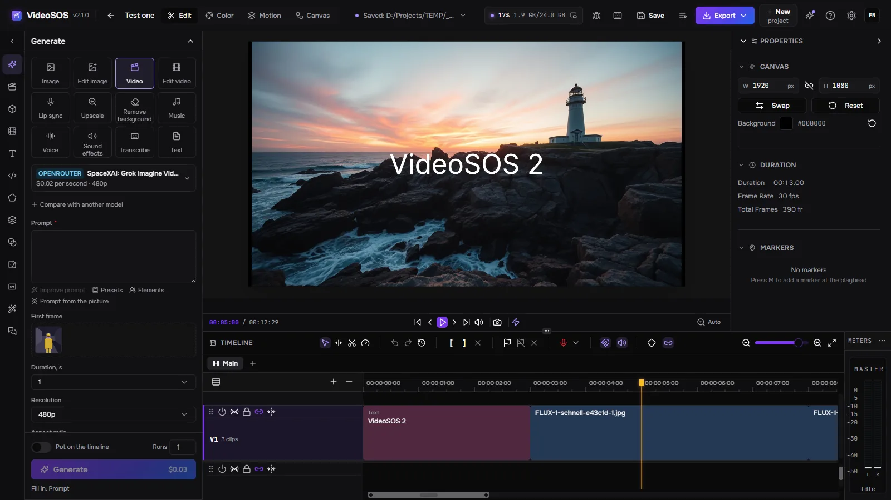
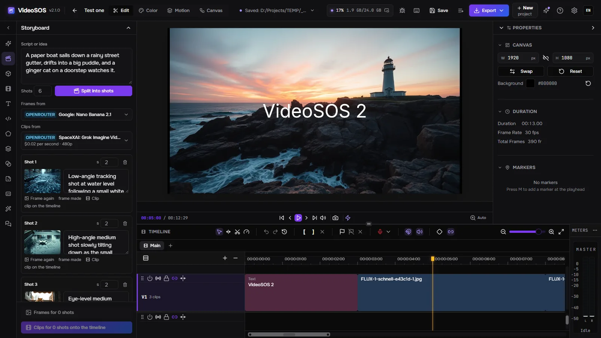
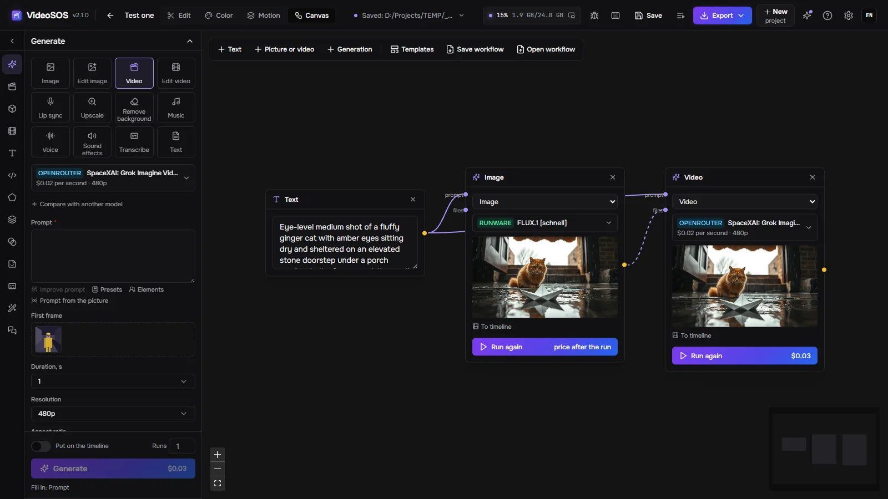
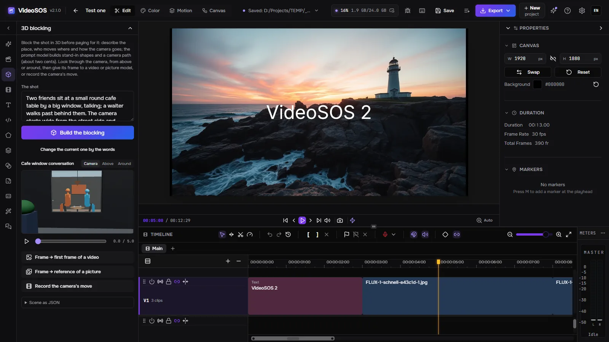
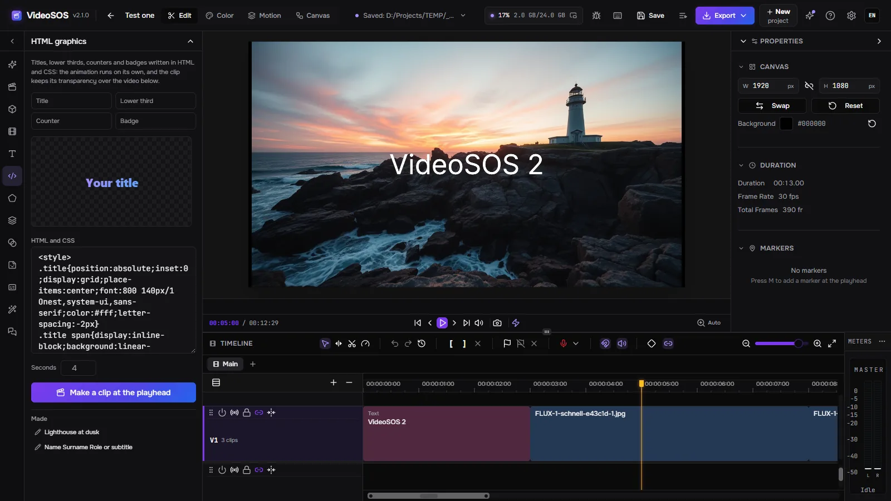

<div align="center">


# VideoSOS 2

**A desktop AI video studio: generate images, video, music, voices, sound effects and text with the best models of OpenRouter, fal and Runware or free on your own graphics card, plan the film on a storyboard, a node canvas and a 3D blocking, and cut it all on a real multitrack timeline into a finished video. One native app (Rust + Tauri) for Windows, Linux and macOS, your own keys, your files on your disk, and an MCP server so an AI agent can make the video with you.**

[](LICENSE)
[](https://github.com/timoncool/videosos/stargazers)
[](https://github.com/timoncool/videosos/releases)
[](https://github.com/timoncool/videosos/releases)
[](https://github.com/timoncool/videosos/commits)

**English** · [Русский](README.ru.md) · [中文](README.zh.md) · [Español](README.es.md) · [Français](README.fr.md) · [Português](README.pt.md)

### 🌐 [Site with every screen →](https://timoncool.github.io/videosos/)



</div>

## What it is

**VideoSOS 2** puts AI generation and video editing into one window. On the left you pick what to make —
an image, an edit of an image, a video from text or from a frame, a lip-synced talking head, an upscale, a
removed background, music, a voice-over, sound effects, a transcript or a script — and a model of **OpenRouter,
fal or Runware**, or one that runs **on this computer for free**. The form is drawn from the model's own description, so every setting the model takes is
there, and the price is shown **before** you press Generate. The result lands in the project's media library
and, if you like, straight onto the timeline at the playhead.

The editor is a full NLE: multiple video and audio tracks, ripple/rolling/slip/slide trims, transitions,
keyframes with a Bezier graph, masks, blend modes, color grading with scopes, text and shapes, captions, and a
fast export to MP4, WebM, MOV or MKV that runs on your graphics card, its loudness brought to -14, -16 or -23
LUFS if you like — or an FCPXML for Final Cut, DaVinci Resolve and Premiere. Captions come from the transcript
whole, word by word as spoken, or as karaoke.

VideoSOS 1 was a web app in the browser. **Version 2 is a native desktop program**: its server written in Rust,
projects and generations kept as plain files on your disk, jobs that survive a restart, and no account of ours
anywhere — you pay the providers directly with your own keys. The window speaks ten languages.

## Generate everything

| Task | What you get | Providers |
|---|---|---|
| Image | text to image | OpenRouter, fal, Runware |
| Edit image | image with references or a mask | OpenRouter, fal, Runware |
| Video | text to video, first frame, first and last frame, references | OpenRouter, fal, Runware |
| Edit video | video to video, extend, restyle | OpenRouter, fal, Runware |
| Lip sync | a face that speaks your audio | fal, Runware |
| Upscale | images and videos in higher resolution | fal, Runware, OpenRouter (video) |
| Remove background | transparent cut-outs | fal, Runware |
| Music | songs and scores | fal, Runware |
| Voice | text to speech in dozens of voices and languages | OpenRouter, fal, Runware |
| Sound effects | foley from text or from a video | fal, Runware |
| Transcribe | speech to text | OpenRouter, fal |
| Text | scripts, prompts, ideas — any LLM of OpenRouter | OpenRouter |

- **Live catalogues.** Models are read from the providers themselves — over a thousand, newest first, with what each
  is good at, its price and its typical time on your computer; favourites stay on top, retiring models are marked.
- **Price before you run.** Rates by second, resolution, sound and input images are worked out from the form; after
  the run the provider's own bill is recorded. Settings, Providers shows what you spent today and in total.
- **Compare models in one run.** The same prompt goes to up to two more models, and the results stand side by side.
- **Files as inputs.** Drag a picture, a clip or a sound from the library — or a result of an earlier generation —
  into a slot: first frame, last frame, references, the video to lip-sync. **Continue from the last frame** starts the
  next clip where the previous one ends.
- **Elements.** A character, an object or a place kept under a name with its pictures: `@name` in a prompt sends its
  pictures to the model as references, so the same face comes back shot after shot.
- **Prompts that help.** Presets, `{{variables}}` filled in when the job is sent, a prompt improved by a language
  model, a prompt written from a picture, and a check against the model's limit before anything is paid.
- **Never paid twice.** A job is saved before it is sent; after a restart a job that was sent is followed, not sent
  again. Results are downloaded at once, before the providers' links expire, and named and tagged by their prompt.
- **Videos by their links.** A YouTube link, any site yt-dlp knows, or a direct file goes into the library with
  its progress, cancel and resume.
- **Generate without end.** The runs go again with new seeds until you stop them or one fails.
- **What a key has spent.** The key check shows OpenRouter's spend and limit and Runware's balance.

## Generate on this computer

No key and no bill: the **Local** provider sits beside the cloud ones (Windows for now).

| Model | What it makes | Accelerators |
|---|---|---|
| Qwen-Image 2.1 | pictures | Turbo 8 steps, LightX2V Lightning 4, Viggle Turbo 6 |
| MiniMax-H3 | video with its own sound, from a prompt or a first frame | LightX2V Turbo 8 and 4 steps |
| LTX-2.5 | video with sound, two passes with Lightricks' ×2 upscaler | distilled 8 steps |

- **stable-diffusion.cpp** runs them on CUDA, Vulkan or the processor; Auto picks the card. Only quantized weights
  (GGUF Q4, int8) are used.
- **Settings, Local models** downloads each model and its engine once, pinned and checked by SHA-256, with resume.
  A file one of the author's other programs already has is taken from it (a hard link on the same drive) instead of
  downloaded, and the model's row says where it came from.
- **The author's music studios.** While [YuE2 Studio](https://github.com/timoncool/YuE2-Studio),
  [MiniMax Music3 Studio](https://github.com/timoncool/MiniMax-Music3-Studio) or
  [ACE-Step Studio](https://github.com/timoncool/ACE-Step-Studio) is open, it appears in Music with its own form; the
  studio makes the song, and its file lands in the library with its tags.
- **Speech Studio.** While Speech Studio is open, each of its engines on this computer (Qwen3-TTS, Supertonic 3,
  Drama 3, Higgs Audio) appears in Voice with the engine's voices and languages; the studio voices the text, and its
  file lands in the library.
- **The window's own models** run in the window: Parakeet Ultra (int8) and Whisper Large v3 Turbo (Q8) for
  transcripts, Gemma 4 E4B for scene captions and cut checks.

## Plan the film

| | |
|---|---|
|  | **Storyboard.** A language model splits a script into shots; each shot gets a frame from a picture model and a clip from a video model that starts on that frame, and the clips land on the timeline one after another. Cheap frames are approved before the paid video. |
|  | **Node canvas.** Text, pictures, videos and generations are nodes joined by what they pass on — a prompt into a picture, the picture into a video. **Workflow templates** put a ready chain on the canvas in one go (frame to video, comparing models, a product shot, a talking head and more); a canvas is saved as a workflow file to pass on. |
|  | **3D blocking.** Describe the shot and the prompt model builds it from stand-in shapes, standing and seated people, their moves and the camera's path. Look through the camera, from above or around, then give its frame to a video model as the first frame or record the camera's move — before a cent goes to the video. |
|  | **HTML graphics.** Titles, lower thirds, counters and badges written in HTML and CSS, previewed live and made into a clip with transparency that lies over the video at the playhead. |

On the timeline itself: a run put on the timeline is drawn where it will land while it runs, and **a part of any
clip can be generated again** — the part is cut, sent to a video edit model, and the new take lands over it.

## For AI agents

While VideoSOS is open it serves MCP at `http://127.0.0.1:8796/mcp`. An agent such as Claude Code, Claude Desktop,
Cursor or Codex can do what the window does: pick models and read their settings, estimate prices, generate, wait for
the results, read and edit the open project's timeline (each edit is an undoable step you see happen), block a shot in
3D, make HTML graphics, import media, move the playhead, take a picture of the window and export the video. Every action
is captioned in the window and written to the activity journal.

```bash
claude mcp add --transport http videosos http://127.0.0.1:8796/mcp
```

Other clients: `{ "mcpServers": { "videosos": { "type": "streamable-http", "url": "http://127.0.0.1:8796/mcp" } } }`.
The server serves its guide as the resource `videosos://skill` (prompt `videosos`) — the same text as
[docs/mcp-skill.md](docs/mcp-skill.md).

- **Checkpoints.** The timeline is kept before every agent's edit; the Checkpoints button beside undo and redo brings
  any of them back. An agent can rehearse an edit (`dry_run`) and see what it would make without touching anything.
- **Proposals.** With Settings, Agents, *Agents' timeline edits wait for me* on, an agent's edit is shown in plain words
  and applies only after you press Accept.
- **A spending limit.** Generations are paid: Settings, Agents sets a daily limit for agents, past which
  `generate` is refused. Only agents on this computer and the program's own window may connect; provider keys are never
  shown to them.
- **Chat in the window.** The Chat tab runs an OpenRouter model of your choice with the same tools, step by step, with
  each step's cost and a Stop button.
- **The connected agent as the window's assistant**, as in YuE2 Studio: with Settings, Agents set to the MCP agent,
  improving a prompt, a prompt from a picture, a storyboard, a blocking and the chat go to the agent, with no key and
  no charge. Writing guides are served as the resources `videosos://guide/prompt`, `picture` and `storyboard`.

## Screenshots

The edit workspace with the generation panel, the node canvas with a real chain, the storyboard, the 3D blocking and the
HTML graphics — every screen in eight languages is on the [site](https://timoncool.github.io/videosos/).

| | |
|---|---|
|  |  |
|  |  |

## Quick start

1. Download from the [latest release](https://github.com/timoncool/videosos/releases/latest): `VideoSOS_<version>_x64-setup.exe`
   (or the `.msi`, or the portable `VideoSOS-<version>-portable-windows-x64.zip`) for Windows, the `.AppImage` or `.deb`
   for Linux, the `.dmg` for macOS on Apple Silicon.
2. Create a project, open the **Generate** tab on the left and paste a key of
   [OpenRouter](https://openrouter.ai/settings/keys), [fal](https://fal.ai/dashboard/keys) or
   [Runware](https://my.runware.ai/keys) when asked. One provider is enough to start.
3. Pick a task and a model, write what you want, press **Generate**.

What changed and when is in [CHANGELOG.md](CHANGELOG.md), and the sparkles button at the top of the window shows it.
Rules for contributors and coding agents: [AGENTS.md](AGENTS.md).

## Requirements

- **Windows** 10/11 x64 with Microsoft Edge WebView2 (the installer gets it when missing).
- **Linux** x86-64 (experimental): the `.deb` or the AppImage, with WebKitGTK and GStreamer from the system.
- **macOS** 13 or newer on Apple Silicon (experimental).
- A graphics card with WebGPU (any recent NVIDIA, AMD or Intel) for the preview and the fast export.
- An internet connection for cloud generation; local generation, editing and export work offline. The local video
  models are checked on a 24 GB card.

Settings, Network has a proxy for the providers and the downloads, and **Access from the network**: off by default; on,
a browser on another computer or a phone opens the same interface with an access key, while everything runs here.

## Everything the app downloads

The program holds what it needs to edit and to generate in the cloud. The rest is downloaded only when you ask for it,
from where it is published, each file checked against its pinned size and SHA-256 before it is used: yt-dlp, Deno and
ffmpeg when you first import a video by its link (yt-dlp then updates itself once a day), the stable-diffusion.cpp
engine and the local models when you download them in Settings, Local models. On Linux the tools come in their Linux
builds; on macOS importing by link is not available yet; local generation is on Windows for now.

The window's own models are fetched from Hugging Face the first time their feature is used and kept in the window's
cache (Settings, Storage clears them): Parakeet Ultra int8 and Whisper Large v3 Turbo Q8 for transcripts, Gemma 4 E4B
for scene captions, CLIP, MiniLM and CLAP for search and filler words, RIFE for frame interpolation.

<!-- downloads:start -->
| Tool | What for | File (direct link) | Size | Where it goes |
|---|---|---|---|---|
| yt-dlp + Deno | importing a video by its link | [yt-dlp.exe](https://github.com/yt-dlp/yt-dlp/releases/download/2026.08.19/yt-dlp.exe) | 17.8 MB | `data\tools\yt-dlp\` (as is) |
|  |  | [deno-x86_64-pc-windows-msvc.zip](https://github.com/denoland/deno/releases/download/v2.9.7/deno-x86_64-pc-windows-msvc.zip) | 42.6 MB | `data\tools\yt-dlp\` (unpacked) |
| ffmpeg | joining a linked video's picture and sound | [ffmpeg-N-126342-gf88b741dbf-win64-gpl.zip](https://github.com/BtbN/FFmpeg-Builds/releases/download/autobuild-2026-08-31-13-27/ffmpeg-N-126342-gf88b741dbf-win64-gpl.zip) | 170.7 MB | `data\tools\ffmpeg\` (ffmpeg.exe and ffprobe.exe of the archive) |
| stable-diffusion.cpp CUDA 12 | local generation on NVIDIA cards | [sd-master-1d0a58a-bin-win-cuda12-x64.zip](https://github.com/leejet/stable-diffusion.cpp/releases/download/master-964-1d0a58a/sd-master-1d0a58a-bin-win-cuda12-x64.zip)<br>[cudart-sd-bin-win-cu12-x64.zip](https://github.com/leejet/stable-diffusion.cpp/releases/download/master-964-1d0a58a/cudart-sd-bin-win-cu12-x64.zip) | 901.5 MB | `data\tools\sd\cuda12\` (unpacked) |
| stable-diffusion.cpp Vulkan | local generation on other cards | [sd-master-1d0a58a-bin-win-vulkan-x64.zip](https://github.com/leejet/stable-diffusion.cpp/releases/download/master-964-1d0a58a/sd-master-1d0a58a-bin-win-vulkan-x64.zip) | 30.2 MB | `data\tools\sd\vulkan\` (unpacked) |
| stable-diffusion.cpp CPU | local generation without a card | [sd-master-1d0a58a-bin-win-cpu-x64.zip](https://github.com/leejet/stable-diffusion.cpp/releases/download/master-964-1d0a58a/sd-master-1d0a58a-bin-win-cpu-x64.zip) | 17.6 MB | `data\tools\sd\cpu\` (unpacked) |
| Qwen-Image 2.1 | pictures on this computer, optional | [Qwen3VL-8B-Instruct-Q4_K_M.gguf](https://huggingface.co/Qwen/Qwen3-VL-8B-Instruct-GGUF/resolve/f982a07559d4a2f6c8744d840bf6fccab30eea96/Qwen3VL-8B-Instruct-Q4_K_M.gguf) → `data\models\qwen-image-2.1\Qwen3VL-8B-Instruct-Q4_K_M.gguf`<br>[qwen_image_2.1_vae_bf16.safetensors](https://huggingface.co/Comfy-Org/Qwen-Image-2.1/resolve/a8342359c61979b06a8dafb1a47991fe1f30e994/vae/qwen_image_2.1_vae_bf16.safetensors) → `data\models\qwen-image-2.1\qwen_image_2.1_vae_bf16.safetensors`<br>[qwen-image-2.1-turbo-Q4_K_M.gguf](https://huggingface.co/unsloth/Qwen-Image-2.1-Turbo-GGUF/resolve/5d1f9f759ea877ae556cda88dbec958b62ad3809/qwen-image-2.1-turbo-Q4_K_M.gguf) → `data\models\qwen-image-2.1\qwen-image-2.1-turbo-Q4_K_M.gguf`<br>[pytorch_lora_weights.safetensors](https://huggingface.co/lightx2v/Qwen-Image-2.1-Lightning/resolve/6b0a1176327c01522a44276c5da67331a025b6fc/pytorch_lora_weights.safetensors) → `data\models\qwen-image-2.1\loras\qwen-image-2.1-lightning-4step.safetensors`<br>[Qwen-Image-2.1-viggle-turbo-v0.3-6step-lora-r256.safetensors](https://huggingface.co/Viggle/Qwen-Image-2.1-viggle-turbo/resolve/009a44a895ef85f7e643c80fdca9543795248867/Qwen-Image-2.1-viggle-turbo-v0.3-6step-lora-r256.safetensors) → `data\models\qwen-image-2.1\loras\qwen-image-2.1-viggle-turbo-v0.3-6step-lora-r256.safetensors`<br>[qwen-image-2.1-Q4_K_M.gguf](https://huggingface.co/unsloth/Qwen-Image-2.1-GGUF/resolve/2c31ccd392b367a6637841a143813320a02dff55/qwen-image-2.1-Q4_K_M.gguf) → `data\models\qwen-image-2.1\qwen-image-2.1-Q4_K_M.gguf` | 15.5 GB | as is, to the path after the arrow |
| MiniMax-H3 | video with sound on this computer, optional | [minimax_h3_fl2va_pruned-Q4_K.gguf](https://huggingface.co/unsloth/MiniMax-H3-GGUF/resolve/d629413c2e5b51b38c453668b75ca3b06ca92703/minimax_h3_fl2va_pruned-Q4_K.gguf) → `data\models\minimax-h3\minimax_h3_fl2va_pruned-Q4_K.gguf`<br>[qwen3vl_32b_minimax_h3-Q4_K_M.gguf](https://huggingface.co/unsloth/MiniMax-H3-GGUF/resolve/d629413c2e5b51b38c453668b75ca3b06ca92703/qwen3vl_32b_minimax_h3-Q4_K_M.gguf) → `data\models\minimax-h3\qwen3vl_32b_minimax_h3-Q4_K_M.gguf`<br>[minimax_h3_video_vae_fp16.safetensors](https://huggingface.co/unsloth/MiniMax-H3-GGUF/resolve/d629413c2e5b51b38c453668b75ca3b06ca92703/vae/minimax_h3_video_vae_fp16.safetensors) → `data\models\minimax-h3\minimax_h3_video_vae_fp16.safetensors`<br>[minimax_h3_audio_vae_fp32.safetensors](https://huggingface.co/unsloth/MiniMax-H3-GGUF/resolve/d629413c2e5b51b38c453668b75ca3b06ca92703/vae/minimax_h3_audio_vae_fp32.safetensors) → `data\models\minimax-h3\minimax_h3_audio_vae_fp32.safetensors`<br>[minimax_h3_fl2v_turbo_8step_v1.0_768p_comfyui_bf16.safetensors](https://huggingface.co/lightx2v/Minimax-h3-Turbo/resolve/3ec17a324ced54151364f24f8b5fb6bf7e26414f/minimax_h3_fl2v_turbo_8step_v1.0_768p_comfyui_bf16.safetensors) → `data\models\minimax-h3\loras\minimax_h3_fl2v_turbo_8step_v1.0_768p_comfyui_bf16.safetensors`<br>[minimax_h3_fl2v_turbo_4step_v1.2_768p_comfyui_bf16.safetensors](https://huggingface.co/lightx2v/Minimax-h3-Turbo/resolve/3ec17a324ced54151364f24f8b5fb6bf7e26414f/minimax_h3_fl2v_turbo_4step_v1.2_768p_comfyui_bf16.safetensors) → `data\models\minimax-h3\loras\minimax_h3_fl2v_turbo_4step_v1.2_768p_comfyui_bf16.safetensors` | 39.4 GB | as is, to the path after the arrow |
| LTX-2.5 | video with sound on this computer, optional | [ltx-2.5-22b-distilled-Q4_K_M.gguf](https://huggingface.co/unsloth/LTX-2.5-GGUF/resolve/6eae90030f7f15460a0ecf9ab16445d676b2bbb6/distilled/ltx-2.5-22b-distilled-Q4_K_M.gguf) → `data\models\ltx-2.5\ltx-2.5-22b-distilled-Q4_K_M.gguf`<br>[gemma4-12b-with-proj-ltx-2.5-comfy-int8-convrot.safetensors](https://huggingface.co/PulpCut/LTX-2.5-INT8-ConvRot-safetensors/resolve/7597fb305b4cab9e7ff2c1d1e9551279c2932f0f/text_encoders/gemma4-12b-with-proj-ltx-2.5-comfy-int8-convrot.safetensors) → `data\models\ltx-2.5\gemma4-12b-with-proj-ltx-2.5-comfy-int8-convrot.safetensors`<br>[ltx-2.5-video-vae-conv-bf16.safetensors](https://huggingface.co/comfyicu/LTX-2.5/resolve/1026e00f808dbd9601911479b22d65b760737dc8/vae/ltx-2.5-video-vae-conv-bf16.safetensors) → `data\models\ltx-2.5\ltx-2.5-video-vae-conv-bf16.safetensors`<br>[ltx-2.5-audio-vae-bf16.safetensors](https://huggingface.co/comfyicu/LTX-2.5/resolve/1026e00f808dbd9601911479b22d65b760737dc8/vae/ltx-2.5-audio-vae-bf16.safetensors) → `data\models\ltx-2.5\ltx-2.5-audio-vae-bf16.safetensors`<br>[ltx-2.5-latent-spatial-upscaler-x2-bf16-1.0.safetensors](https://huggingface.co/comfyicu/LTX-2.5/resolve/1026e00f808dbd9601911479b22d65b760737dc8/latent_upscale_models/ltx-2.5-latent-spatial-upscaler-x2-bf16-1.0.safetensors) → `data\models\ltx-2.5\ltx-2.5-latent-spatial-upscaler-x2-bf16-1.0.safetensors` | 31.8 GB | as is, to the path after the arrow |
<!-- downloads:end -->

## Where your files are

On Windows everything lives beside the program (or in `%LOCALAPPDATA%\VideoSOS` when that folder is read-only); on Linux
in `~/.local/share/videosos` (`$XDG_DATA_HOME`), on macOS in `~/Library/Application Support/VideoSOS`.
`data\workspace` — projects, media, thumbnails and exports; `data\generations` — the files of every generation;
`secrets` — provider keys; `data\videosos.db` — the generation history. Uninstalling keeps them unless you tick
*Delete the application data*.

## Troubleshooting

**The installer stops on WebView2.** The window runs on Microsoft Edge WebView2, and the installer fetches it when
Windows lacks it. On a blocked connection that fetch fails: install WebView2 from Microsoft's standalone installer,
[Evergreen Standalone x64](https://go.microsoft.com/fwlink/p/?LinkId=2124701), then run the installer of VideoSOS again.

**A generation fails.** The card says what kind of failure it was; *Error text* shows the provider's own words, and a
missing or refused key opens Settings, Providers. A job that was sent is never sent again by itself: press *Again* on its card
when you want another try.

**A video by its link stops with "confirm you are not a bot".** The site wants a signed-in browser: export
`cookies.txt` from a browser signed in to the site and add it in the link dialog.

**An OpenRouter video edit refuses a file of this computer.** OpenRouter takes source videos only by an `https` link;
use a video edit model of fal or Runware for a local file, or a video put in from a link.

**The preview or the export is slow or does not start.** Both run on WebGPU and the graphics card's video encoder.
Update the graphics driver; when the card cannot encode the chosen settings, the export dialog says so — pick another
codec or container.

## Anonymous statistics and news

The first-run screen has a switch **Send anonymous statistics**; the same switch is in Settings, Privacy.
While it is on, the program sends once a day: a random install id, the version, the OS and the window language, how
many generations finished or failed by task, and which models ran. Never prompts, files, keys or anything personal.
`DO_NOT_TRACK=1` or `STUDIO_TELEMETRY=0` turns it off entirely.

## How it is built

- `crates/vs-providers` — OpenRouter, fal and Runware brought to one contract: catalogue, form from the model's
  JSON Schema, a price rule, jobs that end in files. Runware tasks are checked against the model's schema before they
  are sent, so a wrong setting costs nothing.
- `crates/vs-server` — axum on 127.0.0.1: the editor's workspace on disk, the job queue in SQLite, keys, spend,
  checkpoints, the link import, the MCP server and its bridge to the window.
- `frontend` — the editor window: a fork of [FreeCut](https://github.com/walterlow/freecut) (MIT) kept as a git
  subtree, with its storage moved to the server and the generation panel, storyboard, canvas, 3D blocking, HTML
  graphics, settings and agent bridge added.
- `desktop` — the Tauri shell: one process, the server inside it, updates from GitHub releases.

### Build from source

```bash
git clone https://github.com/timoncool/videosos.git
cd videosos

npm --prefix frontend ci && npm --prefix frontend run build   # 1) the window
npm --prefix desktop ci && npm --prefix desktop run build     # 2) the program, with the server inside
```

Needs Node 20+ and Rust (the version is pinned in `rust-toolchain.toml`; MSVC on Windows). The program lands in
`desktop/src-tauri/target/release` and finds its window in the repository. `cargo run -p vs-server` starts the server
alone, for a browser at `http://127.0.0.1:8796`. The installers and packages are made by `scripts/build-release.ps1` (Windows), `scripts/build-release-linux.sh` in Docker (Linux) and
`scripts/build-release-macos.sh` (macOS).

### Linux and macOS (experimental)

The `.deb`, the AppImage and the `.dmg` come from the same code. The server and the window were checked on Linux in a
browser — a project made, saved and exported to the Linux disk — but the author works on Windows and has not run the
desktop windows on a real Linux or Mac. **If you live on Linux or macOS, it would be great if you polished them and
sent the fixes back as a pull request.** The macOS build is ad-hoc signed and not notarized, so macOS asks you to allow its first start in System Settings,
Privacy & Security.

## More portable AI apps

| Project | What it is |
|--------|----------|
| [Dub Studio](https://github.com/timoncool/dub-studio) | Offline AI video dubbing with a cloned voice |
| [YuE2 Studio](https://github.com/timoncool/YuE2-Studio) | AI song generator with an editable score |
| [MiniMax Music3 Studio](https://github.com/timoncool/MiniMax-Music3-Studio) | Local and cloud AI music studio |
| [ACE-Step Studio](https://github.com/timoncool/ACE-Step-Studio) | AI music studio — songs, vocals, covers, clips |
| [Higgs Ultimate](https://github.com/timoncool/Higgs-Ultimate) | Native speech synthesis and voice cloning |

## Authors

- **Nerual Dreming** — [Telegram](https://t.me/nerual_dreming) | [neuro-cartel.com](https://neuro-cartel.com) | founder of [ArtGeneration.me](https://artgeneration.me)
- **Neuro-Soft** — [Telegram](https://t.me/neuroport) | portable AI apps

## Credits

- **[FreeCut](https://github.com/walterlow/freecut)** by Walter Low — the editor this window is built on (MIT).
- **[OpenRouter](https://openrouter.ai)**, **[fal](https://fal.ai)** and **[Runware](https://runware.ai)** — the
  providers, and the model makers behind them.
- **[mediabunny](https://github.com/Vanilagy/mediabunny)**, **[three.js](https://threejs.org)**,
  **[React Flow](https://reactflow.dev)**, **[modern-screenshot](https://github.com/qq15725/modern-screenshot)**,
  **[Tauri](https://tauri.app)**, **[axum](https://github.com/tokio-rs/axum)**,
  **[jsonschema](https://github.com/Stranger6667/jsonschema)**, **[yt-dlp](https://github.com/yt-dlp/yt-dlp)**,
  **[FFmpeg](https://ffmpeg.org)**, **[lucide](https://lucide.dev)**.
- Ideas taken from LTX Studio (storyboard), Weave and Flora (canvas and templates), AIMovieStudio (previs), WeftCut
  (motion graphics, checkpoints), OpenChatCut (proposals), Kling (elements) and Descript (FCPXML).
- VideoSOS 1 started as a fork of the **[fal AI Video Starter Kit](https://github.com/fal-ai-community/video-starter-kit)**.

## Support the author

I build open-source software and do AI research — most of what I make is freely available. Donations let me build and research more.

**[All the ways to support](DONATE.md)** | **[dalink.to/nerual_dreming](https://dalink.to/nerual_dreming)** | **[boosty.to/neuro_art](https://boosty.to/neuro_art)**

- **BTC:** `1E7dHL22RpyhJGVpcvKdbyZgksSYkYeEBC`
- **ETH (ERC20):** `0xb5db65adf478983186d4897ba92fe2c25c594a0c`
- **USDT (TRC20):** `TQST9Lp2TjK6FiVkn4fwfGUee7NmkxEE7C`

## Star history

<a href="https://github.com/timoncool/videosos/stargazers">
 <picture>
   <source media="(prefers-color-scheme: dark)" srcset="docs/stars-dark.svg" />
   <source media="(prefers-color-scheme: light)" srcset="docs/stars-light.svg" />
   
 </picture>
</a>

## License

The code is [MIT](LICENSE); the editor window is based on FreeCut (MIT). What you generate is governed by the terms of
the provider and the model you used — read them before you publish or sell.
