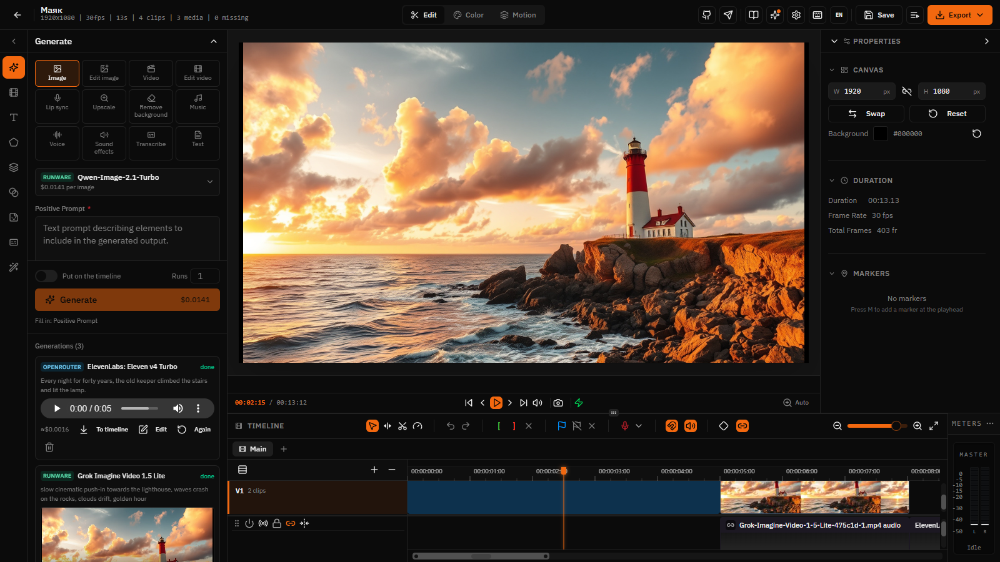

<div align="center">


# VideoSOS 2

**A desktop AI video studio: generate images, video, music, voices, sound effects and text with the best models of OpenRouter, fal and Runware, and cut them on a real multitrack timeline into a finished video. One native app (Rust + Tauri), your own keys, your files on your disk, and an MCP server so an AI agent can make the video with you.**

[](LICENSE)
[](https://github.com/timoncool/videosos/stargazers)
[](https://github.com/timoncool/videosos/releases)
[](https://github.com/timoncool/videosos/releases)
[](https://github.com/timoncool/videosos/commits)

**English** · [Русский](README.ru.md)



</div>

## What it is

**VideoSOS 2** puts AI generation and video editing into one window. On the left you pick what to make —
an image, an edit of an image, a video from text or from a frame, a lip-synced talking head, an upscale, a
removed background, music, a voice-over, sound effects, a transcript or a script — and a model of **OpenRouter,
fal or Runware**. The form is drawn from the model's own description, so every setting the model takes is
there, and the price is shown **before** you press Generate. The result lands in the project's media library
and, if you like, straight onto the timeline at the playhead.

The editor is a full NLE: multiple video and audio tracks, ripple/rolling/slip/slide trims, transitions,
keyframes with a Bezier graph, masks, blend modes, color grading with scopes, text and shapes, captions, and a
fast export to MP4, WebM, MOV or MKV that runs on your graphics card.

VideoSOS 1 was a web app in the browser. **Version 2 is a native desktop program**: one `.exe` with its server
written in Rust, projects and generations kept as plain files on your disk, jobs that survive a restart, and no
account of ours anywhere — you pay the providers directly with your own keys.

## Generate everything

| Task | What you get | Providers |
|---|---|---|
| Image | text to image | OpenRouter, fal, Runware |
| Edit image | image with references or a mask | OpenRouter, fal, Runware |
| Video | text to video, first frame, first and last frame, references | OpenRouter, fal, Runware |
| Edit video | video to video, extend, restyle | OpenRouter, fal, Runware |
| Lip sync | a face that speaks your audio | fal, Runware |
| Upscale | images and videos in higher resolution | fal, Runware, OpenRouter (video) |
| Remove background | transparent cut-outs | fal, Runware |
| Music | songs and scores | fal, Runware |
| Voice | text to speech in dozens of voices and languages | OpenRouter, fal, Runware |
| Sound effects | foley from text or from a video | fal, Runware |
| Transcribe | speech to text | OpenRouter, fal |
| Text | scripts, prompts, ideas — any LLM of OpenRouter | OpenRouter |

- **Live catalogues.** Models are read from the providers themselves — over a thousand, newest first, with each
  provider's price line; retiring models are marked. Nothing is hard-coded.
- **Price before you run.** Rates by second, resolution, sound and input images are worked out from the form; after
  the run the provider's own bill is recorded. Settings, Providers shows what you spent today and in total.
- **Files as inputs.** Drag a picture, a clip or a sound from the library — or a result of an earlier generation —
  into a slot: first frame, last frame, references, the video to lip-sync.
- **Never paid twice.** A job is saved before it is sent; after a restart a job that was sent is followed, not sent
  again. Results are downloaded at once, before the providers' links expire.
- **History.** Every run with its model, settings, price and files: run it again, load it back into the form, put it
  on the timeline.

## For AI agents

While VideoSOS is open it serves MCP at `http://127.0.0.1:8796/mcp`. An agent such as Claude Code, Claude Desktop,
Cursor or Codex can do what the window does: pick models and read their settings, estimate prices, generate, wait for
the results, read and edit the open project's timeline (each edit is an undoable step you see happen), import media,
move the playhead, take a picture of the window and export the video. Every action is shown in the window.

```bash
claude mcp add --transport http videosos http://127.0.0.1:8796/mcp
```

Other clients: `{ "mcpServers": { "videosos": { "type": "streamable-http", "url": "http://127.0.0.1:8796/mcp" } } }`.
The server serves its guide as the resource `videosos://skill` (prompt `videosos`) — the same text as
[docs/mcp-skill.md](docs/mcp-skill.md). Generations are paid: Settings, Providers and agent sets **a daily limit for
agents**, past which `generate` is refused. Only agents on this computer and the program's own window may connect;
provider keys are never shown to them.

## Quick start

1. Download `VideoSOS_2.0.0_x64-setup.exe` (or the portable zip) from the
   [latest release](https://github.com/timoncool/videosos/releases/latest) and run it.
2. Create a project, open the **Generate** tab on the left and paste a key of
   [OpenRouter](https://openrouter.ai/settings/keys), [fal](https://fal.ai/dashboard/keys) or
   [Runware](https://my.runware.ai/keys) when asked. One provider is enough to start.
3. Pick a task and a model, write what you want, press **Generate**.

## Requirements

- Windows 10/11 x64 with Microsoft Edge WebView2 (the installer gets it when missing).
- A graphics card with WebGPU (any recent NVIDIA, AMD or Intel) for the preview and the fast export.
- An internet connection for generation; editing and export work offline.

## Where your files are

Everything lives beside the program (or in `%LOCALAPPDATA%\VideoSOS` when that folder is read-only):
`data\workspace` — projects, media, thumbnails and exports; `data\generations` — the files of every generation;
`secrets` — provider keys; `data\videosos.db` — the generation history. Uninstalling keeps them unless you tick
*Delete the application data*.

## Anonymous statistics and news

The first-run screen has a switch **Send anonymous statistics**; the same switch is in Settings, Providers and agent.
While it is on, the program sends once a day: a random install id, the version, the OS and the window language, how
many generations finished or failed by task, and which models ran. Never prompts, files, keys or anything personal.
`DO_NOT_TRACK=1` or `STUDIO_TELEMETRY=0` turns it off entirely.

## How it is built

- `crates/vs-providers` — OpenRouter, fal and Runware brought to one contract: catalogue, form from the model's
  JSON Schema, a price rule, jobs that end in files. Runware tasks are checked against the model's schema before they
  are sent, so a wrong setting costs nothing.
- `crates/vs-server` — axum on 127.0.0.1: the editor's workspace on disk, the job queue in SQLite, keys, spend, the
  MCP server and its bridge to the window.
- `frontend` — the editor window: a fork of [FreeCut](https://github.com/walterlow/freecut) (MIT) kept as a git
  subtree, with its storage moved to the server and the generation panel, settings and agent bridge added.
- `desktop` — the Tauri shell: one process, the server inside it, updates from GitHub releases.

## More portable AI apps

| Project | What it is |
|--------|----------|
| [Dub Studio](https://github.com/timoncool/dub-studio) | Offline AI video dubbing with a cloned voice |
| [YuE2 Studio](https://github.com/timoncool/YuE2-Studio) | AI song generator with an editable score |
| [MiniMax Music3 Studio](https://github.com/timoncool/MiniMax-Music3-Studio) | Local and cloud AI music studio |
| [ACE-Step Studio](https://github.com/timoncool/ACE-Step-Studio) | AI music studio — songs, vocals, covers, clips |
| [Higgs Ultimate](https://github.com/timoncool/Higgs-Ultimate) | Native speech synthesis and voice cloning |

## Authors

- **Nerual Dreming** — [Telegram](https://t.me/nerual_dreming) | [neuro-cartel.com](https://neuro-cartel.com) | founder of [ArtGeneration.me](https://artgeneration.me)
- **Neuro-Soft** — [Telegram](https://t.me/neuroport) | portable AI apps

## Credits

- **[FreeCut](https://github.com/walterlow/freecut)** by Walter Low — the editor this window is built on (MIT).
- **[OpenRouter](https://openrouter.ai)**, **[fal](https://fal.ai)** and **[Runware](https://runware.ai)** — the
  providers, and the model makers behind them.
- **[mediabunny](https://github.com/Vanilagy/mediabunny)**, **[Tauri](https://tauri.app)**, **[axum](https://github.com/tokio-rs/axum)**,
  **[jsonschema](https://github.com/Stranger6667/jsonschema)**, **[lucide](https://lucide.dev)**.
- VideoSOS 1 started as a fork of the **[fal AI Video Starter Kit](https://github.com/fal-ai-community/video-starter-kit)**.

## Support the author

I build open-source software and do AI research — most of what I make is freely available. Donations let me build and research more.

**[All the ways to support](DONATE.md)** | **[dalink.to/nerual_dreming](https://dalink.to/nerual_dreming)** | **[boosty.to/neuro_art](https://boosty.to/neuro_art)**

- **BTC:** `1E7dHL22RpyhJGVpcvKdbyZgksSYkYeEBC`
- **ETH (ERC20):** `0xb5db65adf478983186d4897ba92fe2c25c594a0c`
- **USDT (TRC20):** `TQST9Lp2TjK6FiVkn4fwfGUee7NmkxEE7C`

## Star history

<a href="https://github.com/timoncool/videosos/stargazers">
 <picture>
   <source media="(prefers-color-scheme: dark)" srcset="docs/stars-dark.svg" />
   <source media="(prefers-color-scheme: light)" srcset="docs/stars-light.svg" />
   
 </picture>
</a>

## License

The code is [MIT](LICENSE); the editor window is based on FreeCut (MIT). What you generate is governed by the terms of
the provider and the model you used — read them before you publish or sell.
