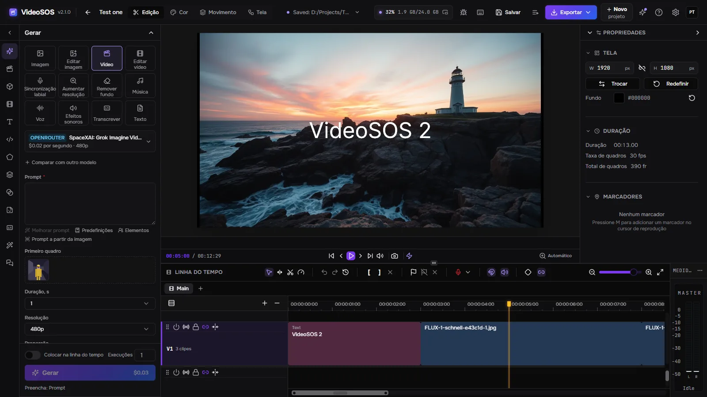
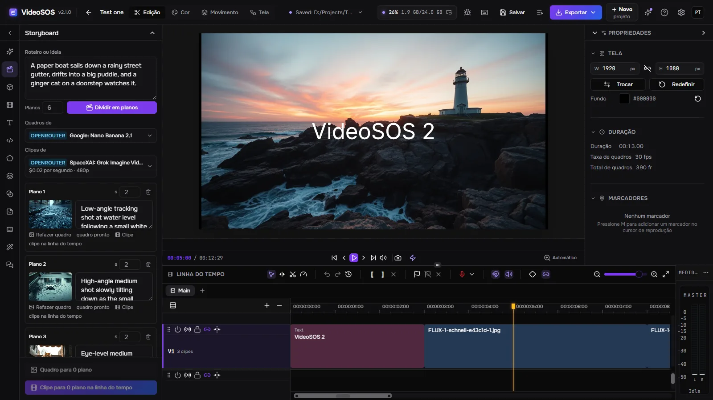
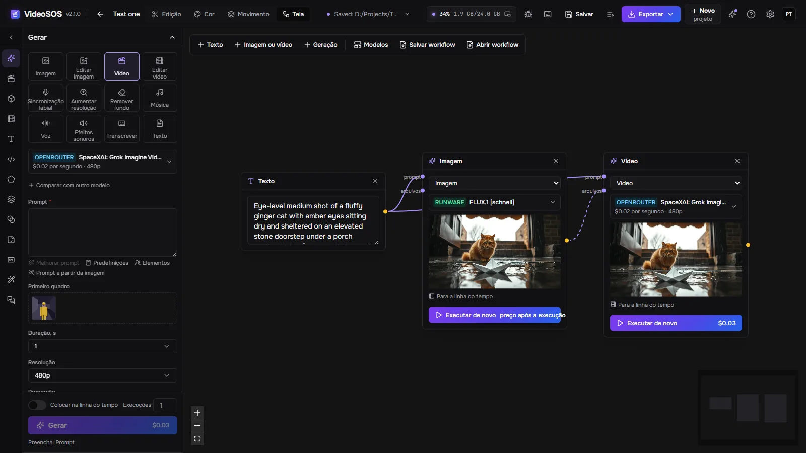
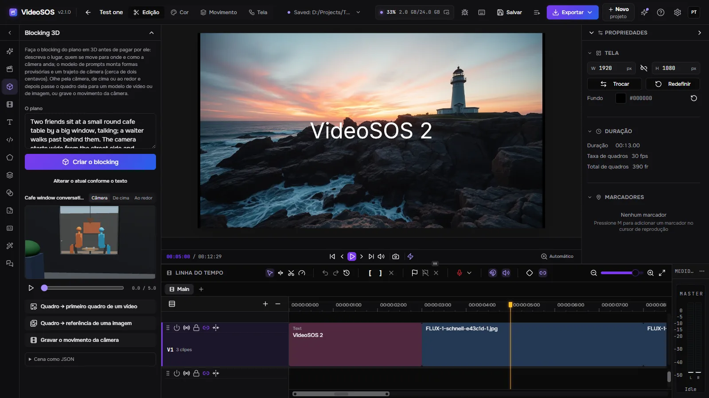
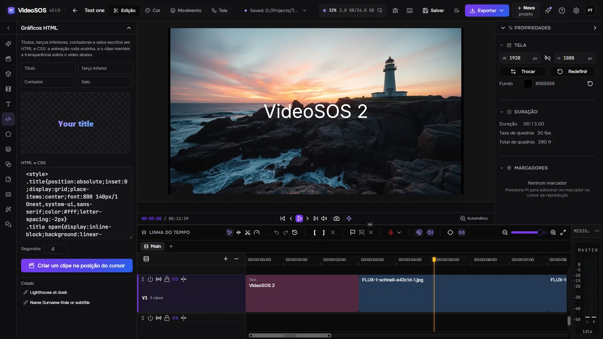

<div align="center">


# VideoSOS 2

**Um estúdio de vídeo com IA para desktop: gere imagens, vídeo, música, vozes, efeitos sonoros e texto com os melhores modelos da OpenRouter, da fal e da Runware ou de graça na sua própria placa de vídeo, planeje o filme em um storyboard, em uma tela de nós e em um blocking 3D, e monte tudo em uma linha do tempo multipista de verdade até chegar a um vídeo pronto. Um único aplicativo nativo (Rust + Tauri) para Windows, Linux e macOS, com as suas próprias chaves, os seus arquivos no seu disco e um servidor MCP para que um agente de IA faça o vídeo com você.**

[](LICENSE)
[](https://github.com/timoncool/videosos/stargazers)
[](https://github.com/timoncool/videosos/releases)
[](https://github.com/timoncool/videosos/releases)
[](https://github.com/timoncool/videosos/commits)

[English](README.md) · [Русский](README.ru.md) · [中文](README.zh.md) · [Español](README.es.md) · [Français](README.fr.md) · **Português**

### 🌐 [Site com todas as telas →](https://timoncool.github.io/videosos/pt.html)



</div>

## O que é

O **VideoSOS 2** reúne a geração com IA e a edição de vídeo em uma só janela. À esquerda você escolhe o que fazer —
uma imagem, a edição de uma imagem, um vídeo a partir de texto ou de um quadro, um busto falante com sincronização labial, um aumento de resolução, um
fundo removido, música, uma locução, efeitos sonoros, uma transcrição ou um roteiro — e um modelo da **OpenRouter,
da fal ou da Runware**. O formulário é montado a partir da própria descrição do modelo, então todos os ajustes que o modelo aceita
estão ali, e o preço aparece **antes** de você apertar Gerar. O resultado vai para a biblioteca de mídia do projeto
e, se você quiser, direto para a linha do tempo, na posição do cursor de reprodução.

O editor é um NLE completo: várias trilhas de vídeo e de áudio, cortes ripple, rolling, slip e slide, transições,
quadros-chave com gráfico de Bézier, máscaras, modos de mesclagem, gradação de cor com scopes, texto e formas, legendas e uma
exportação rápida para MP4, WebM, MOV ou MKV que roda na sua placa de vídeo — ou um FCPXML para Final Cut, DaVinci
Resolve e Premiere. O volume da exportação pode ser levado a −14, −16 ou −23 LUFS, e as legendas da transcrição aparecem inteiras, palavra por palavra ou como karaokê.

O VideoSOS 1 era um aplicativo web no navegador. **A versão 2 é um programa nativo para desktop**: o servidor é escrito em Rust,
os projetos e as gerações ficam guardados como arquivos comuns no seu disco, as tarefas sobrevivem a uma reinicialização e não existe nenhuma conta nossa
em lugar nenhum — você paga aos provedores diretamente, com as suas próprias chaves. A janela fala dez idiomas.

## Gere tudo

| Tarefa | O que você obtém | Provedores |
|---|---|---|
| Imagem | de texto para imagem | OpenRouter, fal, Runware |
| Editar imagem | imagem com referências ou uma máscara | OpenRouter, fal, Runware |
| Vídeo | de texto para vídeo, primeiro quadro, primeiro e último quadro, referências | OpenRouter, fal, Runware |
| Editar vídeo | de vídeo para vídeo, estender, mudar de estilo | OpenRouter, fal, Runware |
| Sincronização labial | um rosto que fala o seu áudio | fal, Runware |
| Aumentar resolução | imagens e vídeos em resolução maior | fal, Runware, OpenRouter (vídeo) |
| Remover fundo | recortes transparentes | fal, Runware |
| Música | canções e trilhas sonoras | fal, Runware |
| Voz | de texto para fala, em dezenas de vozes e idiomas | OpenRouter, fal, Runware |
| Efeitos sonoros | foley a partir de texto ou de um vídeo | fal, Runware |
| Transcrever | de fala para texto | OpenRouter, fal |
| Texto | roteiros, prompts, ideias — qualquer LLM da OpenRouter | OpenRouter |

- **Catálogos ao vivo.** Os modelos são lidos dos próprios provedores — mais de mil, os mais novos primeiro, com aquilo em que cada um
  é bom, o seu preço e o seu tempo habitual no seu computador; os favoritos ficam no topo e os modelos em desativação aparecem marcados.
- **Preço antes de executar.** As tarifas por segundo, resolução, som e imagens de entrada são calculadas a partir do formulário; depois
  da execução, registra-se a cobrança do próprio provedor. Configurações, Provedores mostra o que você gastou hoje e no total.
- **Compare modelos em uma só execução.** O mesmo prompt vai para até mais dois modelos, e os resultados ficam lado a lado.
- **Arquivos como entradas.** Arraste uma imagem, um clipe ou um som da biblioteca — ou o resultado de uma geração anterior —
  para um espaço: primeiro quadro, último quadro, referências, o vídeo a sincronizar com os lábios. **Continuar a partir do último quadro** começa o
  próximo clipe onde o anterior termina.
- **Elementos.** Um personagem, um objeto ou um lugar guardado com um nome e as suas imagens: `@nome` em um prompt envia as imagens
  dele ao modelo como referências, de modo que o mesmo rosto volta plano após plano.
- **Prompts com ajuda.** Predefinições, `{{variáveis}}` preenchidas quando a tarefa é enviada, um prompt melhorado por um modelo
  de linguagem, um prompt escrito a partir de uma imagem e uma verificação do limite do modelo antes de pagar qualquer coisa.
- **Nunca pago duas vezes.** Uma tarefa é salva antes de ser enviada; depois de uma reinicialização, uma tarefa que já foi enviada é acompanhada, não enviada
  de novo. Os resultados são baixados na hora, antes de os links dos provedores expirarem, e recebem nome e etiquetas a partir do prompt.
- **Vídeos pelos seus links.** Um link do YouTube, qualquer site que o yt-dlp conheça ou um arquivo direto entra na biblioteca com
  progresso, cancelamento e retomada.
- **Gerar sem parar.** As execuções se repetem com novas sementes até você pará-las ou uma falhar.
- **Quanto uma chave gastou.** A verificação da chave mostra o gasto e o limite da OpenRouter e o saldo da Runware.

## Gerar neste computador

Sem chave e sem conta: o provedor **Local** fica ao lado dos da nuvem (por enquanto no Windows).

| Modelo | O que faz | Aceleradores |
|---|---|---|
| Qwen-Image 2.1 | imagens | Turbo 8 passos, LightX2V Lightning 4, Viggle Turbo 6 |
| MiniMax-H3 | vídeo com o próprio som, a partir de um prompt ou de um primeiro quadro | LightX2V Turbo 8 e 4 passos |
| LTX-2.5 | vídeo com som, duas passadas com o upscaler ×2 da Lightricks | destilado, 8 passos |

- **stable-diffusion.cpp** os executa em CUDA, Vulkan ou no processador; Automático escolhe a placa. Só são usados
  pesos quantizados (GGUF Q4, int8).
- **Configurações → Modelos locais** baixa cada modelo e o seu motor uma única vez, com versão fixada, verificação
  SHA-256 e retomada. Um arquivo que outro programa do autor já tem é obtido dele (um link físico no mesmo disco) em vez
  de baixado, e a linha do modelo diz de onde veio.
- **Os estúdios de música do autor.** Enquanto [YuE2 Studio](https://github.com/timoncool/YuE2-Studio), [MiniMax Music3 Studio](https://github.com/timoncool/MiniMax-Music3-Studio) ou [ACE-Step Studio](https://github.com/timoncool/ACE-Step-Studio) estiver aberto, ele aparece em Música com o seu
  próprio formulário; o estúdio faz a música, e o arquivo chega à biblioteca com as suas tags.
- **Os modelos próprios da janela** rodam na janela: Parakeet Ultra (int8) e Whisper Large v3 Turbo (Q8) para
  transcrições, Gemma 4 E4B para descrever cenas e conferir cortes.

## Planeje o filme

| | |
|---|---|
|  | **Storyboard.** Um modelo de linguagem divide um roteiro em planos; cada plano recebe um quadro de um modelo de imagem e um clipe de um modelo de vídeo que começa nesse quadro, e os clipes vão para a linha do tempo um após o outro. Os quadros baratos são aprovados antes do vídeo pago. |
|  | **Tela de nós.** Texto, imagens, vídeos e gerações são nós ligados pelo que passam adiante — um prompt para uma imagem, a imagem para um vídeo. Os **modelos de workflow** colocam uma cadeia pronta na tela de uma só vez (quadro para vídeo, comparação de modelos, foto de produto, busto falante e mais); uma tela é salva como arquivo de workflow para ser repassada. |
|  | **Blocking 3D.** Descreva o plano e o modelo de prompts o monta com formas provisórias, pessoas em pé e sentadas, os movimentos delas e o trajeto da câmera. Olhe pela câmera, de cima ou ao redor, e depois passe o quadro dela a um modelo de vídeo como primeiro quadro ou grave o movimento da câmera — antes que um centavo vá para o vídeo. |
|  | **Gráficos HTML.** Títulos, terços inferiores, contadores e selos escritos em HTML e CSS, com prévia ao vivo, transformados em um clipe com transparência que fica sobre o vídeo no cursor de reprodução. |

Na própria linha do tempo: uma execução colocada na linha do tempo é desenhada onde vai ficar enquanto é executada, e **uma parte de qualquer
clipe pode ser gerada de novo** — a parte é recortada, enviada a um modelo de edição de vídeo, e a nova tomada fica por cima dela.

## Para agentes de IA

Enquanto o VideoSOS está aberto, ele serve MCP em `http://127.0.0.1:8796/mcp`. Um agente como Claude Code, Claude Desktop,
Cursor ou Codex pode fazer o que a janela faz: escolher modelos e ler os ajustes deles, estimar preços, gerar, esperar
os resultados, ler e editar a linha do tempo do projeto aberto (cada edição é um passo que pode ser desfeito e que você vê acontecer), montar um plano
em blocking 3D, criar gráficos HTML, importar mídia, mover o cursor de reprodução, tirar uma captura da janela e exportar o vídeo. Cada ação
é legendada na janela e registrada no diário de atividades.

```bash
claude mcp add --transport http videosos http://127.0.0.1:8796/mcp
```

Outros clientes: `{ "mcpServers": { "videosos": { "type": "streamable-http", "url": "http://127.0.0.1:8796/mcp" } } }`.
O servidor oferece o seu guia como o recurso `videosos://skill` (prompt `videosos`) — o mesmo texto de
[docs/mcp-skill.md](docs/mcp-skill.md).

- **Pontos de restauração.** A linha do tempo é guardada antes de cada edição de um agente; o botão Pontos de restauração, ao lado de desfazer
  e refazer, traz de volta qualquer um deles. Um agente pode ensaiar uma edição (`dry_run`) e ver o que ela faria sem tocar em nada.
- **Propostas.** Com *As edições do agente na linha do tempo esperam por mim* ativado em Configurações, Agentes, a edição de um agente é mostrada em palavras simples
  e só é aplicada depois que você apertar Aceitar.
- **Um limite de gastos.** As gerações são pagas: Configurações, Agentes define um limite diário para os agentes, e acima dele
  `generate` é recusado. Só podem se conectar os agentes deste computador e a própria janela do programa; as chaves dos provedores nunca
  são mostradas a eles.
- **Chat na janela.** A aba Chat executa um modelo da OpenRouter à sua escolha com as mesmas ferramentas, passo a passo, com
  o custo de cada passo e um botão Parar.
- **O agente conectado como assistente da janela**, como no YuE2 Studio: com Configurações → Agentes no agente MCP,
  melhorar um prompt, um prompt a partir de uma imagem, o storyboard, o blocking e o chat vão para o agente, sem chave e
  sem custo. Os guias de escrita são servidos como os recursos `videosos://guide/prompt`, `picture` e `storyboard`.

## Capturas de tela

O espaço de edição com o painel de geração, a tela de nós com uma cadeia de verdade, o storyboard, o blocking 3D e os
gráficos HTML — todas as telas, em oito idiomas, estão no [site](https://timoncool.github.io/videosos/pt.html).

| | |
|---|---|
|  |  |
|  |  |

## Início rápido

1. Baixe a [versão mais recente](https://github.com/timoncool/videosos/releases/latest): `VideoSOS_<version>_x64-setup.exe`
   (ou o `.msi`, ou o `VideoSOS-<version>-portable-windows-x64.zip` portátil) para Windows, o `.AppImage` ou o `.deb`
   para Linux, o `.dmg` para macOS em Apple Silicon.
2. Crie um projeto, abra a aba **Gerar** à esquerda e cole uma chave da
   [OpenRouter](https://openrouter.ai/settings/keys), da [fal](https://fal.ai/dashboard/keys) ou da
   [Runware](https://my.runware.ai/keys) quando for solicitado. Um provedor basta para começar.
3. Escolha uma tarefa e um modelo, escreva o que você quer e aperte **Gerar**.

O que mudou e quando está em [CHANGELOG.md](CHANGELOG.md), e o botão de brilhos no alto da janela mostra isso.
Regras para colaboradores e agentes de programação: [AGENTS.md](AGENTS.md).

## Requisitos

- **Windows** 10/11 x64 com Microsoft Edge WebView2 (o instalador o obtém quando falta).
- **Linux** x86-64 (experimental): o `.deb` ou o AppImage, com WebKitGTK e GStreamer do sistema.
- **macOS** 13 ou mais recente em Apple Silicon (experimental).
- Uma placa de vídeo com WebGPU (qualquer NVIDIA, AMD ou Intel recente) para a prévia e a exportação rápida.
- Uma conexão com a internet para gerar na nuvem; a geração local, a edição e a exportação funcionam offline.
  Os modelos de vídeo locais foram conferidos numa placa de 24 GB.

Configurações, Rede tem um proxy para os provedores e os downloads, e **Acesso pela rede**: desativado por padrão; ativado,
um navegador em outro computador ou em um celular abre a mesma interface com uma chave de acesso, enquanto tudo roda aqui.

## Tudo o que o aplicativo baixa

O programa traz o que precisa para editar e gerar na nuvem. O resto só é baixado quando você pede, de onde é publicado, e
cada arquivo é conferido com o tamanho e o SHA-256 fixados antes de ser usado: yt-dlp, Deno e ffmpeg na primeira vez
que você importa um vídeo pelo link (depois disso o yt-dlp se atualiza sozinho uma vez por dia), e o motor
stable-diffusion.cpp e os modelos locais quando você os baixa em Configurações → Modelos locais. No Linux as ferramentas
vêm nas suas versões para Linux; no macOS a importação por link ainda não está disponível; a geração local por enquanto
é só no Windows.

Os modelos próprios da janela são baixados do Hugging Face na primeira vez que a sua função é usada e guardados no cache
da janela (Configurações → Armazenamento os apaga): Parakeet Ultra int8 e Whisper Large v3 Turbo Q8 para transcrições,
Gemma 4 E4B para descrever cenas, CLIP, MiniLM e CLAP para a busca e as palavras de preenchimento, RIFE para a
interpolação de quadros.

<!-- downloads:start -->
| Ferramenta | Para quê | Arquivo (link direto) | Tamanho | Para onde vai |
|---|---|---|---|---|
| yt-dlp + Deno | importar um vídeo pelo link | [yt-dlp.exe](https://github.com/yt-dlp/yt-dlp/releases/download/2026.08.19/yt-dlp.exe) | 17.8 MB | `data\tools\yt-dlp\` (como está) |
|  |  | [deno-x86_64-pc-windows-msvc.zip](https://github.com/denoland/deno/releases/download/v2.9.7/deno-x86_64-pc-windows-msvc.zip) | 42.6 MB | `data\tools\yt-dlp\` (descompactado) |
| ffmpeg | juntar a imagem e o som de um vídeo por link | [ffmpeg-N-126342-gf88b741dbf-win64-gpl.zip](https://github.com/BtbN/FFmpeg-Builds/releases/download/autobuild-2026-08-31-13-27/ffmpeg-N-126342-gf88b741dbf-win64-gpl.zip) | 170.7 MB | `data\tools\ffmpeg\` (ffmpeg.exe e ffprobe.exe do arquivo) |
| stable-diffusion.cpp CUDA 12 | geração local em placas NVIDIA | [sd-master-1d0a58a-bin-win-cuda12-x64.zip](https://github.com/leejet/stable-diffusion.cpp/releases/download/master-964-1d0a58a/sd-master-1d0a58a-bin-win-cuda12-x64.zip)<br>[cudart-sd-bin-win-cu12-x64.zip](https://github.com/leejet/stable-diffusion.cpp/releases/download/master-964-1d0a58a/cudart-sd-bin-win-cu12-x64.zip) | 901.5 MB | `data\tools\sd\cuda12\` (descompactado) |
| stable-diffusion.cpp Vulkan | geração local em outras placas | [sd-master-1d0a58a-bin-win-vulkan-x64.zip](https://github.com/leejet/stable-diffusion.cpp/releases/download/master-964-1d0a58a/sd-master-1d0a58a-bin-win-vulkan-x64.zip) | 30.2 MB | `data\tools\sd\vulkan\` (descompactado) |
| stable-diffusion.cpp CPU | geração local sem placa de vídeo | [sd-master-1d0a58a-bin-win-cpu-x64.zip](https://github.com/leejet/stable-diffusion.cpp/releases/download/master-964-1d0a58a/sd-master-1d0a58a-bin-win-cpu-x64.zip) | 17.6 MB | `data\tools\sd\cpu\` (descompactado) |
| Qwen-Image 2.1 | imagens neste computador, opcional | [Qwen3VL-8B-Instruct-Q4_K_M.gguf](https://huggingface.co/Qwen/Qwen3-VL-8B-Instruct-GGUF/resolve/f982a07559d4a2f6c8744d840bf6fccab30eea96/Qwen3VL-8B-Instruct-Q4_K_M.gguf) → `data\models\qwen-image-2.1\Qwen3VL-8B-Instruct-Q4_K_M.gguf`<br>[qwen_image_2.1_vae_bf16.safetensors](https://huggingface.co/Comfy-Org/Qwen-Image-2.1/resolve/a8342359c61979b06a8dafb1a47991fe1f30e994/vae/qwen_image_2.1_vae_bf16.safetensors) → `data\models\qwen-image-2.1\qwen_image_2.1_vae_bf16.safetensors`<br>[qwen-image-2.1-turbo-Q4_K_M.gguf](https://huggingface.co/unsloth/Qwen-Image-2.1-Turbo-GGUF/resolve/5d1f9f759ea877ae556cda88dbec958b62ad3809/qwen-image-2.1-turbo-Q4_K_M.gguf) → `data\models\qwen-image-2.1\qwen-image-2.1-turbo-Q4_K_M.gguf`<br>[pytorch_lora_weights.safetensors](https://huggingface.co/lightx2v/Qwen-Image-2.1-Lightning/resolve/6b0a1176327c01522a44276c5da67331a025b6fc/pytorch_lora_weights.safetensors) → `data\models\qwen-image-2.1\loras\qwen-image-2.1-lightning-4step.safetensors`<br>[Qwen-Image-2.1-viggle-turbo-v0.3-6step-lora-r256.safetensors](https://huggingface.co/Viggle/Qwen-Image-2.1-viggle-turbo/resolve/009a44a895ef85f7e643c80fdca9543795248867/Qwen-Image-2.1-viggle-turbo-v0.3-6step-lora-r256.safetensors) → `data\models\qwen-image-2.1\loras\qwen-image-2.1-viggle-turbo-v0.3-6step-lora-r256.safetensors`<br>[qwen-image-2.1-Q4_K_M.gguf](https://huggingface.co/unsloth/Qwen-Image-2.1-GGUF/resolve/2c31ccd392b367a6637841a143813320a02dff55/qwen-image-2.1-Q4_K_M.gguf) → `data\models\qwen-image-2.1\qwen-image-2.1-Q4_K_M.gguf` | 15.5 GB | como está, no caminho após a seta |
| MiniMax-H3 | vídeo com som neste computador, opcional | [minimax_h3_fl2va_pruned-Q4_K.gguf](https://huggingface.co/unsloth/MiniMax-H3-GGUF/resolve/d629413c2e5b51b38c453668b75ca3b06ca92703/minimax_h3_fl2va_pruned-Q4_K.gguf) → `data\models\minimax-h3\minimax_h3_fl2va_pruned-Q4_K.gguf`<br>[qwen3vl_32b_minimax_h3-Q4_K_M.gguf](https://huggingface.co/unsloth/MiniMax-H3-GGUF/resolve/d629413c2e5b51b38c453668b75ca3b06ca92703/qwen3vl_32b_minimax_h3-Q4_K_M.gguf) → `data\models\minimax-h3\qwen3vl_32b_minimax_h3-Q4_K_M.gguf`<br>[minimax_h3_video_vae_fp16.safetensors](https://huggingface.co/unsloth/MiniMax-H3-GGUF/resolve/d629413c2e5b51b38c453668b75ca3b06ca92703/vae/minimax_h3_video_vae_fp16.safetensors) → `data\models\minimax-h3\minimax_h3_video_vae_fp16.safetensors`<br>[minimax_h3_audio_vae_fp32.safetensors](https://huggingface.co/unsloth/MiniMax-H3-GGUF/resolve/d629413c2e5b51b38c453668b75ca3b06ca92703/vae/minimax_h3_audio_vae_fp32.safetensors) → `data\models\minimax-h3\minimax_h3_audio_vae_fp32.safetensors`<br>[minimax_h3_fl2v_turbo_8step_v1.0_768p_comfyui_bf16.safetensors](https://huggingface.co/lightx2v/Minimax-h3-Turbo/resolve/3ec17a324ced54151364f24f8b5fb6bf7e26414f/minimax_h3_fl2v_turbo_8step_v1.0_768p_comfyui_bf16.safetensors) → `data\models\minimax-h3\loras\minimax_h3_fl2v_turbo_8step_v1.0_768p_comfyui_bf16.safetensors`<br>[minimax_h3_fl2v_turbo_4step_v1.2_768p_comfyui_bf16.safetensors](https://huggingface.co/lightx2v/Minimax-h3-Turbo/resolve/3ec17a324ced54151364f24f8b5fb6bf7e26414f/minimax_h3_fl2v_turbo_4step_v1.2_768p_comfyui_bf16.safetensors) → `data\models\minimax-h3\loras\minimax_h3_fl2v_turbo_4step_v1.2_768p_comfyui_bf16.safetensors` | 39.4 GB | como está, no caminho após a seta |
| LTX-2.5 | vídeo com som neste computador, opcional | [ltx-2.5-22b-distilled-Q4_K_M.gguf](https://huggingface.co/unsloth/LTX-2.5-GGUF/resolve/6eae90030f7f15460a0ecf9ab16445d676b2bbb6/distilled/ltx-2.5-22b-distilled-Q4_K_M.gguf) → `data\models\ltx-2.5\ltx-2.5-22b-distilled-Q4_K_M.gguf`<br>[gemma4-12b-with-proj-ltx-2.5-comfy-int8-convrot.safetensors](https://huggingface.co/PulpCut/LTX-2.5-INT8-ConvRot-safetensors/resolve/7597fb305b4cab9e7ff2c1d1e9551279c2932f0f/text_encoders/gemma4-12b-with-proj-ltx-2.5-comfy-int8-convrot.safetensors) → `data\models\ltx-2.5\gemma4-12b-with-proj-ltx-2.5-comfy-int8-convrot.safetensors`<br>[ltx-2.5-video-vae-conv-bf16.safetensors](https://huggingface.co/comfyicu/LTX-2.5/resolve/1026e00f808dbd9601911479b22d65b760737dc8/vae/ltx-2.5-video-vae-conv-bf16.safetensors) → `data\models\ltx-2.5\ltx-2.5-video-vae-conv-bf16.safetensors`<br>[ltx-2.5-audio-vae-bf16.safetensors](https://huggingface.co/comfyicu/LTX-2.5/resolve/1026e00f808dbd9601911479b22d65b760737dc8/vae/ltx-2.5-audio-vae-bf16.safetensors) → `data\models\ltx-2.5\ltx-2.5-audio-vae-bf16.safetensors`<br>[ltx-2.5-latent-spatial-upscaler-x2-bf16-1.0.safetensors](https://huggingface.co/comfyicu/LTX-2.5/resolve/1026e00f808dbd9601911479b22d65b760737dc8/latent_upscale_models/ltx-2.5-latent-spatial-upscaler-x2-bf16-1.0.safetensors) → `data\models\ltx-2.5\ltx-2.5-latent-spatial-upscaler-x2-bf16-1.0.safetensors` | 31.8 GB | como está, no caminho após a seta |
<!-- downloads:end -->

## Onde ficam os seus arquivos

No Windows, tudo fica ao lado do programa (ou em `%LOCALAPPDATA%\VideoSOS` quando essa pasta é somente leitura); no Linux
em `~/.local/share/videosos` (`$XDG_DATA_HOME`), no macOS em `~/Library/Application Support/VideoSOS`.
`data\workspace` — projetos, mídia, miniaturas e exportações; `data\generations` — os arquivos de cada geração;
`secrets` — chaves dos provedores; `data\videosos.db` — o histórico de gerações. A desinstalação os mantém, a menos que você marque
*Delete the application data*.

## Solução de problemas

**O instalador para no WebView2.** A janela roda no Microsoft Edge WebView2, e o instalador o obtém quando
o Windows não o tem. Em uma conexão bloqueada, essa obtenção falha: instale o WebView2 pelo instalador independente da Microsoft,
[Evergreen Standalone x64](https://go.microsoft.com/fwlink/p/?LinkId=2124701), e execute o instalador do VideoSOS de novo.

**Uma geração falha.** O cartão diz que tipo de falha foi; *Texto do erro* mostra as palavras do próprio provedor, e uma
chave ausente ou recusada abre Configurações, Provedores. Uma tarefa que já foi enviada nunca é reenviada sozinha: aperte *Repetir* no cartão dela
quando quiser tentar outra vez.

**Um vídeo pelo link para em "confirme que você não é um robô".** O site quer um navegador com login feito: exporte
`cookies.txt` de um navegador em que você entrou no site e adicione-o na caixa de diálogo do link (Adicionar cookies.txt).

**Uma edição de vídeo da OpenRouter recusa um arquivo deste computador.** A OpenRouter só aceita vídeos de origem por um link `https`;
use um modelo de edição de vídeo da fal ou da Runware para um arquivo local, ou um vídeo colocado a partir de um link.

**A prévia ou a exportação está lenta ou não inicia.** Ambas rodam no WebGPU e no codificador de vídeo da placa de vídeo.
Atualize o driver gráfico; quando a placa não consegue codificar os ajustes escolhidos, a caixa de diálogo de exportação avisa — escolha outro
codec ou contêiner.

## Estatísticas anônimas e novidades

A tela da primeira execução tem um interruptor **Enviar estatísticas anônimas**; o mesmo interruptor está em Configurações, Privacidade.
Enquanto estiver ativado, o programa envia uma vez por dia: um id de instalação aleatório, a versão, o sistema operacional e o idioma da janela, quantas
gerações terminaram ou falharam por tarefa e quais modelos foram executados. Nunca prompts, arquivos, chaves nem nada pessoal.
`DO_NOT_TRACK=1` ou `STUDIO_TELEMETRY=0` desativa tudo por completo.

## Como é construído

- `crates/vs-providers` — OpenRouter, fal e Runware reduzidas a um só contrato: catálogo, formulário a partir do
  JSON Schema do modelo, uma regra de preço, tarefas que terminam em arquivos. As tarefas da Runware são conferidas com o esquema do modelo antes de
  serem enviadas, então um ajuste errado não custa nada.
- `crates/vs-server` — axum em 127.0.0.1: o espaço de trabalho do editor em disco, a fila de tarefas em SQLite, chaves, gastos,
  pontos de restauração, a importação por link, o servidor MCP e a sua ponte com a janela.
- `frontend` — a janela do editor: um fork do [FreeCut](https://github.com/walterlow/freecut) (MIT) mantido como git
  subtree, com o armazenamento movido para o servidor e com o painel de geração, o storyboard, a tela, o blocking 3D, os gráficos
  HTML, as configurações e a ponte de agentes adicionados.
- `desktop` — a casca do Tauri: um só processo, com o servidor dentro, e atualizações a partir das versões do GitHub.

### Compilar a partir do código-fonte

```bash
git clone https://github.com/timoncool/videosos.git
cd videosos

npm --prefix frontend ci && npm --prefix frontend run build   # 1) a janela
npm --prefix desktop ci && npm --prefix desktop run build     # 2) o programa, com o servidor dentro
```

São necessários Node 20+ e Rust (a versão está fixada em `rust-toolchain.toml`; MSVC no Windows). O programa fica em
`desktop/src-tauri/target/release` e encontra a sua janela no repositório. `cargo run -p vs-server` inicia só o servidor,
para um navegador em `http://127.0.0.1:8796`. Os instaladores e pacotes são gerados por `scripts/build-release.ps1` (Windows), `scripts/build-release-linux.sh` no Docker (Linux) e
`scripts/build-release-macos.sh` (macOS).

### Linux e macOS (experimental)

O `.deb`, o AppImage e o `.dmg` saem do mesmo código. O servidor e a janela foram verificados no Linux em um
navegador — um projeto criado, salvo e exportado para o disco do Linux — mas o autor trabalha no Windows e não executou as
janelas de desktop em um Linux ou Mac de verdade. **Se você vive no Linux ou no macOS, seria ótimo se você os aprimorasse e
enviasse as correções em um pull request.** A versão do macOS é assinada ad hoc e não notarizada, então o macOS pede que você permita a primeira execução em Ajustes do Sistema,
Privacidade e Segurança.

## Mais aplicativos portáteis de IA

| Projeto | O que é |
|--------|----------|
| [Dub Studio](https://github.com/timoncool/dub-studio) | Dublagem de vídeo com IA offline, com uma voz clonada |
| [YuE2 Studio](https://github.com/timoncool/YuE2-Studio) | Gerador de canções com IA com partitura editável |
| [MiniMax Music3 Studio](https://github.com/timoncool/MiniMax-Music3-Studio) | Estúdio de música com IA, local e na nuvem |
| [ACE-Step Studio](https://github.com/timoncool/ACE-Step-Studio) | Estúdio de música com IA — canções, vocais, covers, clipes |
| [Higgs Ultimate](https://github.com/timoncool/Higgs-Ultimate) | Síntese de fala nativa e clonagem de voz |

## Autores

- **Nerual Dreming** — [Telegram](https://t.me/nerual_dreming) | [neuro-cartel.com](https://neuro-cartel.com) | fundador da [ArtGeneration.me](https://artgeneration.me)
- **Neuro-Soft** — [Telegram](https://t.me/neuroport) | aplicativos portáteis de IA

## Créditos

- **[FreeCut](https://github.com/walterlow/freecut)**, de Walter Low — o editor sobre o qual esta janela é construída (MIT).
- **[OpenRouter](https://openrouter.ai)**, **[fal](https://fal.ai)** e **[Runware](https://runware.ai)** — os
  provedores, e os criadores de modelos que estão por trás deles.
- **[mediabunny](https://github.com/Vanilagy/mediabunny)**, **[three.js](https://threejs.org)**,
  **[React Flow](https://reactflow.dev)**, **[modern-screenshot](https://github.com/qq15725/modern-screenshot)**,
  **[Tauri](https://tauri.app)**, **[axum](https://github.com/tokio-rs/axum)**,
  **[jsonschema](https://github.com/Stranger6667/jsonschema)**, **[yt-dlp](https://github.com/yt-dlp/yt-dlp)**,
  **[FFmpeg](https://ffmpeg.org)**, **[lucide](https://lucide.dev)**.
- Ideias tiradas do LTX Studio (storyboard), do Weave e do Flora (tela e modelos), do AIMovieStudio (previsualização), do WeftCut
  (motion graphics, pontos de restauração), do OpenChatCut (propostas), do Kling (elementos) e do Descript (FCPXML).
- O VideoSOS 1 começou como um fork do **[fal AI Video Starter Kit](https://github.com/fal-ai-community/video-starter-kit)**.

## Apoie o autor

Eu crio software de código aberto e faço pesquisa em IA — quase tudo o que faço está disponível gratuitamente. As doações me permitem desenvolver e pesquisar mais.

**[Todas as formas de apoiar](DONATE.pt.md)** | **[dalink.to/nerual_dreming](https://dalink.to/nerual_dreming)** | **[boosty.to/neuro_art](https://boosty.to/neuro_art)**

- **BTC:** `1E7dHL22RpyhJGVpcvKdbyZgksSYkYeEBC`
- **ETH (ERC20):** `0xb5db65adf478983186d4897ba92fe2c25c594a0c`
- **USDT (TRC20):** `TQST9Lp2TjK6FiVkn4fwfGUee7NmkxEE7C`

## Histórico de estrelas

<a href="https://github.com/timoncool/videosos/stargazers">
 <picture>
   <source media="(prefers-color-scheme: dark)" srcset="docs/stars-dark.svg" />
   <source media="(prefers-color-scheme: light)" srcset="docs/stars-light.svg" />
   
 </picture>
</a>

## Licença

O código é [MIT](LICENSE); a janela do editor se baseia no FreeCut (MIT). O que você gerar é regido pelos termos do
provedor e do modelo que você usou — leia-os antes de publicar ou vender.
