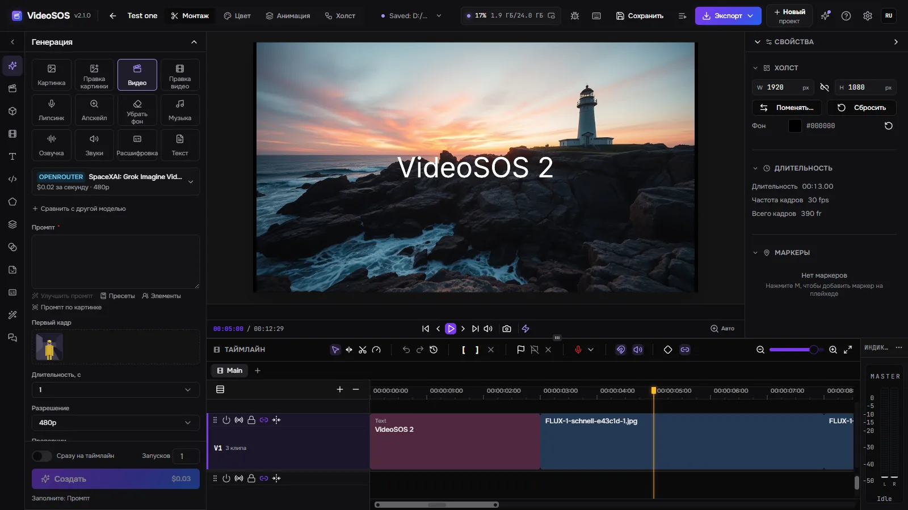
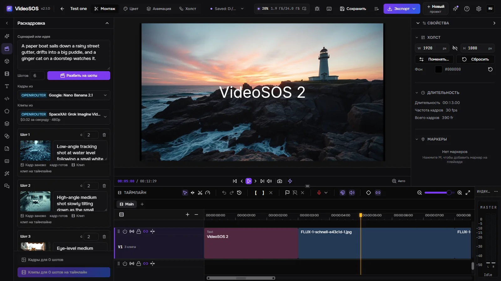
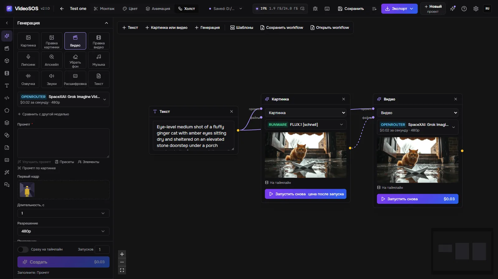
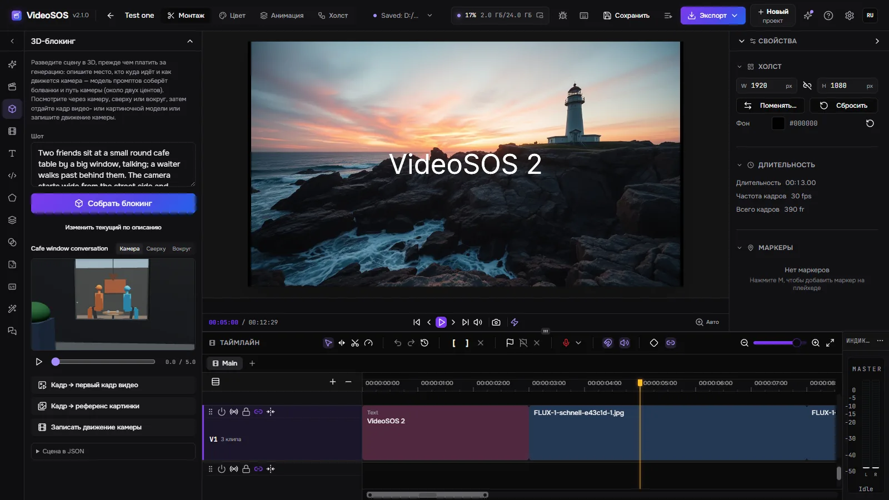
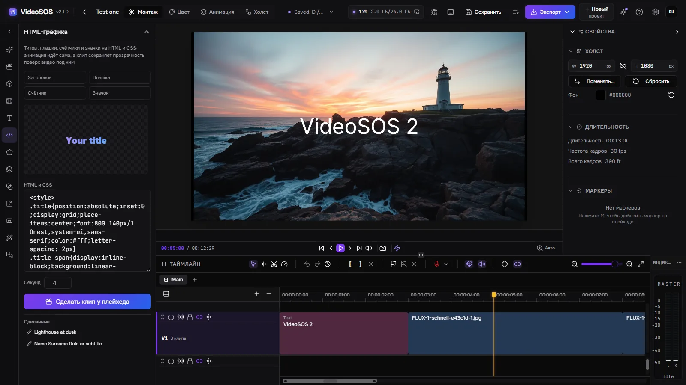

<div align="center">


# VideoSOS 2

**Десктопная AI-видеостудия: генерируйте картинки, видео, музыку, озвучку, звуки и тексты лучшими моделями OpenRouter, fal и Runware, планируйте фильм на раскадровке, узловом холсте и в 3D-блокинге и монтируйте всё на настоящем многодорожечном таймлайне в готовый ролик. Одна нативная программа (Rust + Tauri) для Windows, Linux и macOS, ваши ключи, ваши файлы на вашем диске и MCP-сервер, чтобы ИИ-агент собирал видео вместе с вами.**

[](LICENSE)
[](https://github.com/timoncool/videosos/stargazers)
[](https://github.com/timoncool/videosos/releases)
[](https://github.com/timoncool/videosos/releases)
[](https://github.com/timoncool/videosos/commits)

[English](README.md) · **Русский** · [中文](README.zh.md) · [Español](README.es.md) · [Français](README.fr.md) · [Português](README.pt.md)

### 🌐 [Сайт со всеми экранами →](https://timoncool.github.io/videosos/ru.html)



</div>

## Что это

**VideoSOS 2** соединяет AI-генерацию и видеомонтаж в одном окне. Слева выбираете, что сделать — картинку,
правку картинки, видео из текста или из кадра, говорящую голову с липсинком, апскейл, удаление фона, музыку,
озвучку, звуки, расшифровку или сценарий, — и модель **OpenRouter, fal или Runware**. Форма строится по описанию
самой модели, поэтому в ней все настройки, которые модель принимает, а цена видна **до** нажатия «Создать».
Результат попадает в медиатеку проекта и, если нужно, сразу на таймлайн в позицию плейхеда.

Редактор — полноценный NLE: много видео- и аудиодорожек, подрезка со сдвигом и без, переходы, ключевые кадры с
графиком Безье, маски, режимы наложения, цветокоррекция со скопами, текст и фигуры, субтитры и быстрый экспорт в
MP4, WebM, MOV или MKV на видеокарте — или FCPXML для Final Cut, DaVinci Resolve и Premiere.

VideoSOS 1 был веб-приложением в браузере. **Вторая версия — нативная десктопная программа**: сервер на Rust,
проекты и генерации лежат обычными файлами на диске, задачи переживают перезапуск, и никакого нашего аккаунта — вы
платите провайдерам напрямую своими ключами. Окно говорит на десяти языках.

## Генерируйте всё

| Задача | Что получаете | Провайдеры |
|---|---|---|
| Картинка | из текста | OpenRouter, fal, Runware |
| Правка картинки | по референсам или маске | OpenRouter, fal, Runware |
| Видео | из текста, с первого кадра, с первого и последнего, по референсам | OpenRouter, fal, Runware |
| Правка видео | видео в видео, продление, смена стиля | OpenRouter, fal, Runware |
| Липсинк | лицо говорит вашим аудио | fal, Runware |
| Апскейл | картинки и видео в большем разрешении | fal, Runware, OpenRouter (видео) |
| Убрать фон | вырезка с прозрачностью | fal, Runware |
| Музыка | песни и саундтреки | fal, Runware |
| Озвучка | речь десятками голосов на многих языках | OpenRouter, fal, Runware |
| Звуки | шумы и эффекты из текста или по видео | fal, Runware |
| Расшифровка | речь в текст | OpenRouter, fal |
| Текст | сценарии, промпты, идеи — любая LLM OpenRouter | OpenRouter |

- **Живые каталоги.** Модели читаются у самих провайдеров — больше тысячи, новые сверху, с тем, в чём каждая
  сильна, её ценой и обычным временем на вашем компьютере; избранные сверху, уходящие помечены.
- **Цена до запуска.** Ставки за секунду, разрешение, звук и входные картинки считаются по форме; после запуска
  записывается счёт самого провайдера. В Настройках, раздел «Провайдеры», видно, сколько потрачено сегодня
  и всего.
- **Сравнение моделей за один запуск.** Тот же промпт уходит ещё в одну-две модели, результаты стоят рядом.
- **Файлы на вход.** Перетащите картинку, клип или звук из медиатеки — или результат прошлой генерации — в слот:
  первый кадр, последний кадр, референсы, видео для липсинка. **«Продолжить с последнего кадра»** начинает
  следующий клип там, где закончился предыдущий.
- **Элементы.** Персонаж, предмет или место под именем со своими картинками: `@имя` в промпте отправляет его
  картинки модели референсами, и то же лицо возвращается из шота в шот.
- **Промпты с помощью.** Пресеты, `{{переменные}}`, которые заполняются при отправке, улучшение промпта языковой
  моделью, промпт по картинке и проверка длины по лимиту модели до оплаты.
- **Никогда не дважды.** Задача сохраняется до отправки; после перезапуска отправленная задача дожидается, а не
  отправляется заново. Результаты скачиваются сразу, пока ссылки провайдеров живы, и называются и помечаются по
  промпту.
- **Видео по ссылке.** Ссылка YouTube, любого сайта, который знает yt-dlp, или прямая ссылка на файл попадает в
  медиатеку с прогрессом, отменой и докачкой.

## Планируйте фильм

| | |
|---|---|
|  | **Раскадровка.** Языковая модель делит сценарий на шоты; каждому шоту картиночная модель делает кадр, а видеомодель — клип, который начинается с этого кадра, и клипы встают на таймлайн один за другим. Дешёвые кадры утверждаются до платного видео. |
|  | **Узловой холст.** Текст, картинки, видео и генерации — узлы, связанные тем, что передают: промпт в картинку, картинку в видео. **Шаблоны workflow** ставят готовую цепочку на холст одним нажатием (кадр в видео, сравнение моделей, предметная съёмка, говорящая голова и другие); холст сохраняется файлом workflow, чтобы передать его. |
|  | **3D-блокинг.** Опишите шот — модель промптов соберёт его из болванок, стоящих и сидящих людей, их перемещений и пути камеры. Посмотрите через камеру, сверху или вокруг, затем отдайте кадр видеомодели первым кадром или запишите движение камеры — до того, как хоть цент уйдёт на видео. |
|  | **HTML-графика.** Титры, плашки, счётчики и значки на HTML и CSS с живым превью, превращённые в клип с прозрачностью, который ложится поверх видео у плейхеда. |

Прямо на таймлайне: запуск, поставленный на таймлайн, рисуется там, где ляжет, пока идёт, а **часть любого клипа
можно сгенерировать заново** — отрезок вырезается, уходит в модель правки видео, и новый дубль ложится поверх.

## Для ИИ-агентов

Пока VideoSOS открыт, он отвечает по MCP на `http://127.0.0.1:8796/mcp`. Агент — Claude Code, Claude Desktop,
Cursor или Codex — делает то же, что окно: выбирает модели и читает их настройки, считает цену, генерирует, ждёт
результат, читает и правит таймлайн открытого проекта (каждая правка — шаг с отменой, который видно в окне),
разводит шот в 3D, делает HTML-графику, импортирует медиа, двигает плейхед, снимает картинку окна и экспортирует
видео. Каждое действие подписывается в окне и пишется в журнал событий.

```bash
claude mcp add --transport http videosos http://127.0.0.1:8796/mcp
```

Другие клиенты: `{ "mcpServers": { "videosos": { "type": "streamable-http", "url": "http://127.0.0.1:8796/mcp" } } }`.
Сервер отдаёт руководство как ресурс `videosos://skill` (промпт `videosos`) — тот же текст, что
[docs/mcp-skill.md](docs/mcp-skill.md).

- **Точки отката.** Таймлайн сохраняется перед каждой правкой агента; кнопка «Точки отката» рядом с отменой и
  повтором возвращает любую. Агент может отрепетировать правку (`dry_run`) и увидеть результат, ничего не трогая.
- **Предложения.** Когда в Настройках, раздел «Агенты», включено «Правки агента — после моего
  «Принять»», правка агента показывается простыми словами и применяется только после «Принять».
- **Лимит расходов.** Генерации платные: в том же разделе задаётся дневной лимит агентов, сверх которого `generate`
  отказывает. Подключиться могут только агенты на этом компьютере и окно самой программы; ключи провайдеров им
  никогда не показываются.
- **Чат в окне.** Вкладка «Чат» запускает выбранную модель OpenRouter с теми же инструментами — шаг за шагом, с ценой
  каждого шага и кнопкой «Стоп».

## Скриншоты

Монтаж с панелью генерации, узловой холст с настоящей цепочкой, раскадровка, 3D-блокинг и HTML-графика — все экраны
на восьми языках есть на [сайте](https://timoncool.github.io/videosos/ru.html).

| | |
|---|---|
|  |  |
|  |  |

## Быстрый старт

1. Скачайте из [последнего релиза](https://github.com/timoncool/videosos/releases/latest):
   `VideoSOS_<версия>_x64-setup.exe` (или `.msi`, или портативный `VideoSOS-<версия>-portable-windows-x64.zip`) для
   Windows, `.AppImage` или `.deb` для Linux, `.dmg` для macOS на Apple Silicon.
2. Создайте проект, откройте вкладку **Генерация** слева и вставьте ключ
   [OpenRouter](https://openrouter.ai/settings/keys), [fal](https://fal.ai/dashboard/keys) или
   [Runware](https://my.runware.ai/keys), когда программа попросит. Для начала хватит одного провайдера.
3. Выберите задачу и модель, напишите, что нужно, нажмите **Создать**.

Что и когда менялось — в [CHANGELOG.md](CHANGELOG.md), и кнопка с искрами наверху окна показывает это. Правила для
участников и агентов, пишущих код: [AGENTS.md](AGENTS.md).

## Требования

- **Windows** 10/11 x64 с Microsoft Edge WebView2 (установщик поставит, если его нет).
- **Linux** x86-64 (экспериментально): `.deb` или AppImage, WebKitGTK и GStreamer из системы.
- **macOS** 13 и новее на Apple Silicon (экспериментально).
- Видеокарта с WebGPU (любая свежая NVIDIA, AMD или Intel) для превью и быстрого экспорта.
- Интернет для генерации; монтаж и экспорт работают без него.

В Настройках, раздел «Сеть», есть прокси для провайдеров и загрузок и **«Доступ из сети»**: по умолчанию выключен;
включённый, он открывает тот же интерфейс в браузере на другом компьютере или телефоне по ключу доступа, а всё
работает здесь.

## Что программа скачивает

Всё, что нужно для монтажа и генерации, уже в программе. Два инструмента скачиваются только при первом импорте видео
по ссылке, с их собственных релизов на GitHub, и каждый файл перед использованием сверяется с закреплённым размером и
SHA-256; потом yt-dlp обновляется сам раз в день. На Linux те же инструменты в Linux-сборках; на macOS импорт по
ссылке пока недоступен.

<!-- downloads:start -->
| Инструмент | Зачем | Файл (прямая ссылка) | Размер | Куда |
|---|---|---|---|---|
| yt-dlp + Deno | импорт видео по ссылке | [yt-dlp.exe](https://github.com/yt-dlp/yt-dlp/releases/download/2026.08.19/yt-dlp.exe) | 17.8 MB | `data\tools\yt-dlp\` (как есть) |
|  |  | [deno-x86_64-pc-windows-msvc.zip](https://github.com/denoland/deno/releases/download/v2.9.7/deno-x86_64-pc-windows-msvc.zip) | 42.6 MB | `data\tools\yt-dlp\` (распакованным) |
| ffmpeg | склейка картинки и звука видео по ссылке | [ffmpeg-N-126342-gf88b741dbf-win64-gpl.zip](https://github.com/BtbN/FFmpeg-Builds/releases/download/autobuild-2026-08-31-13-27/ffmpeg-N-126342-gf88b741dbf-win64-gpl.zip) | 170.7 MB | `data\tools\ffmpeg\` (ffmpeg.exe и ffprobe.exe из архива) |
<!-- downloads:end -->

## Где ваши файлы

На Windows всё лежит рядом с программой (или в `%LOCALAPPDATA%\VideoSOS`, если в её папку нельзя писать); на Linux —
в `~/.local/share/videosos` (`$XDG_DATA_HOME`), на macOS — в `~/Library/Application Support/VideoSOS`.
`data\workspace` — проекты, медиа, миниатюры и экспорт; `data\generations` — файлы всех генераций;
`secrets` — ключи провайдеров; `data\videosos.db` — история генераций. Удаление программы их оставляет, если не
отметить «Удалить данные приложения».

## Проблемы и решения

**Установщик останавливается на WebView2.** Окно работает на Microsoft Edge WebView2, и установщик скачивает его, если
в Windows его нет. На заблокированном соединении это не удаётся: поставьте WebView2 автономным установщиком Microsoft,
[Evergreen Standalone x64](https://go.microsoft.com/fwlink/p/?LinkId=2124701), и запустите установщик VideoSOS снова.

**Генерация упала.** Карточка говорит, что это был за сбой; «Текст ошибки» показывает слова самого провайдера, а
пропавший или отклонённый ключ открывает раздел «Провайдеры». Отправленная задача сама не отправляется
повторно: нажмите «Ещё раз» на её карточке, когда захотите новую попытку.

**Видео по ссылке останавливается на «подтвердите, что вы не бот».** Сайту нужен браузер с входом: выгрузите
`cookies.txt` из браузера, где вы вошли на сайт, и добавьте его в окне ссылки («Добавить cookies.txt»).

**Правка видео OpenRouter не берёт файл с этого компьютера.** OpenRouter принимает исходное видео только ссылкой
`https`; для локального файла возьмите модель правки видео fal или Runware либо видео, добавленное по ссылке.

**Превью или экспорт медленные или не стартуют.** Оба работают на WebGPU и видеокодере видеокарты. Обновите драйвер;
если карта не может закодировать выбранные настройки, окно экспорта скажет об этом — выберите другой кодек или
контейнер.

## Анонимная статистика и новости

На экране первого запуска есть переключатель **Отправлять анонимную статистику**; он же — в Настройках, раздел
«Приватность». Пока он включён, программа раз в день отправляет: случайный id установки, версию, ОС и язык
окна, сколько генераций завершилось или упало по задачам и на каких моделях. Никогда — промпты, файлы, ключи или
что-то личное. `DO_NOT_TRACK=1` или `STUDIO_TELEMETRY=0` выключает это полностью.

## Как устроено

- `crates/vs-providers` — OpenRouter, fal и Runware, приведённые к одному контракту: каталог, форма по JSON-схеме
  модели, правило цены, задачи, которые заканчиваются файлами. Задачи Runware проверяются по схеме модели до
  отправки, так что неверная настройка ничего не стоит.
- `crates/vs-server` — axum на 127.0.0.1: рабочая папка редактора на диске, очередь задач в SQLite, ключи, расходы,
  точки отката, импорт по ссылке, MCP-сервер и мост к окну.
- `frontend` — окно редактора: форк [FreeCut](https://github.com/walterlow/freecut) (MIT) как git subtree, с
  хранилищем, переведённым на сервер, и добавленными панелью генерации, раскадровкой, холстом, 3D-блокингом,
  HTML-графикой, настройками и мостом агента.
- `desktop` — оболочка Tauri: один процесс, сервер внутри, обновления с релизов GitHub.

### Сборка из исходников

```bash
git clone https://github.com/timoncool/videosos.git
cd videosos

npm --prefix frontend ci && npm --prefix frontend run build   # 1) окно
npm --prefix desktop ci && npm --prefix desktop run build     # 2) программа с сервером внутри
```

Нужны Node 20+ и Rust (версия закреплена в `rust-toolchain.toml`; на Windows — MSVC). Программа появится в
`desktop/src-tauri/target/release` и найдёт окно в репозитории. `cargo run -p vs-server` запускает один сервер — для
браузера на `http://127.0.0.1:8796`. Установщики и пакеты собирают `scripts/build-release.ps1` (Windows),
`scripts/build-release-linux.sh` в Docker (Linux) и `scripts/build-release-macos.sh` (macOS).

### Linux и macOS (экспериментально)

`.deb`, AppImage и `.dmg` собираются из того же кода. Сервер и окно проверены на Linux через браузер — проект создан,
сохранён и экспортирован на диск Linux, — но автор работает на Windows и не запускал окна программы на настоящем
Linux или Mac. **Если вы живёте на Linux или macOS, будет здорово, если вы их отполируете и пришлёте исправления
пулреквестом.** Сборка macOS подписана ad-hoc и не нотаризована, поэтому первый запуск macOS попросит разрешить в
Системных настройках, «Конфиденциальность и безопасность».

## Ещё портативные AI-программы

| Проект | Что это |
|--------|----------|
| [Dub Studio](https://github.com/timoncool/dub-studio) | Офлайн-дубляж видео с клонированием голоса |
| [YuE2 Studio](https://github.com/timoncool/YuE2-Studio) | Генератор песен с редактируемой партитурой |
| [MiniMax Music3 Studio](https://github.com/timoncool/MiniMax-Music3-Studio) | Локальная и облачная музыкальная студия |
| [ACE-Step Studio](https://github.com/timoncool/ACE-Step-Studio) | Музыкальная студия — песни, вокал, каверы, клипы |
| [Higgs Ultimate](https://github.com/timoncool/Higgs-Ultimate) | Нативный синтез речи и клонирование голоса |

## Авторы

- **Nerual Dreming** — [Telegram](https://t.me/nerual_dreming) | [neuro-cartel.com](https://neuro-cartel.com) | основатель [ArtGeneration.me](https://artgeneration.me)
- **Нейро-Софт** — [Telegram](https://t.me/neuroport) | портативные AI-программы

## Благодарности

- **[FreeCut](https://github.com/walterlow/freecut)** Уолтера Лоу — редактор, на котором построено окно (MIT).
- **[OpenRouter](https://openrouter.ai)**, **[fal](https://fal.ai)** и **[Runware](https://runware.ai)** — провайдеры и
  авторы моделей за ними.
- **[mediabunny](https://github.com/Vanilagy/mediabunny)**, **[three.js](https://threejs.org)**,
  **[React Flow](https://reactflow.dev)**, **[modern-screenshot](https://github.com/qq15725/modern-screenshot)**,
  **[Tauri](https://tauri.app)**, **[axum](https://github.com/tokio-rs/axum)**,
  **[jsonschema](https://github.com/Stranger6667/jsonschema)**, **[yt-dlp](https://github.com/yt-dlp/yt-dlp)**,
  **[FFmpeg](https://ffmpeg.org)**, **[lucide](https://lucide.dev)**.
- Идеи взяты у LTX Studio (раскадровка), Weave и Flora (холст и шаблоны), AIMovieStudio (превиз), WeftCut
  (моушн-графика, точки отката), OpenChatCut (предложения), Kling (элементы) и Descript (FCPXML).
- VideoSOS 1 начинался как форк **[fal AI Video Starter Kit](https://github.com/fal-ai-community/video-starter-kit)**.

## Поддержать автора

Я делаю открытый софт и исследую ИИ — почти всё, что я создаю, доступно бесплатно. Донаты помогают делать и
исследовать больше.

**[Все способы поддержки](DONATE.ru.md)** | **[dalink.to/nerual_dreming](https://dalink.to/nerual_dreming)** | **[boosty.to/neuro_art](https://boosty.to/neuro_art)**

- **BTC:** `1E7dHL22RpyhJGVpcvKdbyZgksSYkYeEBC`
- **ETH (ERC20):** `0xb5db65adf478983186d4897ba92fe2c25c594a0c`
- **USDT (TRC20):** `TQST9Lp2TjK6FiVkn4fwfGUee7NmkxEE7C`

## История звёзд

<a href="https://github.com/timoncool/videosos/stargazers">
 <picture>
   <source media="(prefers-color-scheme: dark)" srcset="docs/stars-dark.svg" />
   <source media="(prefers-color-scheme: light)" srcset="docs/stars-light.svg" />
   
 </picture>
</a>

## Лицензия

Код — [MIT](LICENSE); окно редактора основано на FreeCut (MIT). То, что вы генерируете, подчиняется условиям
провайдера и модели, которыми вы пользовались, — прочитайте их перед публикацией или продажей.
