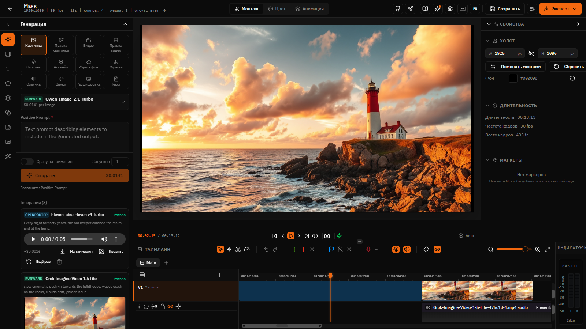

<div align="center">


# VideoSOS 2

**Десктопная AI-видеостудия: генерируйте картинки, видео, музыку, озвучку, звуки и тексты лучшими моделями OpenRouter, fal и Runware и монтируйте их на настоящем многодорожечном таймлайне в готовый ролик. Одна нативная программа (Rust + Tauri), ваши ключи, ваши файлы на вашем диске и MCP-сервер, чтобы ИИ-агент собирал видео вместе с вами.**

[](LICENSE)
[](https://github.com/timoncool/videosos/stargazers)
[](https://github.com/timoncool/videosos/releases)
[](https://github.com/timoncool/videosos/releases)
[](https://github.com/timoncool/videosos/commits)

[English](README.md) · **Русский**



</div>

## Что это

**VideoSOS 2** соединяет AI-генерацию и видеомонтаж в одном окне. Слева выбираете, что сделать — картинку,
правку картинки, видео из текста или из кадра, говорящую голову с липсинком, апскейл, удаление фона, музыку,
озвучку, звуки, расшифровку или сценарий, — и модель **OpenRouter, fal или Runware**. Форма строится по описанию
самой модели, поэтому в ней все настройки, которые модель принимает, а цена видна **до** нажатия «Создать».
Результат попадает в медиатеку проекта и, если нужно, сразу на таймлайн в позицию плейхеда.

Редактор — полноценный NLE: много видео- и аудиодорожек, подрезка со сдвигом и без, переходы, ключевые кадры с
графиком Безье, маски, режимы наложения, цветокоррекция со скопами, текст и фигуры, субтитры и быстрый экспорт в
MP4, WebM, MOV или MKV на видеокарте.

VideoSOS 1 был веб-приложением в браузере. **Вторая версия — нативная десктопная программа**: один `.exe` с
сервером на Rust, проекты и генерации лежат обычными файлами на диске, задачи переживают перезапуск, и никакого
нашего аккаунта — вы платите провайдерам напрямую своими ключами.

## Генерируйте всё

| Задача | Что получаете | Провайдеры |
|---|---|---|
| Картинка | из текста | OpenRouter, fal, Runware |
| Правка картинки | по референсам или маске | OpenRouter, fal, Runware |
| Видео | из текста, с первого кадра, с первого и последнего, по референсам | OpenRouter, fal, Runware |
| Правка видео | видео в видео, продление, смена стиля | OpenRouter, fal, Runware |
| Липсинк | лицо говорит вашим аудио | fal, Runware |
| Апскейл | картинки и видео в большем разрешении | fal, Runware, OpenRouter (видео) |
| Убрать фон | вырезка с прозрачностью | fal, Runware |
| Музыка | песни и саундтреки | fal, Runware |
| Озвучка | речь десятками голосов на многих языках | OpenRouter, fal, Runware |
| Звуки | шумы и эффекты из текста или по видео | fal, Runware |
| Расшифровка | речь в текст | OpenRouter, fal |
| Текст | сценарии, промпты, идеи — любая LLM OpenRouter | OpenRouter |

- **Живые каталоги.** Модели читаются у самих провайдеров — больше тысячи, новые сверху, со строкой цены от
  провайдера; уходящие помечены. Ничего не зашито в код.
- **Цена до запуска.** Ставки за секунду, разрешение, звук и входные картинки считаются по форме; после запуска
  записывается счёт самого провайдера. В Настройках видно, сколько потрачено сегодня и всего.
- **Файлы на вход.** Перетащите картинку, клип или звук из медиатеки — или результат прошлой генерации — в слот:
  первый кадр, последний кадр, референсы, видео для липсинка.
- **Никогда не дважды.** Задача сохраняется до отправки; после перезапуска отправленная задача дожидается, а не
  отправляется заново. Результаты скачиваются сразу, пока ссылки провайдеров живы.
- **История.** Каждый запуск с моделью, настройками, ценой и файлами: повторить, загрузить обратно в форму,
  поставить на таймлайн.

## Для ИИ-агентов

Пока VideoSOS открыт, он отвечает по MCP на `http://127.0.0.1:8796/mcp`. Агент — Claude Code, Claude Desktop,
Cursor или Codex — делает то же, что окно: выбирает модели и читает их настройки, считает цену, генерирует, ждёт
результат, читает и правит таймлайн открытого проекта (каждая правка — шаг с отменой, который видно в окне),
импортирует медиа, двигает плейхед, снимает картинку окна и экспортирует видео. Каждое действие показывается в окне.

```bash
claude mcp add --transport http videosos http://127.0.0.1:8796/mcp
```

Другие клиенты: `{ "mcpServers": { "videosos": { "type": "streamable-http", "url": "http://127.0.0.1:8796/mcp" } } }`.
Сервер отдаёт руководство как ресурс `videosos://skill` (промпт `videosos`) — тот же текст, что
[docs/mcp-skill.md](docs/mcp-skill.md). Генерации платные: в Настройках, раздел «Провайдеры и агент», задаётся
**дневной лимит агентов**, сверх которого `generate` отказывает. Подключиться могут только агенты на этом
компьютере и окно самой программы; ключи провайдеров им никогда не показываются.

## Быстрый старт

1. Скачайте `VideoSOS_2.0.0_x64-setup.exe` (или портативный zip) из
   [последнего релиза](https://github.com/timoncool/videosos/releases/latest) и запустите.
2. Создайте проект, откройте вкладку **Генерация** слева и вставьте ключ
   [OpenRouter](https://openrouter.ai/settings/keys), [fal](https://fal.ai/dashboard/keys) или
   [Runware](https://my.runware.ai/keys), когда программа попросит. Для начала хватит одного провайдера.
3. Выберите задачу и модель, напишите, что нужно, нажмите **Создать**.

## Требования

- Windows 10/11 x64 с Microsoft Edge WebView2 (установщик поставит, если его нет).
- Видеокарта с WebGPU (любая свежая NVIDIA, AMD или Intel) для превью и быстрого экспорта.
- Интернет для генерации; монтаж и экспорт работают без него.

## Где ваши файлы

Всё лежит рядом с программой (или в `%LOCALAPPDATA%\VideoSOS`, если в её папку нельзя писать):
`data\workspace` — проекты, медиа, миниатюры и экспорт; `data\generations` — файлы всех генераций;
`secrets` — ключи провайдеров; `data\videosos.db` — история генераций. Удаление программы их оставляет, если не
отметить «Удалить данные приложения».

## Анонимная статистика и новости

На экране первого запуска есть переключатель **Отправлять анонимную статистику**; он же — в Настройках, раздел
«Провайдеры и агент». Пока он включён, программа раз в день отправляет: случайный id установки, версию, ОС и язык
окна, сколько генераций завершилось или упало по задачам и на каких моделях. Никогда — промпты, файлы, ключи или
что-то личное. `DO_NOT_TRACK=1` или `STUDIO_TELEMETRY=0` выключает это полностью.

## Как устроено

- `crates/vs-providers` — OpenRouter, fal и Runware, приведённые к одному контракту: каталог, форма по JSON-схеме
  модели, правило цены, задачи, которые заканчиваются файлами. Задачи Runware проверяются по схеме модели до
  отправки, так что неверная настройка ничего не стоит.
- `crates/vs-server` — axum на 127.0.0.1: рабочая папка редактора на диске, очередь задач в SQLite, ключи, расходы,
  MCP-сервер и мост к окну.
- `frontend` — окно редактора: форк [FreeCut](https://github.com/walterlow/freecut) (MIT) как git subtree, с
  хранилищем, переведённым на сервер, и добавленными панелью генерации, настройками и мостом агента.
- `desktop` — оболочка Tauri: один процесс, сервер внутри, обновления с релизов GitHub.

## Ещё портативные AI-программы

| Проект | Что это |
|--------|----------|
| [Dub Studio](https://github.com/timoncool/dub-studio) | Офлайн-дубляж видео с клонированием голоса |
| [YuE2 Studio](https://github.com/timoncool/YuE2-Studio) | Генератор песен с редактируемой партитурой |
| [MiniMax Music3 Studio](https://github.com/timoncool/MiniMax-Music3-Studio) | Локальная и облачная музыкальная студия |
| [ACE-Step Studio](https://github.com/timoncool/ACE-Step-Studio) | Музыкальная студия — песни, вокал, каверы, клипы |
| [Higgs Ultimate](https://github.com/timoncool/Higgs-Ultimate) | Нативный синтез речи и клонирование голоса |

## Авторы

- **Nerual Dreming** — [Telegram](https://t.me/nerual_dreming) | [neuro-cartel.com](https://neuro-cartel.com) | основатель [ArtGeneration.me](https://artgeneration.me)
- **Нейро-Софт** — [Telegram](https://t.me/neuroport) | портативные AI-программы

## Благодарности

- **[FreeCut](https://github.com/walterlow/freecut)** Уолтера Лоу — редактор, на котором построено окно (MIT).
- **[OpenRouter](https://openrouter.ai)**, **[fal](https://fal.ai)** и **[Runware](https://runware.ai)** — провайдеры и
  авторы моделей за ними.
- **[mediabunny](https://github.com/Vanilagy/mediabunny)**, **[Tauri](https://tauri.app)**, **[axum](https://github.com/tokio-rs/axum)**,
  **[jsonschema](https://github.com/Stranger6667/jsonschema)**, **[lucide](https://lucide.dev)**.
- VideoSOS 1 начинался как форк **[fal AI Video Starter Kit](https://github.com/fal-ai-community/video-starter-kit)**.

## Поддержать автора

Я делаю открытый софт и исследую ИИ — почти всё, что я создаю, доступно бесплатно. Донаты помогают делать и
исследовать больше.

**[Все способы поддержки](DONATE.md)** | **[dalink.to/nerual_dreming](https://dalink.to/nerual_dreming)** | **[boosty.to/neuro_art](https://boosty.to/neuro_art)**

- **BTC:** `1E7dHL22RpyhJGVpcvKdbyZgksSYkYeEBC`
- **ETH (ERC20):** `0xb5db65adf478983186d4897ba92fe2c25c594a0c`
- **USDT (TRC20):** `TQST9Lp2TjK6FiVkn4fwfGUee7NmkxEE7C`

## История звёзд

<a href="https://github.com/timoncool/videosos/stargazers">
 <picture>
   <source media="(prefers-color-scheme: dark)" srcset="docs/stars-dark.svg" />
   <source media="(prefers-color-scheme: light)" srcset="docs/stars-light.svg" />
   
 </picture>
</a>

## Лицензия

Код — [MIT](LICENSE); окно редактора основано на FreeCut (MIT). То, что вы генерируете, подчиняется условиям
провайдера и модели, которыми вы пользовались, — прочитайте их перед публикацией или продажей.
