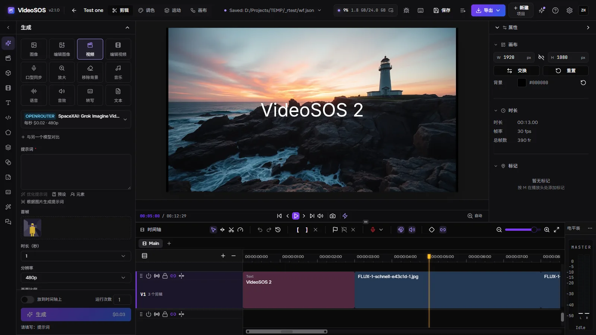
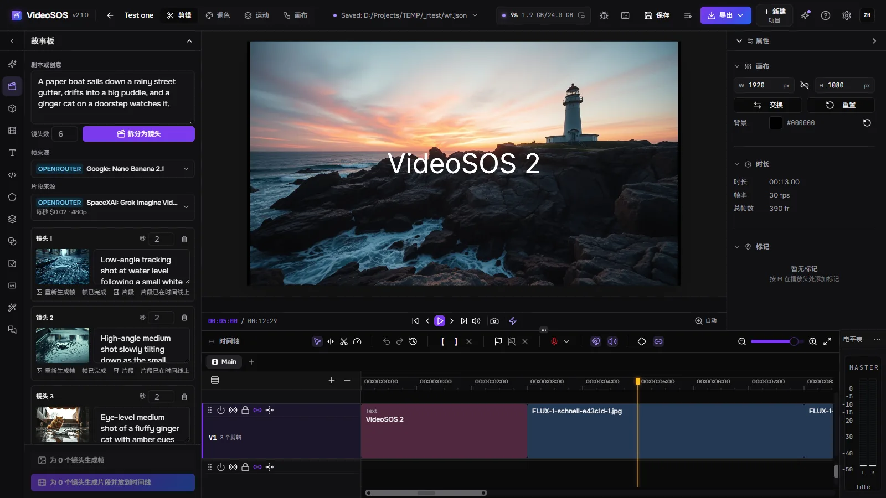
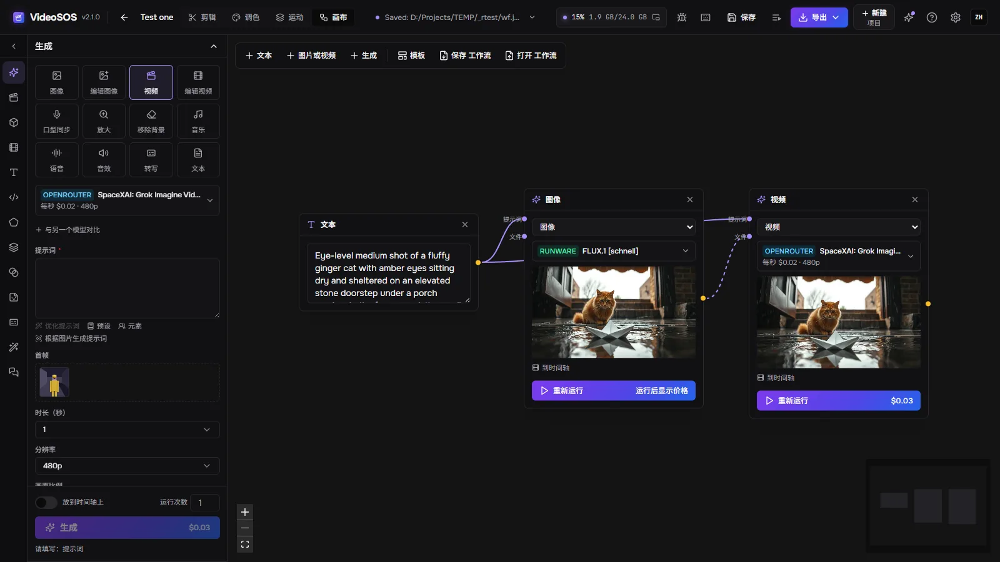
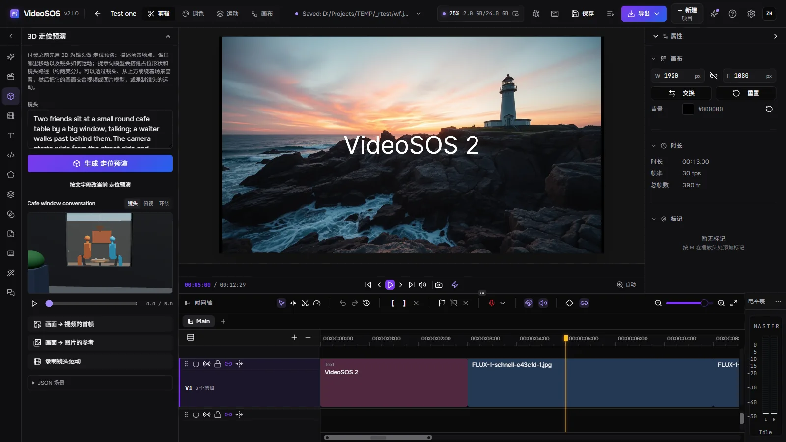
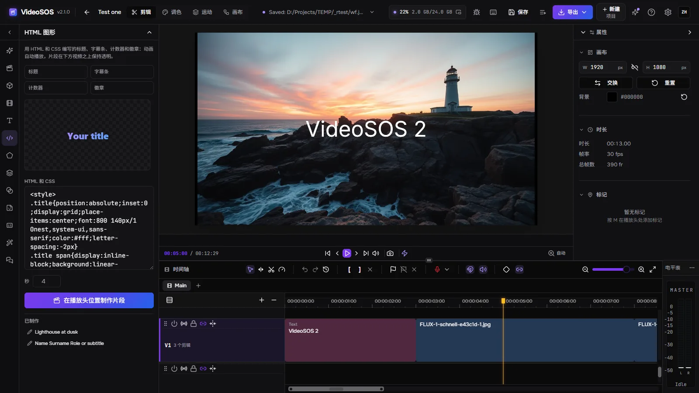

<div align="center">


# VideoSOS 2

**一款桌面端 AI 视频工作室：用 OpenRouter、fal 和 Runware 上最好的模型（或免费在你自己的显卡上）生成图像、视频、音乐、语音、音效和文本，在故事板、节点画布和 3D 走位预演中规划影片，再在真正的多轨时间线上剪辑成成片。一个原生应用（Rust + Tauri），支持 Windows、Linux 和 macOS，使用你自己的密钥，文件保存在你自己的磁盘上，并提供 MCP 服务器，让 AI 智能体与你一起制作视频。**

[](LICENSE)
[](https://github.com/timoncool/videosos/stargazers)
[](https://github.com/timoncool/videosos/releases)
[](https://github.com/timoncool/videosos/releases)
[](https://github.com/timoncool/videosos/commits)

[English](README.md) · [Русский](README.ru.md) · **中文** · [Español](README.es.md) · [Français](README.fr.md) · [Português](README.pt.md)

### 🌐 [包含所有界面的网站 →](https://timoncool.github.io/videosos/zh.html)



</div>

## 这是什么

**VideoSOS 2** 把 AI 生成和视频剪辑放进同一个窗口。在左侧选择要做的事——图像、图像编辑、文生视频或由某一帧生成视频、口型同步的说话人像、放大、移除背景、音乐、配音、音效、转写或脚本——再选择 **OpenRouter、fal 或 Runware** 的一个模型。表单根据模型自身的说明生成，因此模型接受的每项设置都在其中，价格会在你点击「生成」**之前**显示。结果进入项目的媒体库，需要的话，还可以直接放到时间线上播放头所在的位置。

编辑器是完整的非线性编辑器：多条视频和音频轨道，波纹/滚动/滑移/滑动修剪，转场，带贝塞尔曲线图的关键帧，蒙版，混合模式，带示波器的调色，文字和形状，字幕，以及在你的显卡上运行的快速导出，可导出为 MP4、WebM、MOV 或 MKV——也可以导出为 FCPXML，供 Final Cut、DaVinci Resolve 和 Premiere 使用。导出时可按需把响度调整到 −14、−16 或 −23 LUFS；由转录生成的字幕可整句显示、逐词显示或以卡拉 OK 方式显示。

VideoSOS 1 是运行在浏览器中的网页应用。**第 2 版是原生桌面程序**：服务器用 Rust 编写，项目和生成结果以普通文件的形式保存在你的磁盘上，任务在重启后依然保留，也没有我们的任何账户——你用自己的密钥直接向提供商付费。窗口支持十种语言。

## 生成一切

| 任务 | 你得到什么 | 提供商 |
|---|---|---|
| 图像 | 文生图 | OpenRouter、fal、Runware |
| 编辑图像 | 带参考图或蒙版的图像 | OpenRouter、fal、Runware |
| 视频 | 文生视频、首帧、首尾帧、参考图 | OpenRouter、fal、Runware |
| 编辑视频 | 视频生视频、延长、风格转换 | OpenRouter、fal、Runware |
| 口型同步 | 让人脸说出你的音频 | fal、Runware |
| 放大 | 更高分辨率的图像和视频 | fal、Runware、OpenRouter（视频） |
| 移除背景 | 透明抠图 | fal、Runware |
| 音乐 | 歌曲和配乐 | fal、Runware |
| 语音 | 文本转语音，数十种声音和语言 | OpenRouter、fal、Runware |
| 音效 | 由文本或视频生成的拟音 | fal、Runware |
| 转写 | 语音转文字 | OpenRouter、fal |
| 文本 | 脚本、提示词、创意——OpenRouter 的任意 LLM | OpenRouter |

- **实时目录。** 模型直接从各提供商读取——超过一千个，最新的在前，并标明每个模型擅长什么、价格，以及在你的电脑上的典型耗时；收藏的模型置顶，即将下线的模型有标记。
- **运行前先看价格。** 按秒计费、分辨率、声音和输入图像的费率会根据表单算出；运行后记录提供商自己的账单。「设置」的「提供商」页面会显示你今天和累计花了多少。
- **一次运行对比多个模型。** 同一个提示词最多再发给另外两个模型，结果并排显示。
- **文件作输入。** 把媒体库中的图片、片段或声音——或者之前某次生成的结果——拖进插槽：首帧、尾帧、参考图、要做口型同步的视频。**从最后一帧继续**会让下一个片段从上一个片段结束的地方开始。
- **元素。** 以名称保存的角色、物体或场景及其图片：提示词中的 `@名称` 会把它的图片作为参考发给模型，这样同一张脸在每个镜头中都会再现。
- **帮你写提示词。** 预设、发送任务时填入的 `{{变量}}`、由语言模型改进的提示词、根据图片写出的提示词，以及在付费之前对照模型上限的检查。
- **绝不重复付费。** 任务在发送前先保存；重启后，已发送的任务会被继续跟踪，而不是重新发送。结果会在提供商的链接过期之前立即下载，并按提示词命名和打标签。
- **通过链接获取视频。** YouTube 链接、yt-dlp 支持的任意网站或直接的文件链接都会进入媒体库，并带有进度显示、取消和续传。
- **无限生成。** 用新的种子不断重复运行，直到你停止或某次运行失败。
- **密钥花了多少。** 检查密钥时会显示 OpenRouter 的花费和额度以及 Runware 的余额。

## 在本机生成

无需密钥，也没有账单：**本地**提供商就在云端提供商旁边（目前仅限 Windows）。

| 模型 | 生成什么 | 加速器 |
|---|---|---|
| MiniMax-H3 | 自带声音的视频，可由提示词或首帧生成 | LightX2V Turbo 8 步和 4 步 |
| LTX-2.5 | 带声音的视频，两遍生成并使用 Lightricks ×2 放大器 | 蒸馏版 8 步 |

- **stable-diffusion.cpp** 在 CUDA、Vulkan 或处理器上运行它们；「自动」会选择显卡。只使用量化权重（GGUF Q4、int8）。
- **设置 → 本地模型** 会把每个模型及其引擎只下载一次，版本固定、校验 SHA-256，并支持断点续传。作者其他程序已有的文件会直接从那里获取（同一磁盘上用硬链接），不再下载，模型那一行会写明来源。
- **作者的音乐工作室。** 当 [YuE2 Studio](https://github.com/timoncool/YuE2-Studio)、[MiniMax Music3 Studio](https://github.com/timoncool/MiniMax-Music3-Studio) 或 [ACE-Step Studio](https://github.com/timoncool/ACE-Step-Studio) 打开时，它会以自己的表单出现在「音乐」中；歌曲由工作室本身生成，文件连同标签进入媒体库。
- **Speech Studio。** 当 Speech Studio 打开时，它在本机的每个引擎（Qwen3-TTS、Supertonic 3、Drama 3、Higgs Audio）都会带着各自的声音和语言出现在「语音」中；文本由工作室朗读，文件进入媒体库。
- **窗口自带的模型** 在窗口内运行：Parakeet Ultra（int8）和 Whisper Large v3 Turbo（Q8）用于转录，Gemma 4 E4B 用于场景描述和剪辑点检查。

## 规划影片

| | |
|---|---|
|  | **故事板。** 语言模型把脚本拆分成镜头；每个镜头由图像模型生成一帧，再由视频模型生成从该帧开始的片段，这些片段依次落在时间线上。便宜的帧先审批，再做付费的视频。 |
|  | **节点画布。** 文本、图片、视频和生成任务都是节点，按它们传递的内容相连——提示词接入图片，图片接入视频。**工作流模板**一次就能把现成的链路放到画布上（帧生成视频、对比模型、产品图、说话人像等）；画布可保存为工作流文件以便分享。 |
|  | **3D 走位预演。** 描述镜头，提示词模型会用占位形状、站立和坐着的人物、他们的动作以及镜头的运动路径把它搭建出来。透过镜头、从上方或绕着场景查看，然后把它的画面作为首帧交给视频模型，或录制镜头的运动——在视频花掉一分钱之前。 |
|  | **HTML 图形。** 用 HTML 和 CSS 编写的标题、字幕条、计数器和徽章，可实时预览，并生成带透明通道的片段，叠放在播放头所在位置的视频之上。 |

在时间线上：放到时间线上的一次运行，在运行期间就会画在它将落下的位置；**任何片段的一部分都可以重新生成**——这一部分会被剪下，送入视频编辑模型，新的一条镜头会落在它上面。

## 面向 AI 智能体

VideoSOS 打开期间，会在 `http://127.0.0.1:8796/mcp` 提供 MCP 服务。Claude Code、Claude Desktop、Cursor 或 Codex 这样的智能体可以做窗口里能做的一切：选择模型并读取其设置、估算价格、生成、等待结果、读取并编辑当前打开项目的时间线（每次编辑都是一个可撤销的步骤，你能看着它发生）、在 3D 中为镜头做走位预演、制作 HTML 图形、导入媒体、移动播放头、截取窗口画面并导出视频。每个操作都会在窗口中以字幕提示，并写入活动记录。

```bash
claude mcp add --transport http videosos http://127.0.0.1:8796/mcp
```

其他客户端：`{ "mcpServers": { "videosos": { "type": "streamable-http", "url": "http://127.0.0.1:8796/mcp" } } }`。
服务器以资源 `videosos://skill`（提示 `videosos`）提供它的指南——内容与
[docs/mcp-skill.md](docs/mcp-skill.md) 相同。

- **还原点。** 每次智能体编辑之前都会保存时间线；撤销和重做旁边的「还原点」按钮可以恢复其中任何一个。智能体可以预演一次编辑（`dry_run`），看到它会产生什么结果，而不改动任何内容。
- **提议。** 在「设置」的「智能体」中开启*智能体对时间线的编辑需经我确认*后，智能体的编辑会用通俗的话显示出来，只有在你点击「接受」之后才会应用。
- **花费上限。** 生成是要付费的：「设置」的「智能体」可以为智能体设置每日限额，超过后 `generate` 会被拒绝。只有这台电脑上的智能体和程序自己的窗口可以连接；提供商密钥永远不会展示给它们。
- **窗口内聊天。** 「聊天」标签页会用同样的工具运行你选择的 OpenRouter 模型，一步一步地执行，显示每一步的费用，并带有「停止」按钮。
- **把已连接的智能体作为窗口助手**，与 YuE2 Studio 相同：在「设置 → 智能体」中选择 MCP 智能体后，优化提示词、根据图片写提示词、故事板、走位预演和聊天都会交给该智能体处理，无需密钥也不收费。提示词指南以资源 `videosos://guide/prompt`、`picture` 和 `storyboard` 提供。

## 截图

带生成面板的编辑工作区、带真实链路的节点画布、故事板、3D 走位预演和 HTML 图形——八种语言的所有界面都在[网站](https://timoncool.github.io/videosos/zh.html)上。

| | |
|---|---|
|  |  |
|  |  |

## 快速开始

1. 从[最新版本](https://github.com/timoncool/videosos/releases/latest)下载：Windows 用 `VideoSOS_<version>_x64-setup.exe`
   （或 `.msi`，或便携版 `VideoSOS-<version>-portable-windows-x64.zip`），Linux 用 `.AppImage` 或 `.deb`，
   Apple Silicon 的 macOS 用 `.dmg`。
2. 创建一个项目，打开左侧的**生成**标签页，在提示时粘贴
   [OpenRouter](https://openrouter.ai/settings/keys)、[fal](https://fal.ai/dashboard/keys) 或
   [Runware](https://my.runware.ai/keys) 的密钥。有一个提供商就足以开始。
3. 选择任务和模型，写下你想要的内容，点击**生成**。

更新内容和时间见 [CHANGELOG.md](CHANGELOG.md)，窗口顶部的星光按钮也会显示这些内容。
贡献者和编程智能体须遵守的规则：[AGENTS.md](AGENTS.md)。

## 系统要求

- **Windows** 10/11 x64，需要 Microsoft Edge WebView2（缺少时安装程序会自行获取）。
- **Linux** x86-64（实验性）：`.deb` 或 AppImage，使用系统自带的 WebKitGTK 和 GStreamer。
- **macOS** 13 或更高版本，Apple Silicon（实验性）。
- 支持 WebGPU 的显卡（任何较新的 NVIDIA、AMD 或 Intel），用于预览和快速导出。
- 云端生成需要网络连接；本地生成、剪辑和导出可以离线进行。本地视频模型已在 24 GB 显卡上验证。

「设置」的「网络」页面有用于提供商和下载的代理，以及**从网络访问**：默认关闭；开启后，另一台电脑或手机上的浏览器可以凭访问密钥打开同一个界面，而所有运算都在本机进行。

## 应用会下载的全部内容

程序自带剪辑和云端生成所需的一切。其余内容只在你需要时才从其发布位置下载，每个文件在使用前都会按固定的大小和 SHA-256 校验：第一次通过链接导入视频时下载 yt-dlp、Deno 和 ffmpeg（之后 yt-dlp 每天自行更新一次）；在「设置 → 本地模型」中下载时获取 stable-diffusion.cpp 引擎和本地模型。在 Linux 上这些工具使用其 Linux 版本；macOS 暂不支持通过链接导入；本地生成目前仅限 Windows。

窗口自带的模型在首次使用对应功能时从 Hugging Face 下载并保存在窗口缓存中（在「设置 → 存储」中清除）：Parakeet Ultra int8 和 Whisper Large v3 Turbo Q8 用于转录，Gemma 4 E4B 用于场景描述，CLIP、MiniLM 和 CLAP 用于搜索和口头禅检测，RIFE 用于插帧。

<!-- downloads:start -->
| 工具 | 用途 | 文件（直接链接） | 大小 | 存放位置 |
|---|---|---|---|---|
| yt-dlp + Deno | 通过链接导入视频 | [yt-dlp.exe](https://github.com/yt-dlp/yt-dlp/releases/download/2026.08.19/yt-dlp.exe) | 17.8 MB | `data\tools\yt-dlp\` (原样) |
|  |  | [deno-x86_64-pc-windows-msvc.zip](https://github.com/denoland/deno/releases/download/v2.9.7/deno-x86_64-pc-windows-msvc.zip) | 42.6 MB | `data\tools\yt-dlp\` (解压后) |
| ffmpeg | 合并链接视频的画面和声音 | [ffmpeg-N-126342-gf88b741dbf-win64-gpl.zip](https://github.com/BtbN/FFmpeg-Builds/releases/download/autobuild-2026-08-31-13-27/ffmpeg-N-126342-gf88b741dbf-win64-gpl.zip) | 170.7 MB | `data\tools\ffmpeg\` (压缩包中的 ffmpeg.exe 和 ffprobe.exe) |
| stable-diffusion.cpp CUDA 12 | 在 NVIDIA 显卡上本地生成 | [sd-master-1d0a58a-bin-win-cuda12-x64.zip](https://github.com/leejet/stable-diffusion.cpp/releases/download/master-964-1d0a58a/sd-master-1d0a58a-bin-win-cuda12-x64.zip)<br>[cudart-sd-bin-win-cu12-x64.zip](https://github.com/leejet/stable-diffusion.cpp/releases/download/master-964-1d0a58a/cudart-sd-bin-win-cu12-x64.zip) | 901.5 MB | `data\tools\sd\cuda12\` (解压后) |
| stable-diffusion.cpp Vulkan | 在其他显卡上本地生成 | [sd-master-1d0a58a-bin-win-vulkan-x64.zip](https://github.com/leejet/stable-diffusion.cpp/releases/download/master-964-1d0a58a/sd-master-1d0a58a-bin-win-vulkan-x64.zip) | 30.2 MB | `data\tools\sd\vulkan\` (解压后) |
| stable-diffusion.cpp CPU | 无显卡本地生成 | [sd-master-1d0a58a-bin-win-cpu-x64.zip](https://github.com/leejet/stable-diffusion.cpp/releases/download/master-964-1d0a58a/sd-master-1d0a58a-bin-win-cpu-x64.zip) | 17.6 MB | `data\tools\sd\cpu\` (解压后) |
| MiniMax-H3 | undefined | [minimax_h3_fl2va_pruned-Q4_K.gguf](https://huggingface.co/unsloth/MiniMax-H3-GGUF/resolve/d629413c2e5b51b38c453668b75ca3b06ca92703/minimax_h3_fl2va_pruned-Q4_K.gguf) → `data\models\minimax-h3\minimax_h3_fl2va_pruned-Q4_K.gguf`<br>[qwen3vl_32b_minimax_h3-Q4_K_M.gguf](https://huggingface.co/unsloth/MiniMax-H3-GGUF/resolve/d629413c2e5b51b38c453668b75ca3b06ca92703/qwen3vl_32b_minimax_h3-Q4_K_M.gguf) → `data\models\minimax-h3\qwen3vl_32b_minimax_h3-Q4_K_M.gguf`<br>[minimax_h3_video_vae_fp16.safetensors](https://huggingface.co/unsloth/MiniMax-H3-GGUF/resolve/d629413c2e5b51b38c453668b75ca3b06ca92703/vae/minimax_h3_video_vae_fp16.safetensors) → `data\models\minimax-h3\minimax_h3_video_vae_fp16.safetensors`<br>[minimax_h3_audio_vae_fp32.safetensors](https://huggingface.co/unsloth/MiniMax-H3-GGUF/resolve/d629413c2e5b51b38c453668b75ca3b06ca92703/vae/minimax_h3_audio_vae_fp32.safetensors) → `data\models\minimax-h3\minimax_h3_audio_vae_fp32.safetensors`<br>[minimax_h3_fl2v_turbo_8step_v1.0_768p_comfyui_bf16.safetensors](https://huggingface.co/lightx2v/Minimax-h3-Turbo/resolve/3ec17a324ced54151364f24f8b5fb6bf7e26414f/minimax_h3_fl2v_turbo_8step_v1.0_768p_comfyui_bf16.safetensors) → `data\models\minimax-h3\loras\minimax_h3_fl2v_turbo_8step_v1.0_768p_comfyui_bf16.safetensors`<br>[minimax_h3_fl2v_turbo_4step_v1.2_768p_comfyui_bf16.safetensors](https://huggingface.co/lightx2v/Minimax-h3-Turbo/resolve/3ec17a324ced54151364f24f8b5fb6bf7e26414f/minimax_h3_fl2v_turbo_4step_v1.2_768p_comfyui_bf16.safetensors) → `data\models\minimax-h3\loras\minimax_h3_fl2v_turbo_4step_v1.2_768p_comfyui_bf16.safetensors` | 39.4 GB | 原样，放到箭头后的路径 |
| LTX-2.5 | undefined | [ltx-2.5-22b-distilled-Q4_K_M.gguf](https://huggingface.co/unsloth/LTX-2.5-GGUF/resolve/6eae90030f7f15460a0ecf9ab16445d676b2bbb6/distilled/ltx-2.5-22b-distilled-Q4_K_M.gguf) → `data\models\ltx-2.5\ltx-2.5-22b-distilled-Q4_K_M.gguf`<br>[gemma4-12b-with-proj-ltx-2.5-comfy-int8-convrot.safetensors](https://huggingface.co/PulpCut/LTX-2.5-INT8-ConvRot-safetensors/resolve/7597fb305b4cab9e7ff2c1d1e9551279c2932f0f/text_encoders/gemma4-12b-with-proj-ltx-2.5-comfy-int8-convrot.safetensors) → `data\models\ltx-2.5\gemma4-12b-with-proj-ltx-2.5-comfy-int8-convrot.safetensors`<br>[ltx-2.5-video-vae-conv-bf16.safetensors](https://huggingface.co/comfyicu/LTX-2.5/resolve/1026e00f808dbd9601911479b22d65b760737dc8/vae/ltx-2.5-video-vae-conv-bf16.safetensors) → `data\models\ltx-2.5\ltx-2.5-video-vae-conv-bf16.safetensors`<br>[ltx-2.5-audio-vae-bf16.safetensors](https://huggingface.co/comfyicu/LTX-2.5/resolve/1026e00f808dbd9601911479b22d65b760737dc8/vae/ltx-2.5-audio-vae-bf16.safetensors) → `data\models\ltx-2.5\ltx-2.5-audio-vae-bf16.safetensors`<br>[ltx-2.5-latent-spatial-upscaler-x2-bf16-1.0.safetensors](https://huggingface.co/comfyicu/LTX-2.5/resolve/1026e00f808dbd9601911479b22d65b760737dc8/latent_upscale_models/ltx-2.5-latent-spatial-upscaler-x2-bf16-1.0.safetensors) → `data\models\ltx-2.5\ltx-2.5-latent-spatial-upscaler-x2-bf16-1.0.safetensors` | 31.8 GB | 原样，放到箭头后的路径 |
<!-- downloads:end -->

## 你的文件在哪里

在 Windows 上，所有内容都放在程序旁边（如果该文件夹只读，则放在 `%LOCALAPPDATA%\VideoSOS`）；在 Linux 上位于 `~/.local/share/videosos`（`$XDG_DATA_HOME`），在 macOS 上位于 `~/Library/Application Support/VideoSOS`。
`data\workspace` — 项目、媒体、缩略图和导出文件；`data\generations` — 每次生成的文件；
`secrets` — 提供商密钥；`data\videosos.db` — 生成历史。卸载时会保留这些内容，除非你勾选
*Delete the application data*。

## 故障排除

**安装程序停在 WebView2。** 窗口运行在 Microsoft Edge WebView2 上，Windows 缺少它时安装程序会去获取。在被屏蔽的网络下这一步会失败：请用 Microsoft 的独立安装包安装 WebView2，
[Evergreen Standalone x64](https://go.microsoft.com/fwlink/p/?LinkId=2124701)，然后再次运行 VideoSOS 的安装程序。

**生成失败。** 卡片会说明是哪一类失败；*错误信息*会显示提供商自己的原话，密钥缺失或被拒绝时会打开「设置」的「提供商」页面。已发送的任务绝不会自行重新发送：想再试一次时，请点击它卡片上的*再次生成*。

**通过链接获取视频时在「确认你不是机器人」处停止。** 该网站需要已登录的浏览器：从已登录该网站的浏览器中导出
`cookies.txt`，并在链接对话框中添加（「添加 cookies.txt」）。

**OpenRouter 的视频编辑不接受这台电脑上的文件。** OpenRouter 只接受 `https` 链接形式的源视频；
对于本地文件，请使用 fal 或 Runware 的视频编辑模型，或者使用通过链接放入的视频。

**预览或导出很慢，或无法启动。** 两者都运行在 WebGPU 和显卡的视频编码器上。
请更新显卡驱动；当显卡无法按所选设置编码时，导出对话框会提示——请换一种编解码器或容器。

## 匿名统计和新闻

首次运行的界面有一个开关**发送匿名统计信息**；同一个开关也在「设置」的「隐私」中。
开启期间，程序每天发送一次：随机生成的安装 ID、版本、操作系统和窗口语言、按任务统计有多少次生成完成或失败，以及运行过哪些模型。绝不包含提示词、文件、密钥或任何个人信息。
`DO_NOT_TRACK=1` 或 `STUDIO_TELEMETRY=0` 可将其彻底关闭。

## 构建方式

- `crates/vs-providers` — 把 OpenRouter、fal 和 Runware 统一到一个契约下：目录、根据模型 JSON Schema 生成的表单、价格规则、最终产出文件的任务。Runware 的任务在发送前会按模型的 schema 校验，因此错误的设置不会产生任何费用。
- `crates/vs-server` — 运行在 127.0.0.1 上的 axum：磁盘上的编辑器工作区、SQLite 中的任务队列、密钥、花费、还原点、链接导入、MCP 服务器及其通往窗口的桥接。
- `frontend` — 编辑器窗口：[FreeCut](https://github.com/walterlow/freecut)（MIT）的分支，以 git subtree 形式保存，其存储已迁移到服务器，并新增了生成面板、故事板、画布、3D 走位预演、HTML 图形、设置和智能体桥接。
- `desktop` — Tauri 外壳：单个进程，服务器在其内部，更新来自 GitHub 发布页。

### 从源码构建

```bash
git clone https://github.com/timoncool/videosos.git
cd videosos

npm --prefix frontend ci && npm --prefix frontend run build   # 1) 窗口
npm --prefix desktop ci && npm --prefix desktop run build     # 2) 程序，服务器在其内部
```

需要 Node 20+ 和 Rust（版本固定在 `rust-toolchain.toml` 中；Windows 上需要 MSVC）。程序会生成在
`desktop/src-tauri/target/release`，并在仓库中找到它的窗口。`cargo run -p vs-server` 单独启动服务器，供浏览器访问 `http://127.0.0.1:8796`。安装程序和安装包由 `scripts/build-release.ps1`（Windows）、Docker 中的 `scripts/build-release-linux.sh`（Linux）和
`scripts/build-release-macos.sh`（macOS）生成。

### Linux 和 macOS（实验性）

`.deb`、AppImage 和 `.dmg` 来自同一份代码。服务器和窗口已在 Linux 上通过浏览器检查过——项目已创建、保存并导出到 Linux 磁盘——但作者在 Windows 上工作，还没有在真实的 Linux 或 Mac 上运行过桌面窗口。**如果你使用 Linux 或 macOS，欢迎你把它们打磨好，并以 pull request 的形式提交修复。** macOS 版本使用 ad-hoc 签名，未经过公证，因此 macOS 会要求你在“系统设置”的“隐私与安全性”中允许它首次启动。

## 更多便携式 AI 应用

| 项目 | 简介 |
|--------|----------|
| [Dub Studio](https://github.com/timoncool/dub-studio) | 使用克隆声音的离线 AI 视频配音 |
| [YuE2 Studio](https://github.com/timoncool/YuE2-Studio) | 带可编辑乐谱的 AI 歌曲生成器 |
| [MiniMax Music3 Studio](https://github.com/timoncool/MiniMax-Music3-Studio) | 本地和云端 AI 音乐工作室 |
| [ACE-Step Studio](https://github.com/timoncool/ACE-Step-Studio) | AI 音乐工作室——歌曲、人声、翻唱、短片 |
| [Higgs Ultimate](https://github.com/timoncool/Higgs-Ultimate) | 原生语音合成与声音克隆 |

## 作者

- **Nerual Dreming** — [Telegram](https://t.me/nerual_dreming) | [neuro-cartel.com](https://neuro-cartel.com) | [ArtGeneration.me](https://artgeneration.me) 创始人
- **Neuro-Soft** — [Telegram](https://t.me/neuroport) | 便携式 AI 应用

## 致谢

- **[FreeCut](https://github.com/walterlow/freecut)**，作者 Walter Low——本窗口所基于的编辑器（MIT）。
- **[OpenRouter](https://openrouter.ai)**、**[fal](https://fal.ai)** 和 **[Runware](https://runware.ai)** — 提供商，以及它们背后的模型开发者。
- **[mediabunny](https://github.com/Vanilagy/mediabunny)**、**[three.js](https://threejs.org)**、
  **[React Flow](https://reactflow.dev)**、**[modern-screenshot](https://github.com/qq15725/modern-screenshot)**、
  **[Tauri](https://tauri.app)**、**[axum](https://github.com/tokio-rs/axum)**、
  **[jsonschema](https://github.com/Stranger6667/jsonschema)**、**[yt-dlp](https://github.com/yt-dlp/yt-dlp)**、
  **[FFmpeg](https://ffmpeg.org)**、**[lucide](https://lucide.dev)**。
- 创意借鉴自 LTX Studio（故事板）、Weave 和 Flora（画布和模板）、AIMovieStudio（预演）、WeftCut
  （动态图形、还原点）、OpenChatCut（提议）、Kling（元素）和 Descript（FCPXML）。
- VideoSOS 1 最初是 **[fal AI Video Starter Kit](https://github.com/fal-ai-community/video-starter-kit)** 的分支。

## 支持作者

我开发开源软件并做 AI 研究——我做的大部分东西都可以免费使用。捐助能让我做更多的开发和研究。

**[所有支持方式](DONATE.zh.md)** | **[dalink.to/nerual_dreming](https://dalink.to/nerual_dreming)** | **[boosty.to/neuro_art](https://boosty.to/neuro_art)**

- **BTC:** `1E7dHL22RpyhJGVpcvKdbyZgksSYkYeEBC`
- **ETH (ERC20):** `0xb5db65adf478983186d4897ba92fe2c25c594a0c`
- **USDT (TRC20):** `TQST9Lp2TjK6FiVkn4fwfGUee7NmkxEE7C`

## Star 历史

<a href="https://github.com/timoncool/videosos/stargazers">
 <picture>
   <source media="(prefers-color-scheme: dark)" srcset="docs/stars-dark.svg" />
   <source media="(prefers-color-scheme: light)" srcset="docs/stars-light.svg" />
   
 </picture>
</a>

## 许可证

代码采用 [MIT](LICENSE) 许可；编辑器窗口基于 FreeCut（MIT）。你生成的内容受你所用提供商和模型的条款约束——在发布或出售之前请先阅读这些条款。
